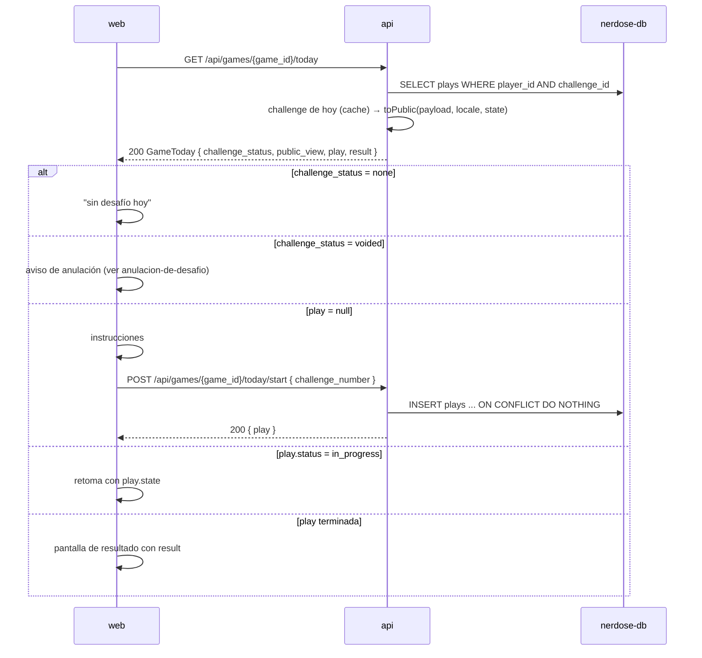

# Abrir el juego de hoy, empezar y retomar

**Tipo:** Feature
**Status:** Draft
**Creado:** 2026-11-03
**Última actualización:** 2026-11-25
**Stories:** S-022, S-023, S-024, S-043, S-046, S-048, S-061

## Descripción

El jugador abre un juego desde la home. La `api` devuelve la vista pública del desafío de hoy, sin solución, y la Play del jugador si existe. Según el estado, el front muestra las instrucciones, retoma la partida o muestra el resultado. Al salir de las instrucciones se crea la Play. Cubre C-08, C-09, C-10 y C-14 (F2).

## Servicios Involucrados

| Servicio | Rol | Tipo de Participación |
|----------|-----|-----------------------|
| web | Pide el juego de hoy, elige la pantalla y empieza la partida | Iniciador |
| api | Aplica `toPublic` / `result` del `GameDefinition` y crea la Play | Procesador |
| nerdose-db | Guarda y lee `plays` | Procesador |

## Pasos del Flujo



### Paso 1: Abrir el juego

**Origen:** web
**Destino:** api
**Tipo:** REST

**Request:**
- **Método:** GET
- **Endpoint:** `/api/games/{game_id}/today`
- **Query:** `lang` (opcional)
- **Headers:** cookie `nd_pid` (opcional)

**Operación de BD:**
- **Tabla:** `plays`
- **Operación:** SELECT
- **Campos:** `status`, `state`, `score`, `code_language`, `result` WHERE `player_id` AND `challenge_id`

**Response (éxito):**
- **Status:** 200
- **Body:**
  ```json
  {
    "game_id": "devdle | bug-hunt | big-o | timeline | grep-grid",
    "date": "string (date)",
    "number": "integer",
    "challenge_status": "published | voided | none",
    "public_view": "PublicView | null — toPublic(challenges.payload, locale, state) en el locale; null si none o voided",
    "play": "null | { status, state, score, code_language }",
    "result": "null | Result — result(challenges.payload, plays.state) si la Play terminó"
  }
  ```

`public_view = toPublic(payload, locale, state)`: la `api` pasa `plays.state` solo si la Play está `in_progress`; si no hay Play o ya terminó, `state` es `undefined`. `public_view` por juego (sin solución, ADR-006):

| game_id | `public_view` |
|---|---|
| devdle | `{ length, possible_categories[] }` |
| grep-grid | `{ grid: string[12][12], words: [{ term_id, word, definition? }] ×8 }` — `definition` solo en las palabras ya encontradas (`term_id` presentes en `plays.state.found_words`), en el locale resuelto; nunca en las no encontradas ni sin Play |
| timeline | `{ category, prompt, items: [{ opaque_id, label }] ×5 }` (mezclados) |
| big-o | `{ code: { js, go, java }, options: big_o_option[8] }` — `options` es siempre `BIG_O_OPTIONS` en orden fijo (`o_1 … o_n_fact`), nunca dependiente de la respuesta; `toPublic` ignora `locale` y `state`. Nunca incluye `answer`, `trap_option`, `explanation`, `recipe`, `recipe_category` ni `date` |
| bug-hunt | `{ function_name, spec, code: { js, go, java }, pickable_lines: int[], visible_tests: [{ input, expected }] ×2–3 }` — `spec` va en el locale resuelto; `pickable_lines` va en orden ascendente; `input` es la lista de argumentos de la llamada; `toPublic` ignora `state`. Nunca incluye `bug_line`, `bug_type`, `mutation`, `fix`, `failing_test`, `tests`, `template`, `params` ni `explanation` |

**Ref:** `docs/apis/api.yaml` GET /api/games/{game_id}/today (`GameToday`, `PublicView`, `PlayView`, `Result`)

---

### Paso 2: Empezar la partida

**Origen:** web
**Destino:** api
**Tipo:** REST

**Request:**
- **Método:** POST
- **Endpoint:** `/api/games/{game_id}/today/start`
- **Body:**
  ```json
  { "challenge_number": "integer — number recibido en el paso 1" }
  ```

**Validaciones:** sesión (`nd_pid`) → hay desafío de hoy → `challenge_number == number` de hoy → `challenges.status == 'published'`.

**Operación de BD:**
- **Tabla:** `plays`
- **Operación:** INSERT … ON CONFLICT (`player_id`, `challenge_id`) DO NOTHING, y después SELECT
- **Campos:** `player_id`, `challenge_id`, `game_id`, `date`, `state = initState(payload)`, `status = 'in_progress'`, `started_at`

`state` inicial por juego: devdle `{ guesses: [] }`; grep-grid `{ found_words: [], gave_up: false }`; timeline, big-o y bug-hunt `{}`.

**Evento de dominio:** `PlayStarted` (`play_id`, `player_ref`, `challenge_id`), solo en los logs. `player_ref` = primeros 8 hex de `sha256(player_id)`: el `player_id` es la credencial de la cookie y nunca se loguea crudo (REQ-012, S-061).

**Response (éxito):**
- **Status:** 200
- **Body:**
  ```json
  {
    "play": {
      "status": "in_progress (o el estado actual si ya existía)",
      "state": "PlayState",
      "score": "null",
      "code_language": "null"
    }
  }
  ```

**Ref:** `docs/apis/api.yaml` POST /api/games/{game_id}/today/start (`ChallengeNumberBody`, `PlayView`)

---

### Paso 3: Cambio de lenguaje de código (solo cliente)

**Origen:** web
**Destino:** (interno)
**Tipo:** Interno

**Acción:** en Big O y Bug Hunt, `public_view.code` trae `js`, `go` y `java`. El shell le pasa al client del juego `codeLanguage = session.preferred_code_language ?? 'js'` (prop genérica de `ClientBaseProps`; los juegos sin código la ignoran) y el `Game` arranca en ese lenguaje. Cambiar de pestaña es estado local: no hace ningún request, no altera la Play ni persiste la preferencia (invariante 17).

En Big O la opción seleccionada tampoco se guarda en el servidor: `plays.state` sigue `{}` hasta confirmar. La selección sobrevive al cambio de lenguaje y de idioma (el `Game` sigue montado), pero se pierde al salir: al retomar, el jugador ve el código y las 8 opciones sin selección y con su intento intacto.

En Bug Hunt la línea seleccionada tampoco se guarda en el servidor: `plays.state` sigue `{}` hasta confirmar; al retomar no hay selección.

En Devdle la pista usada sí se guarda (`plays.state.hint = { position, letter }`, REQ-012): al retomar, la letra se ve como guía en la fila actual y el botón queda «💡 Letra N: X» deshabilitado. Las Play guardadas antes de la pista no traen `hint` y se leen igual.

## Manejo de Errores

| Paso | Error | Código | Response | Comportamiento |
|------|-------|--------|----------|---------------|
| 1 | `game_id` inexistente | 404 | `{ "error": { "code": "not_found", … } }` | web vuelve a la home |
| 2 | Sin cookie `nd_pid` | 401 | `{ "error": { "code": "no_session", … } }` | web llama a `POST /api/session` y reintenta; si sigue fallando, aviso de cookies |
| 2 | Sin desafío de hoy | 404 | `{ "error": { "code": "no_challenge_today", … } }` | web muestra "sin desafío hoy" |
| 2 | `challenge_number` ≠ número de hoy | 409 | `{ "error": { "code": "challenge_expired", … } }` | web invalida la cache y repite el paso 1 |
| 2 | Desafío anulado | 409 | `{ "error": { "code": "challenge_voided", … } }` | web muestra el aviso de anulación |
| 2 | Body inválido | 422 | `{ "error": { "code": "validation_error", … } }` | Error de programación |
| 2 | Rate limit (30/min por `player_id`) | 429 | `{ "error": { "code": "rate_limited", … } }` | Reintento después de `Retry-After` |

## Resultado

**Éxito:** el jugador ve las instrucciones y empieza, retoma la partida donde la dejó, o ve el resultado si ya jugó hoy.

**Estado final:**
- Play: fila en `plays` con `status = 'in_progress'` y `state` inicial (si se empezó).

## Notas

- `/start` es idempotente: dos pestañas o un doble toque no crean dos Play.
- La `api` nunca serializa `challenges.payload` al jugador. Antes de terminar, solo `public_view`. Después, `result`.
- En Grep Grid, al retomar o al cambiar de idioma, las definiciones de las palabras encontradas salen de `public_view.words[].definition`; `plays.state.found_words` guarda solo `{ term_id, cells }` (REQ-005).
- Si `POST …/move` llega sin una Play creada, la crea igual que `/start` (ver `jugada-y-cierre-de-partida`).

> Actualizado por REQ-009 (stories S-043 y S-046): vista pública de Big O con `options` en orden fijo, lenguaje inicial `codeLanguage` desde la sesión y selección solo en el cliente.

> Actualizado por REQ-010 (story S-048): vista pública de Bug Hunt y selección solo en el cliente.
