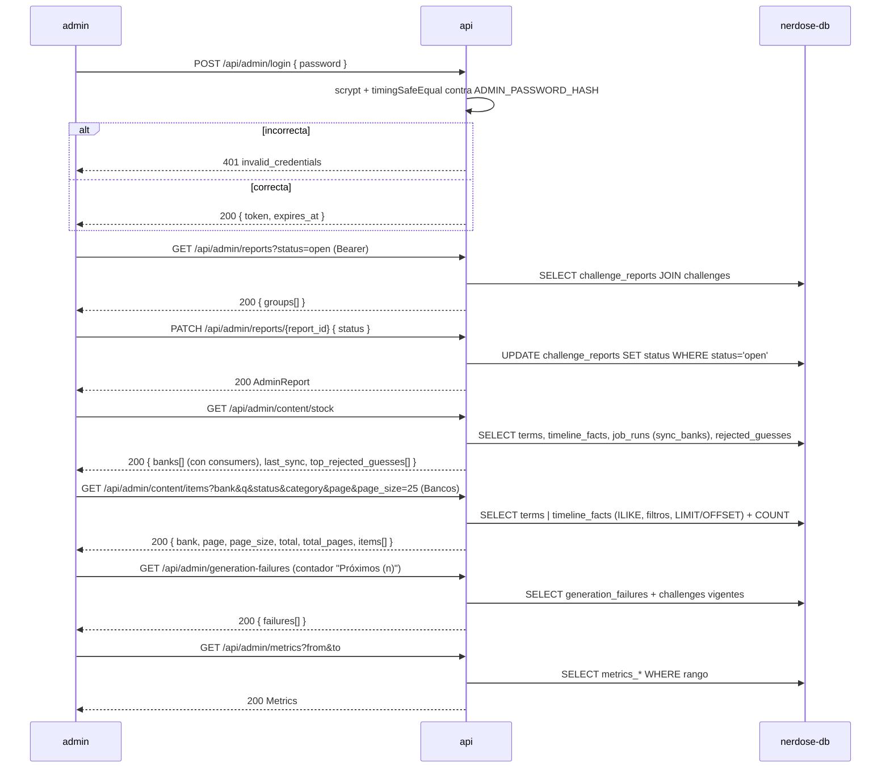

# Admin — login, reportes, bancos, stock y métricas

**Tipo:** Feature
**Status:** Draft
**Creado:** 2026-11-03
**Última actualización:** 2026-11-25
**Stories:** S-032, S-033, S-037, S-039, S-040, S-052, S-053, S-054, S-067, S-068

## Descripción

El responsable entra a `admin.nerdose.dev` con la contraseña única y opera con un JWT de 8 h:
- revisa los reportes agrupados por desafío y los resuelve o descarta;
- consulta el stock de contenido y las palabras más rechazadas;
- explora los ítems de los bancos (pantalla «Bancos», REQ-012);
- consulta las métricas.

La anulación y la regeneración tienen sus propios flujos. Cubre C-38, C-39, C-40, C-45, C-46 y C-56 (F11, ADR-010, ADR-014).

## Servicios Involucrados

| Servicio | Rol | Tipo de Participación |
|----------|-----|-----------------------|
| admin | UI del responsable; guarda el JWT en `sessionStorage` | Iniciador |
| api | Login, verificación del JWT y lecturas del admin | Procesador |
| nerdose-db | `challenge_reports`, `challenges`, `terms`, `timeline_facts`, `rejected_guesses`, `job_runs`, vistas `metrics_*` | Procesador |

## Pasos del Flujo



### Paso 1: Login

**Origen:** admin
**Destino:** api
**Tipo:** REST

**Request:**
- **Método:** POST
- **Endpoint:** `/api/admin/login`
- **Body:** `{ "password": "string" }`

**Acción:** `crypto.scrypt` con los parámetros de `ADMIN_PASSWORD_HASH` y `timingSafeEqual`. Si coincide, firma un JWT HS256 con `ADMIN_JWT_SECRET` y claims `{ sub: "admin", iat, exp = iat + 28800 }`.

**Response (éxito):**
- **Status:** 200
- **Body:** `{ "token": "string", "expires_at": "string (date-time)" }`

**Acción de admin:** guarda `token` en `sessionStorage` y lo manda como `Authorization: Bearer <token>` en todas las rutas `/api/admin/*`.

**Ref:** `docs/apis/api.yaml` POST /api/admin/login (`AdminLoginResponse`)

---

### Paso 2: Reportes agrupados

**Origen:** admin
**Destino:** api
**Tipo:** REST

**Request:** `GET /api/admin/reports?status=open`

**Operación de BD:**
- **Tabla:** `challenge_reports` — SELECT `id`, `challenge_id`, `reason`, `message`, `locale`, `context`, `status`, `created_at` WHERE `status = :status`
- **Tabla:** `challenges` — SELECT `id`, `game_id`, `date`, `number`, `status`, `payload`, `verification` de los desafíos reportados

**Response (éxito):**
- **Status:** 200
- **Body:**
  ```json
  {
    "groups": [
      {
        "challenge": { "id", "game_id", "date", "number", "status", "payload": "completo, con solución y {es,en}", "verification" },
        "report_count": "integer",
        "reasons": { "<reason>": "integer" },
        "reports": [ { "id", "reason", "message", "locale", "context", "status", "created_at" } ]
      }
    ]
  }
  ```
  Los grupos van ordenados por `report_count` desc.

**Ref:** `docs/apis/api.yaml` GET /api/admin/reports (`ReportGroup`, `AdminChallenge`, `AdminReport`)

---

### Paso 3: Resolver o descartar un reporte

**Origen:** admin
**Destino:** api
**Tipo:** REST

**Request:**
- **Método:** PATCH
- **Endpoint:** `/api/admin/reports/{report_id}`
- **Body:** `{ "status": "resolved | dismissed" }`

**Operación de BD:**
- **Tabla:** `challenge_reports` — UPDATE `status` WHERE `id` AND `status = 'open'` RETURNING. Sin filas y con el reporte existente → `409 report_not_open`.

**Evento de dominio:** `ReportResolved` / `ReportDismissed`, solo en los logs.

**Response (éxito):** `200` con `AdminReport`.

---

### Paso 4: Stock de contenido

**Origen:** admin
**Destino:** api
**Tipo:** REST

**Request:** `GET /api/admin/content/stock`

**Operación de BD:**
- **Tabla:** `terms` / `timeline_facts` — conteos por `status`. por consumidor (`GameDefinition.bankUsage`): `approved_available` = `approved` con `last_used_* IS NULL OR <= today - windowDays` y fuera de `bankUsage.excludedItems` (REQ-012/S-067: los 115 términos de nicho de Devdle no cuentan para Devdle, sí para Grep Grid), `days_of_stock = floor(approved_available / itemsPerChallenge)`, `cycle_ok = approved elegibles (approved menos excluidos de ese juego) >= itemsPerChallenge × windowDays`; a nivel banco: disponibles para todos los consumidores, mínimo de días y todos `cycle_ok`. `rejections` ORDER BY `updated_at` DESC. `rejections` = `wikidata_id`, `term`/`label`, `rejection_reason` de los `rejected` (máximo 200).
- **Tabla:** `job_runs` — última fila con `job = 'sync_banks'` y `status = 'success'` (`finished_at`, `summary`); `null` si nunca hubo.
- **Nuevo paso (REQ-008):** `GET /api/admin/generation-failures` devuelve las fallas activas (sin `payload`) para el contador del shell.
- **Tabla:** `rejected_guesses` — `word`, `count(*) AS distinct_players` GROUP BY `word` ORDER BY 2 DESC, `word` ASC LIMIT 50.

**Response (éxito):**
- **Status:** 200
- **Body:**
  ```json
  {
    "banks": [ { "bank": "terms | timeline_facts", "approved_available", "approved_total", "rejected_total", "days_of_stock", "cycle_ok", "consumers": [ { "game_id", "window_days", "items_per_challenge", "approved_available", "days_of_stock", "cycle_ok" } ], "rejections": [ { "wikidata_id", "label", "reason" } ] } ],
    "last_sync": { "finished_at", "dataset_version", "inserted", "updated", "unchanged", "kept_rejected" },
    "top_rejected_guesses": [ { "word", "distinct_players" } ]
  }
  ```

El admin (REQ-012) muestra de `rejections` solo un resumen por banco con enlace a Bancos, y el top 50 de rechazadas paginado de a 10.

**Ref:** `docs/apis/api.yaml` GET /api/admin/content/stock (`BankStock`)

---

### Paso 4b: Bancos (REQ-012, S-067 y S-068)

**Origen:** admin
**Destino:** api
**Tipo:** REST

**Request:** `GET /api/admin/content/items?bank=terms|timeline_facts[&q][&status=approved|rejected][&category][&page][&page_size=10..100]` (el admin pide de a 25; la búsqueda espera 300 ms y los filtros viven en la URL).

**Validación:** `contentItemsQuerySchema`; una `category` que no es del banco, `page < 1` o `page_size` fuera de 10–100 → `422 validation_error`.

**Operación de BD:**
- **Tabla:** `terms` (orden por `term`) o `timeline_facts` (orden por `label`, `id`) — `q` recortado como `ILIKE '%q%'` con `%`, `_` y `\` escapados; filtros de `status` y `category`; `LIMIT/OFFSET` y un `COUNT` con los mismos filtros. Una página más allá del final devuelve `items: []` con los totales reales.

**Response (éxito):** `200 { bank, page, page_size, total, total_pages, items: ContentItem[] }`; cada ítem trae `last_used` por juego que consume el banco y `excluded_from` (juegos cuyo `bankUsage.excludedItems` lo contiene).

**Ref:** `docs/apis/api.yaml` GET /api/admin/content/items (`ContentItem`)

---

### Paso 5: Métricas

**Origen:** admin
**Destino:** api
**Tipo:** REST

**Request:** `GET /api/admin/metrics?from=YYYY-MM-DD&to=YYYY-MM-DD`

**Operación de BD:** SELECT de `metrics_daily_players`, `metrics_retention`, `metrics_streak_distribution` y `metrics_challenge_quality`, filtradas por rango (salvo `streak_distribution`, que es una foto actual), y consulta a `plays` en el rango para `summary`.

**Response (éxito):**
- **Status:** 200
- **Body:**
  ```json
  {
    "summary": { "unique_players", "completed", "d1", "d7" },
    "daily_players": [ { "date", "game_id": "GameId | null", "players" } ],
    "retention": [ { "cohort_date", "cohort_size", "d1", "d7" } ],
    "streak_distribution": [ { "bucket": "0 | 1 | 2-6 | 7-29 | 30+", "players" } ],
    "challenge_quality": [ { "challenge_id", "game_id", "date", "number", "started", "finished", "completion_rate", "win_rate", "reports", "status" } ]
  }
  ```

**Ref:** `docs/apis/api.yaml` GET /api/admin/metrics (`Metrics`), `docs/db-schemas/nerdose-db.md` Vistas de Métricas

## Manejo de Errores

| Paso | Error | Código | Response | Comportamiento |
|------|-------|--------|----------|---------------|
| 1 | Contraseña incorrecta | 401 | `{ "error": { "code": "invalid_credentials", … } }` | admin muestra el error |
| 1 | 5 intentos en 15 min por IP | 429 | `{ "error": { "code": "rate_limited", … } }` + `Retry-After` | admin bloquea el formulario hasta `Retry-After` |
| 2–5 | JWT ausente, inválido o vencido (8 h) | 401 | `{ "error": { "code": "unauthorized", … } }` | admin borra el token y vuelve al login |
| 3 | `report_id` inexistente | 404 | `{ "error": { "code": "not_found", … } }` | admin refresca la lista |
| 3 | Reporte ya procesado | 409 | `{ "error": { "code": "report_not_open", … } }` | admin refresca la lista |
| 2, 3, 5 | Query o body inválido | 422 | `{ "error": { "code": "validation_error", … } }` | admin marca el campo |

## Resultado

**Éxito:** el responsable revisa los reportes con la solución a la vista, los cierra, y conoce el estado del contenido y del uso de la plataforma.

**Estado final:**
- ChallengeReport: `resolved` o `dismissed` (terminales).
- Sin otros cambios: el resto son lecturas.

## Notas

- Las rutas de admin no usan la cookie `nd_pid` ni CORS: van en el mismo origen, `admin.nerdose.dev/api/admin/*`.
- Rotar `ADMIN_JWT_SECRET` invalida todas las sesiones.
- Las métricas salen solo de la base; no hay analítica web (ADR-014).

> Actualizado por REQ-012 (stories S-067 y S-068, implementadas fuera del workflow el 2026-11-25): stock sin los ítems que cada juego excluye, paso nuevo de Bancos (`GET /api/admin/content/items`) y paginado en el cliente de reportes (20), métricas (15) y rechazadas (10).

> Actualizado por REQ-011 (stories S-052, S-053 y S-054): el paso 5 valida el rango con `validateMetricsRange` de core (admin y api, 422 si falla); la api lee las vistas `metrics_*` y consulta `plays` para `summary`; `d1`/`d7` y los tramos vivos de `streak_distribution` se calculan en la api con su reloj y core; la respuesta suma `summary` y trae siempre los 5 tramos.
