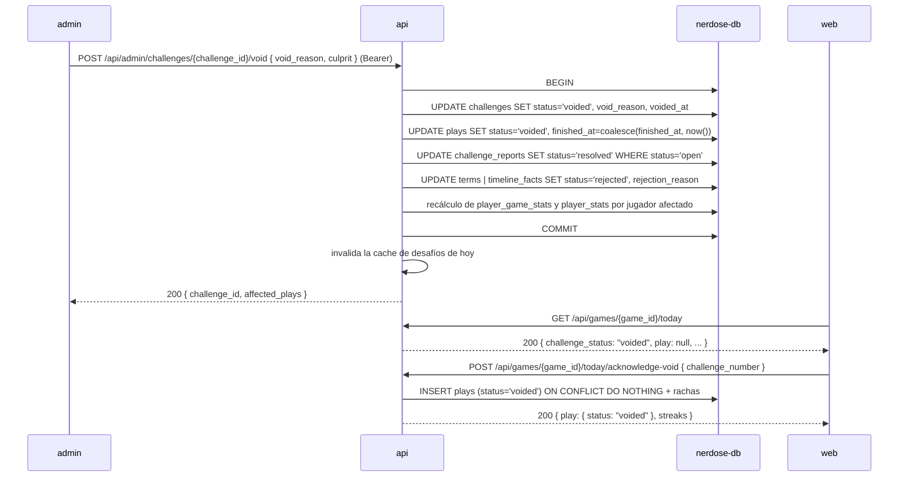

# Anulación de un desafío y marcado como completado

**Tipo:** Feature
**Status:** Draft
**Creado:** 2026-11-03
**Última actualización:** 2026-11-03
**Stories:** —

## Descripción

El responsable anula desde el admin un desafío publicado con un error confirmado. En una transacción:
- sus partidas pasan a `voided`;
- sus reportes abiertos se resuelven;
- el ítem culpable pasa a `rejected`;
- se recalculan las rachas y las stats de los jugadores afectados.

Si es el desafío de hoy, un jugador que no lo jugó puede marcarlo como completado sin perder la racha. Cubre C-35, C-41 y C-42 (F6).

## Servicios Involucrados

| Servicio | Rol | Tipo de Participación |
|----------|-----|-----------------------|
| admin | Envía la anulación con el motivo y el culpable | Iniciador |
| api | Ejecuta la anulación, recalcula los agregados e invalida la cache | Procesador |
| nerdose-db | `challenges`, `plays`, `challenge_reports`, `terms`, `timeline_facts`, `player_game_stats`, `player_stats` | Procesador |
| web | Muestra el aviso y permite marcar el desafío como completado | Consumidor / Iniciador |

## Pasos del Flujo



### Paso 1: Pedido de anulación

**Origen:** admin
**Destino:** api
**Tipo:** REST

**Request:**
- **Método:** POST
- **Endpoint:** `/api/admin/challenges/{challenge_id}/void`
- **Headers:** `Authorization: Bearer <jwt>`
- **Body:**
  ```json
  {
    "void_reason": "string — obligatorio",
    "culprit": {
      "kind": "term | timeline_fact | template | none",
      "id": "uuid — obligatorio si kind es term o timeline_fact"
    }
  }
  ```

**Validaciones:** JWT válido → el challenge existe → `challenges.status == 'published'` (si no, `409 not_voidable`).

**Ref:** `docs/apis/api.yaml` POST /api/admin/challenges/{challenge_id}/void (`VoidRequest`)

---

### Paso 2: Anular (transacción)

**Origen:** api
**Destino:** nerdose-db
**Tipo:** Interno

**Operaciones de BD:**
1. **Tabla:** `challenges` — UPDATE `status = 'voided'`, `void_reason`, `voided_at = now()` WHERE `id` (trigger `challenges_status_transition`: `published→voided`)
2. **Tabla:** `plays` — UPDATE `status = 'voided'`, `finished_at = coalesce(finished_at, now())` WHERE `challenge_id` (conservan `result`). Devuelve los `player_id` afectados.
3. **Tabla:** `challenge_reports` — UPDATE `status = 'resolved'` WHERE `challenge_id` AND `status = 'open'`
4. Según `culprit.kind`:
   - `term` → **Tabla:** `terms` — UPDATE `status = 'rejected'`, `rejection_reason = void_reason` WHERE `id = culprit.id`
   - `timeline_fact` → **Tabla:** `timeline_facts` — UPDATE `status = 'rejected'`, `rejection_reason = void_reason` WHERE `id = culprit.id`
   - `template` / `none` → sin cambios (queda en `void_reason`)

**Eventos de dominio:** `ChallengeVoided`, `ContentItemRejected`, `ReportResolved`, solo en los logs.

---

### Paso 3: Recalcular agregados (misma transacción)

**Origen:** api
**Destino:** nerdose-db
**Tipo:** Interno

**Acción:** para cada `player_id` afectado, `recomputeStats(player_id, game_id)` de `@nerdose/core` (ADR-011) recorre sus `plays` en orden de `date`, aplicando la función de rachas con días neutros y `reduceStats`. Las Play `voided` cuentan para las rachas y `total_completed`, pero no para `played`, `wins` ni `extra`.

**Operación de BD:**
- **Tabla:** `plays` — SELECT por `player_id` ordenado por `date`
- **Tabla:** `player_game_stats` — UPDATE `current_streak`, `max_streak`, `played`, `wins`, `last_completed_date`, `extra`
- **Tabla:** `player_stats` — UPDATE `global_streak`, `max_global_streak`, `last_active_date`, `total_completed`

**Evento de dominio:** `StreaksUpdated`, solo en los logs.

**Response (éxito):**
- **Status:** 200
- **Body:** `{ "challenge_id": "uuid", "affected_plays": "integer" }`

Después del COMMIT, la `api` invalida la cache de desafíos de hoy.

---

### Paso 4: Jugador sin Play ve el desafío anulado

**Origen:** web
**Destino:** api
**Tipo:** REST

**Request:** `GET /api/games/{game_id}/today`

**Response:** `200` con `challenge_status: "voided"`, `public_view: null`, `play: null`. web muestra "Este desafío tenía un error y fue anulado. Tu racha no se ve afectada" con un botón.

---

### Paso 5: Marcar como completado

**Origen:** web
**Destino:** api
**Tipo:** REST

**Request:**
- **Método:** POST
- **Endpoint:** `/api/games/{game_id}/today/acknowledge-void`
- **Body:** `{ "challenge_number": "integer" }`

**Operación de BD (transacción):**
- **Tabla:** `plays` — INSERT (`player_id`, `challenge_id`, `game_id`, `date`, `state = '{}'`, `status = 'voided'`, `started_at`, `finished_at = now()`) ON CONFLICT (`player_id`, `challenge_id`) DO NOTHING
- **Tabla:** `player_game_stats` — UPSERT de la racha (F3.1), sin tocar `played`, `wins` ni `extra`
- **Tabla:** `player_stats` — UPSERT de `global_streak`, `max_global_streak`, `last_active_date`, `total_completed + 1`

**Response (éxito):**
- **Status:** 200
- **Body:** `{ "play": { "status": "voided" }, "streaks": { "game": { "current", "max" }, "global": { "current", "max" } } }`

**Ref:** `docs/apis/api.yaml` POST /api/games/{game_id}/today/acknowledge-void (`AcknowledgeVoidResponse`)

## Manejo de Errores

| Paso | Error | Código | Response | Comportamiento |
|------|-------|--------|----------|---------------|
| 1 | JWT ausente o vencido | 401 | `{ "error": { "code": "unauthorized", … } }` | admin vuelve al login |
| 1 | Challenge inexistente | 404 | `{ "error": { "code": "not_found", … } }` | admin refresca la lista |
| 1 | No está `published` | 409 | `{ "error": { "code": "not_voidable", … } }` | admin muestra el estado actual |
| 1 | Falta `void_reason`, o falta `culprit.id` con kind `term`/`timeline_fact` | 422 | `{ "error": { "code": "validation_error", … } }` | admin marca el campo |
| 2–3 | Error de BD | 500 | `{ "error": { "code": "internal_error", … } }` | ROLLBACK: nada queda anulado a medias |
| 5 | El desafío de hoy no está anulado | 409 | `{ "error": { "code": "not_voided", … } }` | web recarga el juego |
| 5 | Jugada tardía | 409 | `{ "error": { "code": "challenge_expired", … } }` | web recarga |
| 5 | Sin sesión | 401 | `{ "error": { "code": "no_session", … } }` | web recrea la sesión |

## Resultado

**Éxito:** el desafío deja de aceptar jugadas. Las partidas afectadas cuentan para la racha sin ser victoria ni derrota, y el ítem culpable no se vuelve a usar.

**Estado final:**
- Challenge: `status = 'voided'`, `void_reason`, `voided_at`.
- Plays del desafío: `status = 'voided'`, con su `result` original.
- ChallengeReports abiertos: `resolved`.
- Term / TimelineFact culpable: `rejected` (y `sync_banks` nunca lo revive, ADR-016).
- PlayerGameStats / PlayerStats de los afectados: recalculados.

## Notas

- Anular es siempre manual (invariante 7). Los reportes solo alertan.
- El recálculo puede tocar cientos de jugadores en una transacción. A ~1.000 jugadores diarios es aceptable.
- Las jugadas en curso sobre el desafío anulado reciben `409 challenge_voided` (ver `jugada-y-cierre-de-partida`).
