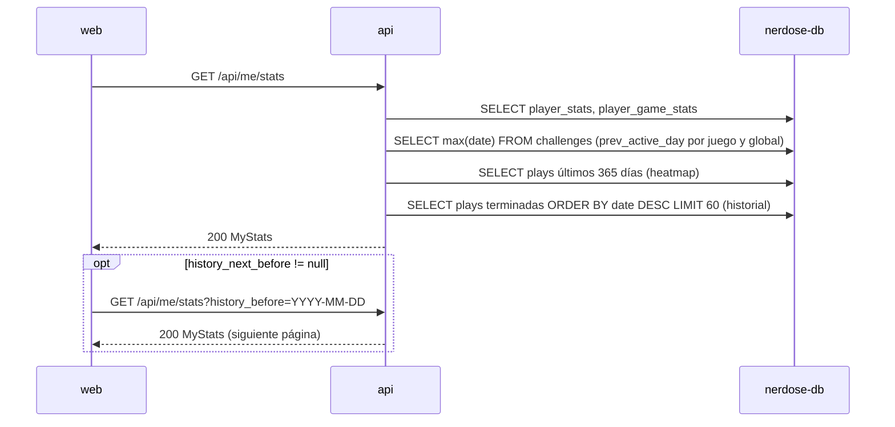

# Estadísticas del jugador

**Tipo:** Feature
**Status:** Draft
**Creado:** 2026-11-03
**Última actualización:** 2026-11-14
**Stories:** S-043, S-048

## Descripción

El jugador abre la pantalla de estadísticas. Ve:
- sus rachas vivas y récords (global y por juego);
- los totales y el porcentaje de victorias;
- las stats propias de cada juego;
- el heatmap de los últimos 365 días;
- el historial paginado.

Cubre C-34 (F12, ADR-011).

## Servicios Involucrados

| Servicio | Rol | Tipo de Participación |
|----------|-----|-----------------------|
| web | Pantalla `/stats`, con paginación del historial | Iniciador |
| api | Calcula las rachas vivas y arma la respuesta | Procesador |
| nerdose-db | `player_stats`, `player_game_stats`, `plays`, `challenges` (lectura) | Procesador |

## Pasos del Flujo



### Paso 1: Pedir estadísticas

**Origen:** web
**Destino:** api
**Tipo:** REST

**Request:**
- **Método:** GET
- **Endpoint:** `/api/me/stats`
- **Query:** `lang` (opcional), `history_before` (opcional, `YYYY-MM-DD`)
- **Headers:** cookie `nd_pid`

**Ref:** `docs/apis/api.yaml` GET /api/me/stats

---

### Paso 2: Leer agregados y calcular rachas vivas

**Origen:** api
**Destino:** nerdose-db
**Tipo:** Interno

**Operación de BD:**
- **Tabla:** `player_stats` — SELECT `global_streak`, `max_global_streak`, `last_active_date`, `total_completed`
- **Tabla:** `player_game_stats` — SELECT `game_id`, `current_streak`, `max_streak`, `played`, `wins`, `last_completed_date`, `extra`
- **Tabla:** `challenges` — `prev_active_day(game_id, today)` y `prev_active_day_global(today)`

**Acción:** la racha se muestra viva según `liveStreak` de core, construido sobre `isStreakAlive(lastCompleted, prevActiveDay, today)`: `last_completed_date == today` o `last_completed_date >= prev_active_day`. `games` trae siempre los 5 juegos en el orden de `GAME_IDS`. Si no, 0 (sin escribir en la base). `win_rate = wins / played` (`null` si `played = 0`).

---

### Paso 3: Heatmap e historial

**Origen:** api
**Destino:** nerdose-db
**Tipo:** Interno

**Operación de BD:**
- **Tabla:** `plays` — heatmap: `date`, `count(*)` WHERE `player_id` AND `date >= today − 364` AND `status IN ('won','lost','voided')` GROUP BY `date`
- **Tabla:** `plays` JOIN `challenges` — historial: `date`, `number`, `game_id`, `status`, `result` WHERE `player_id` AND `status IN ('won','lost','voided')` AND (`date < history_before` si viene) ORDER BY `date` DESC, `game_id` ASC LIMIT 61; el heatmap usa `date BETWEEN today − 364 AND today`

**Acción:** `label = historyLabel(result)` del `GameDefinition`; toda Play `voided` lleva la etiqueta «anulado» / «voided» en el locale. Paginación por días completos (REQ-011): si vinieron 61 filas y la 61 tiene la misma `date` que la 60, se quitan de la página todas las filas de esa fecha. `history_next_before` = `date` de la última fila de la página (`null` si vinieron 60 o menos), así la página siguiente (`date < history_next_before`) empieza por el día recortado. Cada página trae entre 56 y 60 filas. El heatmap viene en orden `date` ascendente.

---

### Paso 4: Respuesta

**Origen:** api
**Destino:** web
**Tipo:** REST (response del paso 1)

**Response (éxito):**
- **Status:** 200
- **Body:**
  ```json
  {
    "today": "YYYY-MM-DD",
    "global": { "current_streak": "integer", "max_streak": "integer", "total_completed": "integer" },
    "games": [ { "game_id", "current_streak", "max_streak", "played", "wins", "win_rate": "number | null", "extra": "object" } ],
    "heatmap": [ { "date": "YYYY-MM-DD", "completed": "integer 0–5" } ],
    "history": [ { "date", "number", "game_id", "status", "label" } ],
    "history_next_before": "YYYY-MM-DD | null"
  }
  ```

**Ref:** `docs/apis/api.yaml` (`MyStats`, `GameStatsView`), `docs/db-schemas/nerdose-db.md` tablas `player_stats`, `player_game_stats`, `plays`

## Manejo de Errores

| Paso | Error | Código | Response | Comportamiento |
|------|-------|--------|----------|---------------|
| 1 | Sin sesión | 401 | `{ "error": { "code": "no_session", … } }` | web no llama con la sesión bloqueada; con 401 muestra stats vacías y el aviso de cookies |
| 1 | `history_before` inválido | 422 | `{ "error": { "code": "validation_error", … } }` | Error de programación |
| 1 | Rate limit de lecturas (600/min por IP) | 429 | `{ "error": { "code": "rate_limited", … } }` | Reintento después de `Retry-After` |

## Resultado

**Éxito:** el jugador ve todo su progreso, con rachas que respetan los días neutros y las anulaciones.

**Estado final:** sin cambios (solo lectura).

## Notas

- Las Play `voided` cuentan en el heatmap, el historial, las rachas y `total_completed`, pero no en `played`, `wins` ni `extra` (invariante 23).
- Las Play `in_progress` (incluidas las de días pasados) no aparecen.
- `extra` de big-o = `{ by_category: { <recipe_category>: { played, correct } } }` (una partida suma `played` a la categoría de su receta y `correct` si ganó). La `api` ya lo devuelve en `games[].extra`; mostrar los aciertos por categoría en la pantalla es de FG-10. La etiqueta del historial de big-o es `✓ O(n log n)` (la respuesta correcta) si ganó, o `✗` si no.
- `extra` de bug-hunt = `{ by_language: { <code_language>: { played, correct } }, by_bug_type: { <bug_type>: { played, correct } } }`; la etiqueta del historial es `✓ L<n>` / `✗ L<n>` con `n` = `bug_line`.
- TanStack Query invalida esta query al terminar una partida y al cambiar el día.

> Actualizado por REQ-009 (story S-043): `extra` y etiqueta del historial de Big O.

> Actualizado por REQ-010 (story S-048): `extra` y etiqueta del historial de Bug Hunt.

> Actualizado por REQ-011 (stories S-055 y S-057): `today`, 5 juegos en orden, historial por días completos, etiqueta «anulado» para toda Play `voided`; invalidación de `['me','stats']` también en `acknowledge-void`; stats propias renderizadas por `StatsSummary` de cada `client`.

> Actualizado por S-055: cursor del historial = fecha de la última fila de la página.
