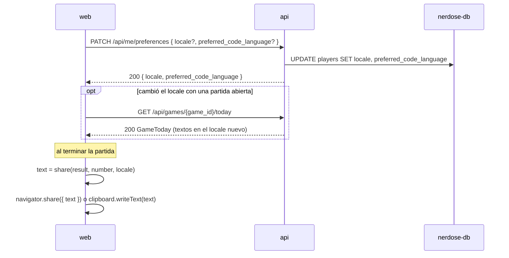

# Preferencias del jugador y compartir resultado

**Tipo:** Feature
**Status:** Draft
**Creado:** 2026-11-03
**Última actualización:** 2026-11-25
**Stories:** S-007, S-009, S-024, S-046, S-051, S-058, S-061, S-063

## Descripción

El jugador cambia el idioma o el lenguaje de código preferido, incluso a mitad de partida. Al terminar, comparte su resultado sin spoilers, por share nativo o por el portapapeles. Compartir no registra ningún evento de analítica (la analítica web se retiró en REQ-011, ADR-014). Cubre C-03, C-04 y C-13.

## Servicios Involucrados

| Servicio | Rol | Tipo de Participación |
|----------|-----|-----------------------|
| web | Selector de idioma y lenguaje; arma el texto de share | Iniciador |
| api | Guarda las preferencias y responde los textos en el locale nuevo | Procesador |
| nerdose-db | `players` | Procesador |

## Pasos del Flujo



### Paso 1: Cambiar preferencias

**Origen:** web
**Destino:** api
**Tipo:** REST

**Request:**
- **Método:** PATCH
- **Endpoint:** `/api/me/preferences`
- **Body:**
  ```json
  {
    "locale": "es | en (opcional)",
    "preferred_code_language": "js | go | java (opcional)"
  }
  ```
  Debe traer al menos una propiedad.

**Operación de BD:**
- **Tabla:** `players`
- **Operación:** UPDATE
- **Campos:** `locale` y/o `preferred_code_language` WHERE `id = nd_pid`

**Evento de dominio:** `PlayerPreferencesChanged` (`player_ref`, `locale`, `preferred_code_language`), solo en los logs; `player_ref` en lugar del `player_id` crudo (REQ-012, S-061).

**Response (éxito):**
- **Status:** 200
- **Body:** `{ "locale": "es | en", "preferred_code_language": "js | go | java" }`

**Acción de web:** `i18next.changeLanguage(locale)` para los textos de la UI.

**Ref:** `docs/apis/api.yaml` PATCH /api/me/preferences (`PreferencesUpdate`, `Preferences`)

---

### Paso 2: Recargar el contenido en el locale nuevo

**Origen:** web
**Destino:** api
**Tipo:** REST

**Request:** `GET /api/games/{game_id}/today`

**Acción:** la `api` resuelve el locale con `players.locale` y devuelve `public_view` (y `result`, si terminó) en el idioma nuevo. La partida (`plays.state`) no cambia. En Grep Grid a mitad de partida, `public_view.words[].definition` de las palabras ya encontradas vuelve en el idioma nuevo; `grid`, `words` y `found_words` no cambian.

---

### Paso 3: Compartir (solo cliente)

**Origen:** web
**Destino:** (interno)
**Tipo:** Interno

**Acción:**
1. `text = share(result, number, locale)` del `client` del juego (el `locale` es el idioma activo de la sesión; solo el share de Bug Hunt tiene texto y lo traduce). Nunca incluye la solución ni el sitio.
2. `web` le agrega una última línea con el host de la dirección abierta (`window.location.host`, `withSite` en `share-button.tsx`); ningún dominio queda fijo en el código. En los ejemplos, `<sitio>` es ese host. Ejemplo:
   ```
   🟩 Devdle #128 · 2/6
   🟩🟨⬛⬛⬛
   🟩🟩🟩🟩🟩
   <sitio>
   ```
   Devdle termina la primera línea en `X/6` si perdió o se rindió, y le suma ` 💡` si usó la pista (`🟩 Devdle #128 · 4/6 💡`), sin decir qué letra reveló (REQ-012, S-063).
   Grep Grid (sin las palabras ni indicio de rendición):
   ```
   🔎 Grep Grid #8
   6/8
   <sitio>
   ```
   Big O (🟩 si acertó, 🟥 si no, y el lenguaje con el que confirmó; sin la opción elegida ni la correcta, idéntico en es y en):
   ```
   🧮 Big O #12
   🟩 Java
   <sitio>
   ```
   Bug Hunt (🟩 si encontró el bug, 🟥 si no, y el lenguaje de la pestaña con la que confirmó; sin la línea ni el tipo de bug; el texto sigue el idioma activo):
   ```
   🐛 Bug Hunt #12 · JavaScript
   🟥 se me escapó
   <sitio>
   ```
   En inglés, la segunda línea es `🟥 it got away` (y `🟩 bug found` al acertar).
3. `navigator.share({ text })` si está disponible; si no, `navigator.clipboard.writeText(text)` y el aviso "copiado". No se emite ningún evento de analítica.

## Manejo de Errores

| Paso | Error | Código | Response | Comportamiento |
|------|-------|--------|----------|---------------|
| 1 | Sin sesión | 401 | `{ "error": { "code": "no_session", … } }` | web cambia el idioma solo en la UI y reintenta después de `POST /api/session` |
| 1 | Body vacío o valores inválidos | 422 | `{ "error": { "code": "validation_error", … } }` | Error de programación |
| 1 | Rate limit (30/min por `player_id`) | 429 | `{ "error": { "code": "rate_limited", … } }` | Reintento después de `Retry-After` |
| 3 | El usuario cancela el share nativo | — | `AbortError` | Se ignora |
| 3 | Clipboard no disponible | — | — | web muestra el texto en un cuadro para copiar a mano |

## Resultado

**Éxito:** la interfaz y el contenido aparecen en el idioma elegido, el código en el lenguaje preferido, y el resultado se comparte sin spoilers.

**Estado final:**
- Player: `locale` y/o `preferred_code_language` actualizados.

## Notas

- `preferred_code_language` también se actualiza solo al confirmar en Big O o Bug Hunt (ver `jugada-y-cierre-de-partida`): la `api` lo guarda con `codeLanguage(state)` en la transacción de cierre y la web lo copia de `MoveResponse.play.code_language` a la cache de la sesión (`sessionKeys.all`) sin otro request, así la próxima partida de Big O o Bug Hunt arranca en ese lenguaje.
- El cambio de lenguaje de código durante la partida es solo del cliente: no llama a este endpoint hasta que el jugador lo fija como preferencia.
- Compartir no hace ningún request a la `api` ni a terceros.

> Actualizado por REQ-009 (story S-046): formato de share de Big O y preferencia de lenguaje reflejada en la cache de la sesión al confirmar.

> Actualizado por REQ-012 (2026-11-25, implementado fuera del workflow): formato real del share de Devdle con ` 💡` cuando se usó la pista (S-063) y `player_ref` en el evento de preferencias (S-061).

> Actualizado por REQ-011 (story S-058): se retira la analítica web (Plausible) por decisión del usuario; compartir ya no emite `share:<game_id>` y el flujo deja de cubrir C-53.
