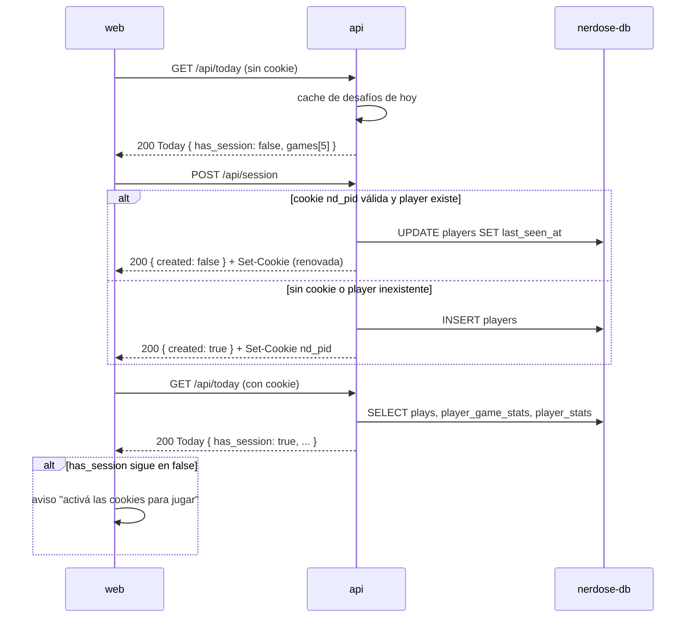

# Primera visita, sesión anónima y home

**Tipo:** Feature
**Status:** Draft
**Creado:** 2026-11-03
**Última actualización:** 2026-11-03
**Stories:** —

## Descripción

El jugador entra a `nerdose.dev`. La home muestra el catálogo aunque todavía no haya sesión, y después el front crea o renueva el Player anónimo con la cookie `nd_pid`. Si las cookies están bloqueadas, el catálogo queda visible pero no se puede jugar. Cubre C-01, C-02, C-04, C-05 y C-06 (F1 del análisis técnico).

## Servicios Involucrados

| Servicio | Rol | Tipo de Participación |
|----------|-----|-----------------------|
| web | Carga la home, pide el estado del día y la sesión, muestra la cuenta regresiva | Iniciador |
| api | Resuelve el estado del día desde la cache, crea o renueva el Player | Procesador |
| nerdose-db | Guarda `players` y lee `plays`, `player_game_stats` y `player_stats` | Procesador |

## Pasos del Flujo



### Paso 1: Estado del día sin sesión

**Origen:** web
**Destino:** api
**Tipo:** REST

**Request:**
- **Método:** GET
- **Endpoint:** `/api/today`
- **Query:** `lang` (opcional, `es` | `en`)

**Response (éxito):**
- **Status:** 200
- **Body:**
  ```json
  {
    "date": "string (date) — día UTC de la plataforma",
    "number": "integer — today − LAUNCH_DATE + 1",
    "next_reset_at": "string (date-time) — próxima 00:00 UTC",
    "seconds_to_reset": "integer",
    "has_session": "boolean — false en este paso",
    "global_streak": { "current": "integer — 0", "max": "integer — 0" },
    "completed_today": "integer — 0",
    "games": [
      {
        "game_id": "devdle | bug-hunt | big-o | timeline | grep-grid",
        "challenge_status": "published | voided | none",
        "play_status": "null",
        "history_label": "null",
        "current_streak": "integer — 0"
      }
    ]
  }
  ```

**Operación de BD:** ninguna. Los desafíos de hoy salen de la cache en memoria (ADR-012).

**Ref:** `docs/apis/api.yaml` GET /api/today (`Today`, `TodayGame`)

---

### Paso 2: Crear o renovar la sesión

**Origen:** web
**Destino:** api
**Tipo:** REST

**Request:**
- **Método:** POST
- **Endpoint:** `/api/session`
- **Headers:** `Content-Type: application/json`, `Accept-Language`, cookie `nd_pid` (si existe)
- **Body:** `{}`

**Operación de BD (cookie válida y player existente):**
- **Tabla:** `players`
- **Operación:** UPDATE
- **Campos:** `last_seen_at = now()`

**Operación de BD (sin cookie, o cookie de un player inexistente):**
- **Tabla:** `players`
- **Operación:** INSERT
- **Campos:** `id` (gen_random_uuid), `locale` (de `Accept-Language` si es `es` o `en`, si no `es`), `preferred_code_language = 'js'`, `created_at`, `last_seen_at`

**Evento de dominio:** `PlayerCreated` (`player_id`, `locale`). Solo se registra en los logs; no hay bus de eventos.

**Response (éxito):**
- **Status:** 200
- **Headers:** `Set-Cookie: nd_pid=<players.id>; HttpOnly; Secure; SameSite=Lax; Path=/; Max-Age=34560000`
- **Body:**
  ```json
  {
    "locale": "es | en",
    "preferred_code_language": "js | go | java",
    "created": "boolean — true si se creó el Player"
  }
  ```

**Ref:** `docs/apis/api.yaml` POST /api/session (`SessionResponse`), `docs/db-schemas/nerdose-db.md` tabla `players`

---

### Paso 3: Estado del día con sesión

**Origen:** web
**Destino:** api
**Tipo:** REST

**Request:**
- **Método:** GET
- **Endpoint:** `/api/today`
- **Headers:** cookie `nd_pid`

**Operación de BD:**
- **Tabla:** `plays` — SELECT `game_id`, `status`, `result` WHERE `player_id` AND `date = today`
- **Tabla:** `player_game_stats` — SELECT `game_id`, `current_streak`, `last_completed_date`
- **Tabla:** `player_stats` — SELECT `global_streak`, `max_global_streak`, `last_active_date`
- **Tabla:** `challenges` — SELECT `max(date)` para `prev_active_day` (racha viva, ADR-011)

**Response (éxito):**
- **Status:** 200
- **Body:** `Today` con `has_session: true`. Por juego, `play_status` es el `plays.status` de hoy (o `null`), `history_label` es `historyLabel(plays.result)` si la Play terminó, y `current_streak` es la racha viva. `global_streak` = `{ current: racha global viva, max: max_global_streak }`. `completed_today` cuenta las Play de hoy con `status IN ('won','lost','voided')`.

**Ref:** `docs/apis/api.yaml` GET /api/today

---

### Paso 4: Cuenta regresiva y cambio de día

**Origen:** web
**Destino:** (interno)
**Tipo:** Interno

**Acción:** cuando `seconds_to_reset` llega a 0, el front espera entre 0 y 3 s al azar y vuelve a pedir `GET /api/today` (ver `cambio-de-dia-y-publicacion`).

## Manejo de Errores

| Paso | Error | Código | Response | Comportamiento |
|------|-------|--------|----------|---------------|
| 1, 3 | Exceso de lecturas por IP (600/min) | 429 | `{ "error": { "code": "rate_limited", "message": "…" } }` + `Retry-After` | web reintenta después de `Retry-After` |
| 2 | Exceso de creación de sesión por IP (20/10 min) | 429 | `{ "error": { "code": "rate_limited", … } }` | web muestra el catálogo sin sesión y reintenta en la próxima carga |
| 2 | `Origin` distinto de `https://nerdose.dev` | 403 | `{ "error": { "code": "forbidden_origin", … } }` | No aplica a un navegador legítimo |
| 2 | Falta `Content-Type: application/json` | 415 | `{ "error": { "code": "unsupported_media_type", … } }` | Error de programación del front |
| 3 | Cookies bloqueadas (`has_session: false` después del paso 2) | 200 | `Today` con `has_session: false` | web muestra el aviso y deshabilita "Jugar" |
| 2, 3 | Error de BD | 500 | `{ "error": { "code": "internal_error", … } }` | web muestra un error genérico y reintenta |

## Resultado

**Éxito:** el jugador ve la home con los 5 juegos, el estado de cada uno, su racha global, el `#número` y la cuenta regresiva, en su idioma.

**Estado final:**
- Player: fila en `players` con `locale` y `preferred_code_language`, y `last_seen_at` actualizado.
- Navegador: cookie `nd_pid` válida por 400 días.

## Notas

- `POST /api/session` se llama en cada carga: así la cookie no vence mientras el jugador vuelva.
- La cookie es host-only (sin `Domain`) y nunca llega a `admin.nerdose.dev`.
- `GET /api/today` no exige sesión, para que la home cargue al instante y para detectar cookies bloqueadas.
- Hasta FG-3, `challenge_status` es siempre `none` y el paso 3 no lee `plays`, `player_game_stats`, `player_stats` ni `challenges`. `number` es `null` si hoy es anterior a `LAUNCH_DATE` y la home oculta el `#número`.
