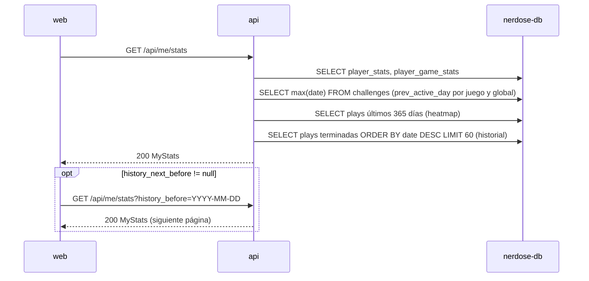

# Story Plan: S-057 (web) - Web: pantalla de estadísticas

## Status

**Status:** Completed

## Referencia de la Story

- **Story:** [S-057](../stories/S-057.web-pantalla-de-estadisticas.md)
- **Servicio:** web
- **Resumen:** Crea el módulo `stats` de `apps/web` y la ruta `/stats`: racha global, récord y completados; una tarjeta por juego (en el orden de `GAME_IDS`) con racha, récord, jugadas, ganadas, % de victorias y el `StatsSummary` del `client` del juego cargado lazy por el registry; el `Heatmap` de 365 días de `@nerdose/ui` anclado en `MyStats.today`; y el historial paginado con «Ver más partidas» (`useInfiniteQuery(['me','stats', locale])` con `pageParam = history_next_before`). Cubre los estados vacío, sin sesión (sin llamar a la `api`), carga, error (429 y red, con «Reintentar») y error al cargar más. Invalida `['me','stats']` al cerrar una partida (`useSubmitMove`), al confirmar una anulación (`useAcknowledgeVoid`) y al cambiar el día. Textos es/en.

> **Alcance de este plan:** solo el servicio `web` (`apps/web/`, más `docs/reusable-code/web/`). Queda **fuera**:
> - **`api`**: `GET /api/me/stats` ya existe (S-055, **Completed**). Si un test revela que la respuesta no cumple `MyStats`, se reporta; `web` no lo parchea.
> - **`games`**: `StatsSummary({ extra, locale, t })` ya lo exportan los 5 `./client` (S-056, **Completed**). `web` solo lo declara en su copia estructural `GameClient` y lo monta.
> - **`ui`**: `Heatmap` ya existe en `@nerdose/ui` (S-056, **Completed**). Las variants de `Card` `stat`, `metric` y `game-stats`, y la tarjeta de racha (`streak-number` `hero`), **no** están en `@nerdose/ui`: este plan las arma localmente en `src/modules/stats/components/` según el spec del DS (gap aceptado en REQ-011, ver «DS Gaps»). No se tocan `packages/ui` ni `tokens.css`.
> - **S-058** (quitar Plausible) es independiente: este plan no toca `lib/analytics.ts`, `lib/env.ts` ni `share-button.tsx`. Si S-058 se implementa antes, no hay conflicto.
>
> **Rutas:** las de «Archivos a crear/modificar» son relativas a `apps/web/`, salvo las que empiezan con `docs/` (raíz del repo).

---

## Contexto Arquitectónico

### Stack Tecnológico

- React 19 + Vite (SPA, sin SSR), TypeScript estricto (`strict`, `noUncheckedIndexedAccess`), alias `@/*` → `src/*`.
- React Router (data router, `createBrowserRouter`, rutas `lazy`).
- `@tanstack/react-query` ^5.105.3 (`useInfiniteQuery`, `keepPreviousData`, `InfiniteData`).
- `i18next` ^26 + `react-i18next` ^17 (solo UI; contenido ya resuelto por la `api`).
- Tailwind CSS v4 con los tokens de `@nerdose/ui/tokens.css` (`@theme`), `cn()`, `buttonClass()`, `linkClass()`, `dataTableClass()`.
- `@nerdose/core`: `GAME_IDS`, `GameId`, `Locale`, `LOCALES`.
- `@nerdose/ui`: `Heatmap`, `Panel`, `Banner`, `Alert`, `StreakNumber`, `Card`, `buttonClass`, `dataTableClass`, `cn`.
- Tests: Vitest + jsdom + Testing Library + `@testing-library/user-event` + `vitest-axe` + MSW ^3 (`src/test/msw.ts`). Sin e2e (deuda D3).

### Estado actual del código de `web` que toca este plan (relevado)

- `src/app/router.tsx`: rutas `index` (home), `about`, `:game_id` y `*`. **No existe `stats`**: hoy `/stats` cae en `:game_id` y muestra la 404 del game-host. El nav (`components/main-nav.tsx`, `NavLink` a `/stats`), la píldora de racha, el panel «Tu progreso» de la home, el botón «Estadísticas» del `game-header` y «Ver mis estadísticas» del resultado ya enlazan a `/stats`.
- `src/modules/` tiene `about`, `catalog`, `game-host` y `session`. **No existe `src/modules/stats/`.**
- `src/modules/game-host/types.ts`: `GameClient = { Instructions, Game, Result, share, i18n, HELP_TARGET_ID }` — **falta `StatsSummary`** (los paquetes ya lo exportan; el registry usa `satisfies Partial<Record<GameId, () => Promise<GameClient>>>`, así que sumarlo al tipo no rompe nada).
- `src/modules/game-host/load-game-client.ts`: `loadGameClient(gameId)` memoizado, registra el namespace i18n del client. `use-loaded-game-client.ts`: `useLoadedGameClient(gameId)` con `use()` (requiere `<Suspense>`). `src/modules/game-host/index.ts` hoy solo exporta `type GameClient`.
- `src/modules/game-host/api/use-submit-move.ts`: en `onSuccess`, si `res.result !== null` invalida solo `todayKeys.all`. **No invalida `['me','stats']`.**
- `src/modules/game-host/api/use-acknowledge-void.ts`: `onSuccess` devuelve `Promise.all([invalidate(todayKeys.all), invalidate(gameTodayKeys.all)])`. **No invalida `['me','stats']`.**
- `src/modules/catalog/api/use-day-countdown.ts`: al llegar a 0 invalida `todayKeys.all` (+ `extraKeys`); solo lo montan `DayTerminal` (home) y `ResultExits` (resultado). La pantalla `/stats` no tiene cuenta regresiva.
- `src/modules/catalog/games.ts`: `GAME_CATALOG[gameId] = { minutes, untimed, accentClass: 'text-game-<id>' }`. No tiene la clase de fondo del acento (la barra de 4px de `game-stats` la necesita).
- `src/modules/session/session-provider.tsx`: `status: 'loading' | 'active' | 'cookies_blocked' | 'unavailable'`; `cookies_blocked` = `POST /api/session` OK y el `GET /api/today` siguiente con `has_session: false`. El `Shell` ya muestra el `Banner` O-03 («Activá las cookies para poder jugar») cuando `status === 'cookies_blocked'` y no hay header custom.
- `src/app/shell.tsx`: enfoca `main h1` al cambiar de ruta (`focusMainHeading`).
- `src/test/msw.ts`: `defaultHandlers` sin `/api/me/stats`; `noNetwork` responde error de red a todo `/api/*` sin handler.
- `src/test/render.tsx`: `renderWithProviders({ route, routes?, strict? })` → devuelve `queryClient` (con `retry: false`).
- `src/i18n/es.ts`/`en.ts`: no hay claves `stats.*`; existen `games.{id}.name` («Devdle», «Grep Grid», «Tech Timeline», «Big O», «Bug Hunt»), `cookies.title`/`cookies.detail`, `errors.retry`.
- Guardas existentes que el módulo nuevo tiene que respetar:
  - `src/modules/game-host/game-host-boundaries.test.ts`: solo `registry.ts` contiene `@nerdose/game-`; los literales `'big-o'`, `'bug-hunt'`, `'timeline'`, `'grep-grid'` solo pueden aparecer en `registry.ts`, `catalog/games.ts`, `catalog/components/how-it-works.tsx`, `i18n/es.ts`, `i18n/en.ts` (fuera de `src/test/`); ningún archivo de app puede contener `bug_type`, `recipe_category`, `public_view.category`, etc. **El módulo `stats` itera `GAME_IDS` y no nombra juegos.**
  - `src/modules/catalog/catalog-boundaries.test.ts` (TS-50): `modules/catalog/**` y `app/**` no contienen `@nerdose/game-`, `/client'`, `createGameRegistry` ni `GameDefinition`.
  - `src/styles.test.ts`: ningún `.tsx` de `src/` usa hex, valores arbitrarios que empiecen con dígito/`#`/`rgb` (`/\[(\d|#|rgb)/`) ni `rounded-md|shadow-md|text-2xl|font-semibold`.
  - `src/i18n/i18n.test.ts`: `es` y `en` tienen exactamente las mismas claves.

### Arquitectura del servicio (`docs/architectures/web/overview.md`, copiado lo aplicable)

- **stats** — `/stats`: estadísticas y rachas del jugador.
- Cliente HTTP de mismo origen (`/api/*`), JSON en `snake_case` sin transformar y errores por `error.code` (ADR-015).
- Identidad anónima por cookie `nd_pid` `HttpOnly`: el front no la lee ni la escribe, solo llama a `POST /api/session` en cada carga (ADR-009).
- Contextos de React a nivel app: solo el de sesión/preferencias (locale) además del `QueryClientProvider`.
- **Contrato de props de los `client`.** ADR-006 define que cada `client` exporta `Instructions`, `Game`, `Result` y `share(result, number, locale)`; `web` las declara estructuralmente en el tipo `GameClient` de `apps/web/src/modules/game-host/types.ts`. El registry sigue parcial a propósito (`Partial<Record<GameId, () => Promise<GameClient>>>`).
- **Reloj del día.** El cliente no calcula "hoy": usa `number`, `next_reset_at` y `seconds_to_reset` de `GET /api/today` y espera 0–3 s al azar antes de pedir de nuevo al llegar a 0 (ADR-008).
- **Almacenamiento del navegador.** Solo conveniencias por visitante (nunca solución, estado de partida ni tokens), siempre con `try/catch`. (Este plan no usa storage.)
- **Update (REQ-011):** The `stats` module (`/stats`) is implemented: statistics screen with global streak, per-game cards (`StatsSummary`), 365-day heatmap and paginated history.

### Estructura del módulo nuevo (decidida en este plan, sigue `_base` → «Project structure»)

```
src/modules/stats/
├── index.ts                         # SOLO statsKeys y useInvalidateStatsOnDayChange (ver regla de dependencias)
├── api/
│   ├── my-stats.ts                  # tipos MyStats/StatsHistoryEntry, statsKeys, fetchMyStats
│   ├── use-my-stats.ts              # useInfiniteQuery + recuperación de páginas al cambiar de idioma
│   └── use-invalidate-stats-on-day-change.ts
├── stats-view.ts                    # deriveStatsView (función pura) + EMPTY_GAME_STATS
├── format.ts                        # formatShortDate, formatWinRate, formatCount
├── components/
│   ├── stats-invitation.tsx         # invitacion + btn-ir-juegos
│   ├── stats-kpis.tsx               # kpi-racha, kpi-record, kpi-completados (+ StatCard local)
│   ├── game-stats-card.tsx          # stats-<juego> (card game-stats + Metric local)
│   ├── game-stats-summary.tsx       # StatsSummary del client (lazy, Suspense local)
│   ├── activity-panel.tsx           # titulo-actividad + heatmap + detalle-dia
│   └── history-panel.tsx            # titulo-historial + tabla + alerta-ver-mas + btn-ver-mas + live region
└── routes/
    └── stats.tsx                    # export function Component() — composición y estados
```

**Regla de dependencias entre módulos (evita ciclos):**
- `stats` importa de `@/modules/catalog` (`useToday`, `GAME_CATALOG`), `@/modules/session` (`useSession`) y `@/modules/game-host` (`useLoadedGameClient`, tipos `Translate`/`GameStatsView`).
- `game-host` importa `statsKeys` de `@/modules/stats` (invalidaciones) y `app/shell.tsx` importa `useInvalidateStatsOnDayChange` de `@/modules/stats`.
- Por eso **`src/modules/stats/index.ts` solo reexporta `statsKeys` (y sus tipos) y `useInvalidateStatsOnDayChange`**, que no importan nada de `game-host`. Los componentes y la ruta no se reexportan (la ruta se carga por `lazy` desde el router). Así `game-host → stats/index → (api/my-stats, catalog)` no vuelve a `game-host`.
- `src/modules/game-host/index.ts` pasa a exportar `useLoadedGameClient` y los tipos `Translate`, `GameStatsView`, `StatsSummaryProps` (además de `GameClient`).

### Convenciones activas (verbatim, `docs/architectures/web/conventions/`)

Todas custom (no hay catálogo para `react`). Se copian completas las que gobiernan esta story; `error-handling` entra por `required_by` de `data-fetching` y `routing`. No aplican a esta story: `testing-e2e` (no adoptado, D3).

#### Convención `_base`

##### Base Conventions (React, Vite)

Always active in `web` and `admin`. Defines what does not vary across modules or screens: SPA with Vite (no SSR), strict TypeScript, project layout, import boundaries with the monorepo packages, environment variables and dates. This is a custom base because the catalog only ships `nextjs`, which assumes App Router and Server Components that these apps do not use.

###### SPA, no server rendering

- The app is a client-rendered single-page app built with **Vite**, React 19 and TypeScript. There is no SSR, no Server Components and no server code inside `apps/web` or `apps/admin`.
- Entry point is `index.html` + `src/main.tsx`, which mounts `<App />` inside `StrictMode`.
- All data comes from the `api` over HTTP (see `data-fetching`). The static build is served by the hosting layer (deferred); the app never assumes a Node runtime.
- Heavy or per-feature code is split with `React.lazy` + dynamic `import()` (see `routing`).

###### TypeScript

- TypeScript is mandatory. `tsconfig.json` extends the monorepo base with `strict: true` and `noUncheckedIndexedAccess: true`.
- `target: ES2022` or higher, `moduleResolution: bundler`, `jsx: react-jsx`.
- No `any` except at boundaries with untyped libraries, and then wrapped in a typed function.
- Path alias `@/*` resolves to `src/*` (configured in `tsconfig.json` and in `vite.config.ts`).
- API payload types come from the shared packages (`@nerdose/core`, `@nerdose/game-<game_id>`); do not redeclare them locally.

###### Project structure

```
apps/{web|admin}/
├── index.html
├── vite.config.ts                # aliases, dev proxy, VITE_* handling
├── src/
│   ├── main.tsx                  # mounts <App />
│   ├── app/                      # providers, router, shell/layout, error boundaries
│   ├── modules/                  # one folder per domain module (see manifest `modules`)
│   │   └── {module}/
│   │       ├── routes/           # route components (lazy-loaded entry points)
│   │       ├── components/       # components used only by this module
│   │       ├── api/              # query/mutation hooks + query keys of the module
│   │       └── index.ts          # public surface of the module
│   ├── components/               # app-wide reusable components (not in @nerdose/ui)
│   ├── lib/
│   │   ├── env.ts                # typed, validated import.meta.env
│   │   ├── api-client.ts         # fetch wrapper (see data-fetching)
│   │   └── utils.ts              # cn() and small pure helpers
│   ├── hooks/                    # generic custom hooks
│   ├── i18n/                     # web only: i18next setup and ES/EN resources
│   └── test/                     # test setup and shared test utilities
├── e2e/                          # e2e specs (not adopted yet, debt D3; see testing-e2e)
├── public/                       # static assets served as-is
└── package.json
```

- **`app/`**: wiring only (providers, router, layout). No business logic.
- **`modules/{module}/`**: everything that belongs to one module. A module never imports from another module's internals; it uses that module's `index.ts` or goes through `lib/` or a shared package.
- **`components/`**: reusable pieces specific to the app. Anything shared by `web` and `admin` belongs in `@nerdose/ui`, not copied.
- **`lib/`**: no JSX. Clients, validated env, pure helpers.
- The shell contains **no per-game logic** (see `game-clients`).

###### Monorepo boundaries

- Internal packages are imported by name: `@nerdose/core`, `@nerdose/ui`, `@nerdose/game-<game_id>/client`.
- From a game package, only the `./client` entry may be imported. Never `./definition` or `./generator`.
- Never import `@nerdose/db`, `@nerdose/polyglot` or `@nerdose/content`.
- Never import from another app (`apps/*` do not depend on each other).
- Shared UI goes to `packages/ui`; if a component is needed in both apps, move it there instead of duplicating it.

###### Naming

| Element | Convention | Example |
|---|---|---|
| Files (general) | `kebab-case` | `game-card.tsx`, `format-date.ts` |
| Components (exported) | `PascalCase` | `export function GameCard()` |
| Folders | `kebab-case` | `game-host/`, `content-stock/` |
| Hooks | `use-*` file, `useX` export | `use-today.ts` -> `useToday` |
| Query keys | factory per module | `todayKeys.all`, `reportKeys.list(filters)` |
| Types / interfaces | `PascalCase`, no `I` prefix | `TodayResponse` |
| Constants | `SCREAMING_SNAKE_CASE` | `RESET_JITTER_MAX_MS` |
| API fields | `snake_case`, exactly as the API | `challenge_number`, `seconds_to_reset` |

Component files export one main component; tests live next to the file as `*.test.tsx`.

###### Imports

- Absolute imports via `@/*`. No `../../../`.
- Order within a file: (1) external libraries and `@nerdose/*`, (2) `@/` imports, (3) relative imports from the same folder. Separate groups with a blank line.
- Type-only imports use `import type`.

###### Environment variables

- All `import.meta.env` access happens in **one place** (`src/lib/env.ts`), validated with Zod at module load so a bad build fails fast.
- Only `VITE_*` variables reach the bundle. Everything in the bundle is public: never put secrets in a `VITE_*` variable.
- Known variables: none. The Plausible variables (`VITE_PLAUSIBLE_*`) were removed with web analytics in REQ-011; a new variable goes through `src/lib/env.ts` as above.
- The rest of the code consumes the typed `env` object, not `import.meta.env`.

###### Dates

- At system boundaries (HTTP, logs) dates are ISO 8601 UTC; day dates are `YYYY-MM-DD`.
- The client **never decides what "today" is**: the day and challenge number come from the `api`. Countdowns use `seconds_to_reset` / `next_reset_at` from the response.
- Format dates for display with `Intl.DateTimeFormat` using the active locale. Never assume the browser timezone equals UTC.

###### Async / Promises

- `async/await` over `.then()`.
- Components are never `async`. Data loading goes through TanStack Query hooks (see `data-fetching`).
- Unhandled promise rejections are a bug. Event handlers that call async code handle or surface the error.

###### Comments

- Default: no comments. Clear names explain the code.
- Comment only the why when it is not obvious (workaround, external constraint, surprising decision).
- No `// TODO` without an associated issue.

#### Convención `routing`

##### Routing (React, React Router)

Client-side routing with **React Router** in data-router mode (`createBrowserRouter`). The route table is small and fixed; each game's screen is a lazy chunk so the home loads fast on 4G (NFR-P02). There is no server routing: the host serves `index.html` for every path (deferred hosting requirement).

###### When to use

- Any navigation between screens of `web`: home, a game, stats, about.
- Any code split by screen or by game.

###### Package

```
react-router      # createBrowserRouter, Link, useParams, useNavigate
```

###### Structure

```
src/
├── app/
│   ├── router.tsx                 # the route table
│   └── shell.tsx                  # layout: header, banners, <Outlet />
└── modules/
    ├── catalog/routes/home.tsx            # /
    ├── game-host/routes/game.tsx          # /:game_id
    ├── stats/routes/stats.tsx             # /stats
    └── about/routes/about.tsx             # /about
```

###### Route table

| Path | Module | Notes |
|---|---|---|
| `/` | `catalog` | Home: today's state of the 5 games, streak, countdown |
| `/:game_id` | `game-host` | Instructions, round and result of one game. `game_id` in `devdle \| grep-grid \| timeline \| big-o \| bug-hunt`; anything else renders the not-found screen |
| `/stats` | `stats` | Player stats |
| `/about` | `about` | About / how it works |
| `*` | `shell` | Not found |

###### Configuration

```tsx
// src/app/router.tsx
export const router = createBrowserRouter([
  {
    element: <Shell />,
    errorElement: <RouteError />,
    children: [
      { index: true, lazy: () => import('@/modules/catalog/routes/home') },
      { path: ':game_id', lazy: () => import('@/modules/game-host/routes/game') },
      { path: 'stats', lazy: () => import('@/modules/stats/routes/stats') },
      { path: 'about', lazy: () => import('@/modules/about/routes/about') },
      { path: '*', element: <NotFound /> },
    ],
  },
]);
```

###### How to use

###### One chunk per game

The game-host route resolves the game from the registry and loads its `client` entry with `React.lazy`; see `game-clients`. The route component wraps it in `<Suspense>` with an accessible loading state.

```tsx
const GameView = lazy(() => loadGameClient(gameId)); // registry lookup, no per-game branching
```

###### Validating `:game_id`

```tsx
const { game_id } = useParams();
if (!isGameId(game_id)) return <NotFound />;   // isGameId comes from @nerdose/core
```

###### Navigation and focus

- Use `<Link>` / `useNavigate`, never `window.location` for in-app navigation.
- On route change, move focus to the page `<h1>` (or the `main` landmark) and update `document.title`, so keyboard and screen-reader users know the screen changed.

###### Day change

- Routes do not depend on the day. When the countdown reaches 0 the catalog and the open game refetch their queries (see `data-fetching`); the URL does not change.

###### Rules

- All routes are declared in `src/app/router.tsx`; no routes defined elsewhere.
- Every route component is lazy-loaded (`lazy` or `React.lazy`). The shell and the home are the only eagerly loaded UI.
- A game's code is loaded only when its route (or its preview of instructions) is opened; the home never imports a game's `client` entry.
- Route components are thin: they compose module components and read params; logic lives in module hooks.
- `:game_id` is validated before use; an unknown id shows the not-found screen, never a broken game.
- No per-game `if`/`switch` in the router or the shell; the registry decides (see `game-clients`).
- Route-level errors render through `errorElement` (see `error-handling`).
- Each route sets a meaningful `document.title` and moves focus on navigation.
- Links to external sites use `rel="noopener noreferrer"`.

###### Integration with other conventions

- **game-clients**: `/:game_id` mounts the game's lazy `client` through the registry.
- **error-handling**: `errorElement` and the not-found screen.
- **accessibility**: focus management and page titles on navigation.

#### Convención `data-fetching`

##### Data Fetching (React, TanStack Query)

All server data is read with **TanStack Query** on top of one thin `fetch` wrapper. The `api` is on the same origin as the app, speaks JSON in `snake_case` and returns typed errors (ADR-015). The client does not transform field names.

###### When to use

- Any read from the `api`: today's challenges, a game's public view, player stats, reports, metrics.
- Any mutation against the `api`: start, move, report, preferences, void, regenerate.
- Not for purely local UI state (see `state-management`).

###### Package

```
@tanstack/react-query            # server state, cache, retries
@tanstack/react-query-devtools   # dev only
zod                              # runtime validation of moves (schemas from @nerdose/game-*)
```

###### Configuration

###### Same origin and dev proxy

Production uses relative URLs (`/api/...`): `nerdose.dev` serves `web` and routes `/api/*` to the `api`; `admin.nerdose.dev` routes `/api/admin/*`. There is no CORS and no absolute base URL in the code. In development Vite emulates the same origin:

```ts
// vite.config.ts (web)
export default defineConfig({
  server: { proxy: { '/api': 'http://localhost:3000' } },
});
// vite.config.ts (admin)
//   server: { proxy: { '/api/admin': 'http://localhost:3000' } }
```

###### API client

```ts
// src/lib/api-client.ts
export class ApiError extends Error {
  constructor(
    readonly status: number,
    readonly code: string,       // error.code from the catalog in @nerdose/core
    message: string,             // error.message, already in the response locale
    readonly retryAfter?: number,
  ) { super(message); }
}

// Optional app-level hooks, registered once at startup (see error-handling and, in admin, auth).
type Hooks = { getHeaders?: () => Record<string, string>; onError?: (err: ApiError) => void };
let hooks: Hooks = {};
export const configureApi = (h: Hooks) => { hooks = h; };

export async function api<T>(path: string, init: RequestInit & { json?: unknown } = {}): Promise<T> {
  const { json, headers, ...rest } = init;
  const res = await fetch(path, {
    ...rest,
    headers: {
      Accept: 'application/json',
      ...(json !== undefined && { 'Content-Type': 'application/json' }),
      ...hooks.getHeaders?.(),
      ...headers,
    },
    body: json !== undefined ? JSON.stringify(json) : rest.body,
  });
  if (res.ok) return (res.status === 204 ? undefined : await res.json()) as T;
  const body = await res.json().catch(() => null);
  const err = new ApiError(
    res.status,
    body?.error?.code ?? 'internal_error',
    body?.error?.message ?? res.statusText,
    Number(res.headers.get('Retry-After')) || undefined,
  );
  hooks.onError?.(err);
  throw err;
}
```

- The wrapper is the only place that calls `fetch`. Responses are returned as parsed JSON, **keys untouched** (`snake_case`).
- Cookies (`nd_pid` in web) travel by default because the request is same-origin; do not set `credentials` or CORS options.
- Apps may register `getHeaders` and `onError` once at startup with `configureApi`, for cross-cutting needs (see `error-handling`; in `admin`, `auth` uses both). Feature code never sets auth headers by hand.

###### QueryClient

```ts
// src/app/query-client.ts
export const queryClient = new QueryClient({
  defaultOptions: {
    queries: {
      staleTime: 30_000,
      refetchOnWindowFocus: false,
      retry: (count, err) => !(err instanceof ApiError && err.status < 500) && count < 2,
    },
    mutations: { retry: false },
  },
});
```

###### How to use

###### Queries with key factories

```ts
// src/modules/catalog/api/today.ts
export const todayKeys = { all: ['today'] as const };

export function useToday() {
  return useQuery({
    queryKey: todayKeys.all,
    queryFn: () => api<TodayResponse>('/api/today'),
  });
}
```

- One key factory per module; keys are arrays starting with the resource name.
- Response types come from `@nerdose/core` / the game package when they exist, otherwise from a type declared in the module's `api/` folder that mirrors `docs/apis/api.yaml` field by field.

###### Mutations and invalidation

```ts
export function useSubmitMove(gameId: GameId) {
  const qc = useQueryClient();
  return useMutation({
    mutationFn: (move: unknown) =>
      api<MoveResponse>(`/api/games/${gameId}/today/move`, { method: 'POST', json: move }),
    onSuccess: (res) => {
      if (res.result !== null) { // the move closed the round
        qc.invalidateQueries({ queryKey: todayKeys.all });
        qc.invalidateQueries({ queryKey: ['me', 'stats'] });
      }
    },
  });
}
```

- Mutations invalidate the queries they make stale; they do not hand-edit caches unless the response carries the new state.
- Validate player moves with the game's `moveSchema` before sending; the `api` stays the source of truth and may still answer `422 invalid_move`.

###### Polling

- Polling is explicit per query with `refetchInterval`, only where a flow demands it, and stops when its condition ends (e.g. `refetchInterval: (q) => hasPendingRegeneration(q.state.data) ? 5_000 : false`).

###### Rules

- Call `fetch` only from `lib/api-client.ts`. No `axios`, no ad-hoc `fetch` in components.
- Server data lives in TanStack Query. Never copy query results into `useState` or a context.
- Do not convert keys to `camelCase` and do not rename API fields; types use the API names.
- URLs are relative (`/api/...`). No hardcoded hosts, no CORS configuration, no `VITE_API_URL`.
- Mutating requests send `Content-Type: application/json` (the wrapper does it when `json` is given).
- Mutations of a game round include `challenge_number`; the client never sends a date.
- Query keys come from per-module factories, never inline string literals repeated across files.
- Do not set `retry` on mutations; a repeated move is the user's decision.
- Branch on `ApiError.code`, never on `message` text or on the HTTP status alone.
- Never log or persist API responses outside the Query cache.

###### Integration with other conventions

- **error-handling**: `ApiError` and its `code` drive recovery; error boundaries receive query errors.
- **state-management**: decides what is server state (here) versus local state.
- **game-clients**: game moves are validated with the `moveSchema` exported by each game's package before `useSubmitMove`.
- **testing-unit**: network is mocked at the `fetch` boundary, with `snake_case` fixtures.

#### Convención `error-handling`

##### Error Handling (React)

Errors fall into two classes: **expected** ones, which the `api` returns as `{ "error": { "code", "message" } }` and the UI recovers from by `code`, and **unexpected** ones (bugs, network), which end in an error boundary. This is the `web` variant, where the player's session is a cookie; the `admin` app has its own variant.

###### When to use

- Every query, mutation and route in the app.
- Any component that can fail while rendering.

###### Two classes of errors

| Class | Examples | Handling |
|---|---|---|
| Expected (`ApiError`) | `challenge_expired`, `challenge_voided`, `game_finished`, `not_in_word_list`, `rate_limited`, `no_session` | Handled in the module with a specific recovery or message |
| Unexpected | `internal_error`, network failure, render exception | Route `errorElement` / error boundary with a retry action |

###### Recovery by error code

| `code` | Recovery in `web` |
|---|---|
| `challenge_expired` | Invalidate `today` and the game query and reload the challenge; show a short "new challenge" notice |
| `challenge_voided` | Refetch; the game view switches to the voided state and offers `acknowledge-void` |
| `game_finished` | Refetch the play state and show the result |
| `no_challenge_today` | Show the "no challenge today" state for that game |
| `no_session` | Call `POST /api/session` once and retry; if still without session, show the blocked-cookies notice and disable play |
| `not_in_word_list` (Devdle) | Inline field message; the attempt is not consumed |
| `invalid_move`, `validation_error`, `invalid_report` | Inline message on the control; no navigation |
| `rate_limited` | Message with the `Retry-After` wait; disable the action until then |
| `already_reported` | Show the "already reported" state |
| `internal_error`, network | Inline retry, or the route error screen if the whole view failed |

###### How to use

###### Reading the code

```ts
// src/lib/api-errors.ts
export const isApiError = (e: unknown, code?: string): e is ApiError =>
  e instanceof ApiError && (code === undefined || e.code === code);
```

```tsx
onError: (err) => {
  if (isApiError(err, 'challenge_expired')) return qc.invalidateQueries({ queryKey: todayKeys.all });
  if (isApiError(err, 'rate_limited')) return setWait(err.retryAfter ?? 5);
  throw err;                                    // unexpected: reaches the boundary
}
```

###### Route error screen

```tsx
// src/app/route-error.tsx
export function RouteError() {
  const error = useRouteError();
  return (
    <main role="alert">
      <h1>{t('errors.title')}</h1>
      <button onClick={() => location.reload()}>{t('errors.retry')}</button>
    </main>
  );
}
```

###### Query errors in a section

- Use the query's `error` state to render an inline message with a retry button for failures local to one section (e.g. stats failed but the page is usable).
- For a view that cannot render without its data, let the error propagate to the route `errorElement` (`throwOnError: true` on that query).

###### Messages

- Show `ApiError.message` for expected errors that need no custom text: it already arrives in the player's locale.
- UI-only messages (network down, generic failure) come from i18n resources (see `i18n`).

###### Rules

- Branch on `ApiError.code`, never on `message` text.
- Every route has an `errorElement`; a render error never leaves a blank page.
- Never show stack traces, raw JSON or internal details to the player.
- Every error state has a way forward: retry, go home, or an explanatory message.
- Error messages are announced to assistive tech (`role="alert"` or an `aria-live` region) and do not rely only on color.
- Expected errors are handled where they occur; only unexpected ones propagate to boundaries.
- Do not swallow errors silently: either recover, show a message or rethrow.
- Network failures (`TypeError` from `fetch`) are treated as unexpected, with a retry action.
- No client-side error tracking service in v1; errors reach the browser console only (error tracking is deferred).

###### Integration with other conventions

- **data-fetching**: `ApiError` is thrown by the client wrapper and consumed here.
- **routing**: `errorElement` per route tree.
- **i18n**: UI-only error texts live in the translation resources.
- **accessibility**: announcement and non-color feedback requirements.

#### Convención `state-management`

##### State Management (React)

No global state library. Each kind of state has one home: server data in TanStack Query, navigational state in the URL, ephemeral UI state in the component, and a small number of app-wide values in React context. The goal is to avoid duplicated truth between the `api` and the UI.

###### When to use

- Deciding where a new piece of state should live.
- Reviewing a component that mirrors server data into local state.

###### Decision tree

| The state is... | It lives in |
|---|---|
| Data that comes from the `api` (today, play, stats, reports, metrics) | TanStack Query (`data-fetching`) |
| Which screen, game or filter is selected and should survive reload or be shareable | URL (route params / search params) |
| Local to one component or a small subtree (open/closed, current input, selected item) | `useState` / `useReducer` |
| In-progress game interaction that the game owns (selection, drag order) | State inside the game's `client` |
| App-wide, rarely changing and needed far from its source (locale, session status) | A React context, in `app/` |
| Must survive a reload and is not server data | Browser storage, explicitly (see below) |

###### How to use

###### Server state

```tsx
const { data } = useToday();                  // never: const [today, setToday] = useState(data)
```

- Derive values during render (`const done = data.games.filter(...)`); do not store derived values.

###### URL state

- Use route params for identity (`/:game_id`) and `useSearchParams` for filters in lists.

###### Local state

- Keep state as low as possible and lift it only when two siblings need it.
- Use `useReducer` when the next state depends on several fields or on an action (e.g. Timeline ordering).

###### Context

```tsx
// src/app/providers.tsx
export function Providers({ children }: PropsWithChildren) {
  return (
    <QueryClientProvider client={queryClient}>
      {children}
    </QueryClientProvider>
  );
}
```

- Contexts hold stable, low-frequency values only. Each module's cross-cutting context is listed in the app's overview.
- Expose a hook (`useX`) that throws a clear error when used outside its provider.

###### Browser storage

- Store only per-viewer conveniences, never data that the `api` owns. Wrap reads and writes in `try/catch`; the app must work when storage is unavailable.
- Never store the solution, game state of an unfinished round, or tokens in `localStorage`.

###### Rules

- Server data is read only through TanStack Query; never copied into `useState`, context or any store.
- No global state libraries (Redux, Zustand, MobX, Jotai) in v1.
- State that identifies a screen or filter goes in the URL, not in a context.
- Contexts are few, low-frequency and defined in `app/`; no context holds server data that has a query.
- Derived values are computed during render, not stored.
- `useEffect` is not used to sync one piece of state into another.
- Storage access is wrapped in `try/catch` and has a working fallback.
- The solution and in-progress game truth are never persisted client-side; the `api` owns them.

###### Integration with other conventions

- **data-fetching**: owns everything that comes from the server.
- **routing**: owns URL state.
- **game-clients**: the game's own UI state stays inside its `client`.

#### Convención `game-clients`

##### Game Clients (React)

Every game provides its own UI in `packages/games/<game_id>/client` (ADR-006). The app keeps a **registry** that maps `game_id` to that entry, and the shell talks to every game through the same contract. The shell has no game-specific logic: adding a game means adding a package and a registry line.

###### When to use

- Any screen that shows a game's instructions, round, result or share text.
- The `web` game host and, in `admin`, the challenge preview in solution mode.

###### Structure

```
src/modules/game-host/
├── registry.ts          # game_id -> lazy import of the client entry
├── game-host.tsx        # loads the client, renders Instructions / Game / Result
└── share-button.tsx     # Web Share API with Clipboard fallback (web)
```

###### Configuration

```ts
// src/modules/game-host/registry.ts
import type { GameId } from '@nerdose/core';

export const clientRegistry = {
  'devdle': () => import('@nerdose/game-devdle/client'),
  'grep-grid': () => import('@nerdose/game-grep-grid/client'),
  'timeline': () => import('@nerdose/game-timeline/client'),
  'big-o': () => import('@nerdose/game-big-o/client'),
  'bug-hunt': () => import('@nerdose/game-bug-hunt/client'),
} satisfies Record<GameId, () => Promise<GameClient>>;
```

`GameClient` is the shape of the `./client` entry defined by the game contract: React components `Instructions`, `Game`, `Result` and `share(result, number, locale): string`. The exact props of those components are owned by the game packages and `@nerdose/core`; the app passes them through and does not reinterpret them.

###### How to use

###### Mounting a game

```tsx
const Client = lazy(clientRegistry[gameId]);

<Suspense fallback={<GameSkeleton />}>
  <GameHost gameId={gameId} />
</Suspense>
```

- The host fetches the public view and the play state with TanStack Query (`/api/games/{game_id}/today`), then hands them to the client components.
- Moves go through the game's `moveSchema` (Zod) before `POST .../move`.

###### Share

- `share(result, number, locale)` produces the text. The shell calls `navigator.share({ text })` when available and falls back to `navigator.clipboard.writeText`, with a visible confirmation message. Sharing emits no analytics event (web analytics was removed in REQ-011).

###### Heavy dependencies stay inside the game

- Shiki (big-o, bug-hunt) and dnd-kit (timeline) are dependencies of the game packages and are loaded in the game's own chunk. The shell never imports them.

###### Admin preview

- `admin` mounts the same `Game`/`Result` components in **solution mode** with the full `payload` returned by `/api/admin/*`, in Spanish and in English side by side. The admin renders the preview inside a container that makes it read-only (no moves are sent).

###### Rules

- Import only `@nerdose/game-<game_id>/client`. Never `./definition` or `./generator`, and never `@nerdose/polyglot`.
- The registry is the only place that lists games. No `if (gameId === ...)` or `switch` by game anywhere in `apps/*`.
- Each game is loaded with a dynamic `import()` so it is its own chunk.
- The shell renders games only through `Instructions`, `Game`, `Result` and `share`; it does not read game-specific fields.
- The `client` never receives the solution before the round ends in `web`; the app never requests or caches anything beyond the public view and the move responses.
- Share text is never built by the shell; it always comes from the game's `share()`.
- Validate every move with the game's `moveSchema` before sending, and still handle `422 invalid_move` from the `api`.
- Adding a game must require only a new package, a registry line and its translations.

###### Integration with other conventions

- **routing**: `/:game_id` resolves the registry entry and lazy-loads it.
- **data-fetching**: public view, play state and moves go through TanStack Query hooks.
- **accessibility**: every game must be fully playable with keyboard and its feedback must not rely only on color.

###### Update (REQ-005)

- `GameProps.feedback: unknown | null`: the host passes the last `MoveResponse.feedback` to the `Game` component (`null` until the first move; it comes from `useSubmitMove().data`). The host does not interpret it; `GameRoute`/`GameScreens` forward it as-is.
- A client that needs it (Grep Grid: `not_a_word` and `already_found` do not change the state, they only exist in `feedback`) validates its shape and discards repeated values by identity, the same pattern as `moveError`. Clients that do not need it ignore it (Devdle).

###### Update (REQ-009)

- `ClientBaseProps.codeLanguage: CodeLanguage` is generic (no per-game branch): the host resolves it as `session.preferred_code_language ?? 'js'` and the client reads it when it mounts (Big O, Bug Hunt); the other clients ignore it.
- `web` writes `MoveResponse.play.code_language` into the `GameToday` cache and, when not null, into the session cache through `rememberCodeLanguage` (no `PATCH`: the `api` already stored it when the game closed).
- Shiki never appears in `apps/web` (not even in tests); a build guard checks it stays out of the entry chunk.

###### Update (REQ-010)

- `GameClient.share(result, number, locale)`: `ClientShareButton` receives the session locale from `GameHostHeader` and builds the text on click; games whose share text has no words ignore the third argument. The five games have a client; the registry stays `Partial` so a new game can be added before its client.

###### Update (REQ-011)

- Each `client` also exports `StatsSummary` with props `{ extra, locale, t }` (mandatory member, like `Preview`): it shows the game's own stats from `extra` in the player's statistics screen. The derived values (average, percentage of 8/8, success per category, best category) come from pure functions in the package; a percentage with no games in the category is shown as `—`. It never imports the board and `web` loads it with the existing client registry (`load-game-client.ts`), never branching on `game_id` (ADR-006).

#### Convención `i18n`

##### Internationalization (React, i18next)

The `web` app is bilingual (ES/EN, NFR-U05). **i18next + react-i18next** translate only the **UI texts**: labels, buttons, notices, instructions chrome. Challenge content (statements, definitions, explanations) and error messages arrive **already resolved in the player's locale** from the `api`, so the client never picks a language inside `{ es, en }` objects. (`admin` is Spanish-only and does not use this.)

###### When to use

- Any text the player reads that the client itself owns: navigation, buttons, states, empty and error screens, share confirmations.
- Not for content from the `api` or error `message` fields: render them as received.

###### Package

```
i18next            # core
react-i18next      # React bindings (useTranslation)
```

###### Structure

```
src/i18n/
├── index.ts          # i18next init
├── es.ts             # Spanish resources
└── en.ts             # English resources
```

Game packages ship their own UI strings through the same i18n instance (a namespace per game, e.g. `devdle`).

###### Configuration

```ts
// src/i18n/index.ts
import i18n from 'i18next';
import { initReactI18next } from 'react-i18next';
import { es } from './es';
import { en } from './en';

i18n.use(initReactI18next).init({
  resources: { es: { translation: es }, en: { translation: en } },
  lng: 'es',
  fallbackLng: 'es',
  interpolation: { escapeValue: false },   // React already escapes
});
export default i18n;
```

###### How to use

###### Locale source

- The active locale comes from the session: `POST /api/session` returns `locale`; the app calls `i18n.changeLanguage(locale)` and sets `<html lang>`.
- When the player changes language, the app sends `PATCH /api/me/preferences { locale }`, then calls `i18n.changeLanguage(locale)` and invalidates the content queries so the `api` returns content in the new locale (the `lang` query parameter or the stored preference drives the response).

###### Using translations

```tsx
const { t } = useTranslation();
<button type="button">{t('game.share')}</button>
```

- Keys are nested by module (`catalog.title`, `stats.streak`) and the same keys exist in `es` and `en`.
- Plurals and interpolation use i18next (`t('stats.days', { count })`), never string concatenation.

###### Dates and numbers

- Format with `Intl.DateTimeFormat` / `Intl.NumberFormat` using the active locale.

###### Rules

- Every UI string goes through `t()`; no hardcoded user-facing literals in components.
- Every key exists in both `es` and `en`; a missing key fails the unit test that compares both resource trees.
- Never translate or choose a language for content that comes from the `api`; render it as received.
- Never build sentences by concatenating translated fragments; use interpolation.
- Locale is only `es` or `en`; the default and fallback is `es`.
- Changing language updates `<html lang>` and refetches content queries.
- Do not store the locale in the client as the source of truth; the `api` (player preferences) owns it.
- Do not translate error codes; branch on codes and show the `api`'s message or a UI key.

###### Integration with other conventions

- **data-fetching**: content queries are invalidated on locale change.
- **error-handling**: UI-only error messages come from the resources.
- **accessibility**: `lang` attribute and translated accessible names.
- **testing-unit**: a test asserts both resource trees have identical keys.

#### Convención `styling`

##### Styling (React, Tailwind CSS v4)

Styling uses **Tailwind CSS v4** with CSS-first configuration: the visual tokens live in an `@theme` block in `packages/ui`, shared by `web` and `admin`. The look is dark, terminal-like, JetBrains Mono, with `#3DDC84` as the brand accent and one accent per game (NFR-U07).

###### When to use

- Every component in `web`, `admin` and `@nerdose/ui`.
- Not for dynamic values computed at runtime that cannot be expressed as classes (use a CSS variable set via `style`).

###### Package

```
tailwindcss                  # v4
@tailwindcss/vite            # Vite plugin
@fontsource/inter            # self-hosted prose font (400, 700)
@fontsource/jetbrains-mono   # self-hosted font (400, 500, 700, 800)
clsx                         # conditional classes
tailwind-merge               # conflict-free class merging
```

###### Setup

```ts
// vite.config.ts
import tailwindcss from '@tailwindcss/vite';
export default defineConfig({ plugins: [react(), tailwindcss()] });
```

```css
/* src/index.css */
@import 'tailwindcss';
@import '@nerdose/ui/tokens.css';   /* the @theme block */
@import '@fontsource/jetbrains-mono/400.css';
@import '@fontsource/jetbrains-mono/500.css';
@import '@fontsource/inter/400.css';
@import '@fontsource/inter/700.css';
@import '@fontsource/jetbrains-mono/700.css';
@import '@fontsource/jetbrains-mono/800.css';
```

###### Design tokens

> **Source of truth.** The Design System of each surface (`docs/design-system/<surface>/`) takes precedence over the values below; for `web` it is v1.0.0+, extracted from the prototype `docs/nerdose.html`, which is the visual source of truth (NFR-U07). `@nerdose/ui/tokens.css` must be updated to match the DS. The values below are a historical snapshot and may be outdated.

```css
/* packages/ui/src/tokens.css */
@theme {
  --font-sans: 'Inter', system-ui, sans-serif;   /* prose only */
  --font-mono: 'JetBrains Mono', ui-monospace, monospace;

  --color-bg: #0A0C0F;            /* page background */
  --color-surface: #0F1318;       /* cards */
  --color-surface-2: #11151A;     /* raised / inputs */
  --color-surface-3: #141920;
  --color-border: #222A33;
  --color-border-strong: #2A323C;
  --color-border-interactive: #8D99A6;
  --color-border-subtle: #1E252E;

  --color-text: #E6EDF3;          /* primary text */
  --color-text-muted: #9AA6B2;    /* secondary text */
  --color-text-dim: #8D99A6;      /* tertiary text, labels */

  --color-accent: #3DDC84;        /* brand accent, also Devdle */
  --color-on-accent: #06120B;     /* text on accent backgrounds */

  --color-game-devdle: #3DDC84;
  --color-game-bug-hunt: #FFB547;
  --color-game-big-o: #5EB1FF;
  --color-game-timeline: #C39BFF;
  --color-game-grep-grid: #F472B6;
}
```

- Tailwind then exposes them as `bg-bg`, `bg-surface`, `text-text`, `text-text-muted`, `border-border`, `text-accent`, `text-game-bug-hunt`, etc.
- The streak/warning amber is the Bug Hunt accent `#FFB547` in the prototype; it is referenced through the token, not repeated.
- Per-game accent is applied by the game's own `client` via its token, never with a literal hex.

###### The `cn()` helper

```ts
// packages/ui/src/cn.ts
import { clsx, type ClassValue } from 'clsx';
import { twMerge } from 'tailwind-merge';
export const cn = (...inputs: ClassValue[]) => twMerge(clsx(inputs));
```

###### Dark theme only

- The product is dark. There is no light theme and no theme switcher in v1. Tokens are defined once on `:root`; do not add `dark:` variants.

###### Responsive design

- **Mobile-first from 320 px** (NFR-U01): base classes target the smallest screen; use `sm:`/`md:`/`lg:` to add layout for larger ones. No horizontal scroll at 320 px (WCAG reflow).
- Touch targets are at least 44 x 44 px.
- Do not hide essential functionality at small sizes.

###### When NOT to use Tailwind classes

- Values from data or timers (progress width, countdown): set a CSS variable with `style={{ '--w': pct + '%' }}` and consume it in a class.
- Third-party rendered output (Shiki markup): style through a scoped CSS selector in the owning package.

###### Class ordering

- Layout, spacing, typography, color, state variants (`hover:`, `focus-visible:`). Use the Prettier Tailwind plugin to enforce it.

###### Rules

- Use only the tokens above (or later, the Design System's). No literal hex colors, no arbitrary `[#abc]` color values in components.
- Tokens live only in `packages/ui`; `web` and `admin` must not redeclare them.
- Inter for prose, JetBrains Mono for everything else (`foundations/typography.md`), both via `@fontsource/*`, self-hosted. No Google Fonts or other external font requests.
- Merge conditional classes with `cn()`; never concatenate class strings by hand.
- Text and interactive-element contrast meets WCAG 2.1 AA against the surface it sits on (4.5:1 text, 3:1 large text and UI components). Verify any new color pair.
- Focus is always visible: use `focus-visible:` rings with `--color-accent`; never `outline-none` without a replacement.
- State is never conveyed by color alone: pair it with an icon, text or pattern (see `accessibility`).
- Respect `prefers-reduced-motion`: animations are disabled or reduced under it.
- No CSS-in-JS and no component CSS files, except the token file and third-party overrides.

###### Integration with other conventions

- **accessibility**: contrast, focus rings, touch targets and non-color feedback are checked there.
- **game-clients**: each game uses its accent token and shared components from `@nerdose/ui`.
- **testing-e2e**: viewport projects at 320 px and desktop validate the responsive rules.

###### Updates from REQ-003 (alignment with the Design System 1.0.0+)

- **Responsive design:** no global media queries. Layout uses `flex-wrap` and `repeat(auto-fit, minmax(min(300px, 100%), 1fr))`; only the 320 px adaptations documented in the Design System are allowed. Page container is `max-w-page` (1240 px) with a 32 px gutter.
- **Buttons and links:** `@nerdose/ui` exports the class helpers `buttonClass({ variant, size, game?, fullWidth?, disabled? })` and `linkClass({ tone? })`, so they apply both to `<button>` and to router `<Link>` without `@nerdose/ui` importing `react-router`.
- **Tokens grow additively:** per-game tints, status tints, streak amber family, type roles (`--text-*`), radii (`--radius-*`), shadows, `--animate-blink` and the `texture-dots` utility live in `tokens.css`; existing token names are kept.
- **Static check:** component and web `.tsx` files must not contain arbitrary values (`/\[(\d|#|rgb)/`) nor generic utilities (`rounded-md`, `shadow-md`, `text-2xl`, `font-semibold`).

#### Convención `accessibility`

##### Accessibility (React, WCAG 2.1 AA)

The apps target **WCAG 2.1 AA**. These rules make the product usable from 320 px, fully playable and operable with the keyboard, and readable without relying on color (NFR-U01 to NFR-U04). They apply to every screen and every game.

###### When to use

- Every component, screen and game in `web` and `admin`.
- Reviewing any change that adds an interactive element, a color or an animation.

###### Package

```
axe-core / vitest-axe          # component checks (testing-unit)
# @axe-core/playwright: not installed; only for one-off page audits (see testing-e2e, debt D3)
eslint-plugin-jsx-a11y         # lint-time checks
```

###### How to use

###### Structure and semantics

- One `<main>` per page, landmarks for header/nav/footer, one `<h1>` per screen, headings in order.
- Use native elements first: `<button>`, `<a>`, `<input>`, `<label>`, `<table>`. Use ARIA only when no native element fits.
- Every input has a visible `<label>` or an `aria-label`; errors are tied with `aria-describedby`.

###### Keyboard

- Everything operable with the mouse is operable with the keyboard, in a logical tab order, with no keyboard traps.
- Timeline's drag and drop uses dnd-kit with **both** `TouchSensor` and `KeyboardSensor`, and announces moves through live regions.
- Provide a visible focus ring on every focusable element (`focus-visible`).

###### Not only color

- Feedback that uses color (Devdle marks, Timeline correct/wrong, win/loss) is also expressed with an icon, a pattern or text, and exposed to screen readers as text.

###### Dynamic messages

- Result, errors and notices appear in `role="status"` (polite) or `role="alert"` (errors) regions.
- On navigation, move focus to the new page heading and update `document.title`.

###### Motion and sizes

- Honor `prefers-reduced-motion`.
- Touch targets are at least 44 x 44 px. Layout reflows at 320 px without horizontal scroll and supports 200% text zoom.

###### Rules

- Contrast is at least 4.5:1 for text (3:1 for large text and UI boundaries) against its actual background.
- No interactive element is built from a `<div>` or `<span>` with a click handler; use a native control.
- Every image or icon is either decorative (`aria-hidden`) or has an accessible name.
- Color is never the only carrier of meaning.
- Each of the 5 games can be completed with the keyboard alone (NFR-U03).
- Focus is never removed (`outline: none`) without a visible replacement.
- Modal and overlay UI traps focus while open, closes with `Escape` and returns focus to the trigger.
- Dynamic updates are announced via live regions; do not move focus unexpectedly.
- axe-core reports zero violations in unit checks and in page audits (one-off while e2e is not adopted, see testing-e2e).
- Language is declared (`<html lang>`) and updated when the locale changes.

###### Integration with other conventions

- **styling**: tokens, contrast, focus rings, touch targets and responsive rules.
- **testing-unit** and **testing-e2e**: axe-core checks and keyboard-only specs enforce these rules.
- **game-clients**: every game client must meet these rules.

#### Convención `testing-unit`

##### Unit Testing (React, Vitest, Testing Library)

Unit and component tests run on **Vitest** with **React Testing Library** in jsdom. They exercise behavior as the user sees it (roles, labels, text) and run a quick **axe-core** check on rendered components. Full flows against a real browser belong to `testing-e2e`.

###### When to use

- Components, hooks and pure helpers of the app.
- Not for full user flows (see `testing-e2e`) and not for game rules (they are tested in the game packages).

###### Package

```
vitest                          # runner (shares config with Vite)
jsdom                           # DOM environment
@testing-library/react          # render, screen, waitFor
@testing-library/user-event     # realistic interaction
@testing-library/jest-dom       # DOM matchers
vitest-axe                      # axe-core matchers (toHaveNoViolations)
msw                             # network mocking at the fetch boundary
```

###### Configuration

```ts
// vitest.config.ts
import { defineConfig, mergeConfig } from 'vitest/config';
import viteConfig from './vite.config';

export default mergeConfig(viteConfig, defineConfig({
  test: {
    environment: 'jsdom',
    setupFiles: ['./src/test/setup.ts'],
    globals: false,
    css: false,
  },
}));
```

```ts
// src/test/setup.ts
import '@testing-library/jest-dom/vitest';
import { afterEach } from 'vitest';
import { cleanup } from '@testing-library/react';
afterEach(cleanup);
```

###### Structure

```
src/
├── modules/catalog/components/game-card.tsx
├── modules/catalog/components/game-card.test.tsx   # next to the unit
└── test/
    ├── setup.ts
    ├── render.tsx            # renderWithProviders (QueryClient, Router, i18n when web)
    └── fixtures/             # API responses in snake_case
```

###### How to use

###### Component

```tsx
it('shows the play state of a game', async () => {
  renderWithProviders(<GameCard game={fixtures.today.games[0]} />);
  expect(screen.getByRole('link', { name: /devdle/i })).toBeInTheDocument();
  expect(screen.getByText('✓ 4/6')).toBeVisible();
});
```

###### Accessibility check

```tsx
import { axe } from 'vitest-axe';
it('has no axe violations', async () => {
  const { container } = renderWithProviders(<GameCard game={fixtures.today.games[0]} />);
  expect(await axe(container)).toHaveNoViolations();
});
```

###### Network

- Mock at the network boundary with MSW handlers returning fixtures copied from `docs/apis/api.yaml` examples (`snake_case`, error shape `{ error: { code, message } }`). Do not mock `fetch` call by call inside components.

###### Time

- Use `vi.useFakeTimers()` and `vi.setSystemTime()` for countdowns, polling and day-change jitter. Never depend on the real clock.

###### Hooks

- Test hooks through a component or `renderHook` wrapped in the providers.

###### Rules

- Query by role, label or visible text. `data-testid` only when no accessible query exists.
- Use `userEvent`, not `fireEvent`, for interactions.
- Each interactive component has an axe check; fix violations instead of disabling rules.
- Fixtures use the API's `snake_case` names; do not write camelCase fixtures.
- Mock the network with MSW, never the app's own modules (api client, hooks) except to isolate a single unit.
- No snapshot tests of large DOM trees.
- Tests do not rely on the real date or timers; use fake timers.
- Test names state the behavior ("shows ... when ..."), not the implementation.
- Tests never hit a real `api`.

###### Integration with other conventions

- **data-fetching**: MSW handlers emulate the same-origin `/api` routes and `ApiError` bodies.
- **error-handling**: error codes are asserted by the user-visible recovery, not by internals.
- **accessibility**: the axe check here is the first line; e2e runs it on full pages.

### ADRs Relevantes

Se copian las Reglas de Implementación (verbatim) de los ADR que aplican. Decisión en una línea: **ADR-006** cada juego es un paquete con `./client` enchufable por registry (sin lógica por juego en `apps/*`); **ADR-008** el día lo decide la `api` (UTC), el cliente nunca calcula «hoy»; **ADR-009** identidad anónima por cookie `nd_pid` `HttpOnly` gestionada por la `api`; **ADR-011** rachas vivas con días neutros, calculadas solo en core; **ADR-014** métricas en la base, sin analítica web; **ADR-015** JSON `snake_case`, respuestas localizadas por `lang` y errores `{ error: { code, message } }`.

#### ADR-006: Contrato `GameDefinition` y juegos como paquetes enchufables

##### Reglas de Implementación

- La `api` MUST guardar `plays.code_language = codeLanguage(state)` al cerrar la Play y, si no es `null`, actualizar `players.preferred_code_language` en la misma transacción, sin ramificar por `game_id` (REQ-009).
- `StatsSummary` MUST derivar sus valores con funciones puras del paquete y mostrar `—` para un porcentaje sin partidas; MUST NOT importar el tablero ni hacer `fetch` (REQ-011).
- `generateForDate` MUST hacer `await` de `verify`; los generadores síncronos siguen siendo válidos.

- Cada juego MUST vivir en `packages/games/<game_id>`, con `game_id` ∈ `devdle | grep-grid | timeline | big-o | bug-hunt`.
- La entrada `./definition` MUST exportar un objeto que implemente `GameDefinition` de `@nerdose/core`, con todos los métodos de la interfaz.
- Las rutas de juego de la `api` MUST resolver el juego por el registry. MUST NOT haber `if (game_id === '…')` ni `switch` por juego en `apps/api` ni en el shell de `apps/web`.
- La `api` MUST NOT serializar `challenges.payload` en ninguna respuesta de jugador. Antes de terminar la Play solo puede responder `toPublic(payload, locale, state?)`; después, `result(payload, state)`.
- La `api` MUST pasar `state` a `toPublic` solo si la Play está `in_progress` (sin Play o con la Play terminada, `undefined`). Con `state`, `toPublic` MAY revelar únicamente lo que el jugador ya descubrió en esa Play (Grep Grid: `words[].definition` de los `term_id` presentes en `found_words`); MUST NOT revelar nada de lo no descubierto (REQ-005).
- `Feedback` MUST ir en el locale del jugador (`ctx.locale`), nunca como `{ es, en }` (ADR-015).
- `toPublic` MUST NOT incluir: la palabra de Devdle, `placements` de Grep Grid, `correct_order`/`event_date`/`fact_id` de Timeline, `answer` de Big O, ni `bug_line`/`bug_type`/`mutation`/`fix`/`failing_test`/`tests`/`template`/`params`/`explanation` de Bug Hunt.
- Cada juego MUST tener un test de contrato anti-spoiler: se serializa `toPublic(payload)` (sin estado y con estados intermedios, si el juego usa `state`) y toda respuesta pre-resultado, y se verifica que no contienen ningún valor de la solución.
- `moveSchema` MUST usarse tanto en `web` (antes de enviar) como en la `api` (`@hono/zod-validator`). Si el parse falla, la respuesta es `422 invalid_move`.
- `share(result, number, locale)` MUST NOT incluir la solución y MUST terminar en `nerdose.dev`.
- `bankUsage` MUST coincidir con `historySpec` del generator del mismo juego (banco y campo `last_used_*`); un test del paquete lo verifica. Los juegos sin banco declaran `null` (REQ-008).
- `culprits(p)` MUST devolver solo ítems de banco presentes en el payload; un juego sin banco devuelve `[]` (REQ-007).
- `Preview` MUST ser de solo lectura: valida `payload` con el schema del juego, traduce con los recursos del propio paquete según `language`, y no hace `fetch`, no usa storage ni estado de partida. `web` MUST NOT montarla (necesita el `payload` completo, que solo devuelve `/api/admin/*`). El admin la monta en ES y EN lado a lado; un juego sin `Preview` cae a la vista genérica del payload (REQ-008).
- `generate` MUST ser determinista: el mismo `{ date, seed, history }` da el mismo `Payload`. MUST NOT usar `Math.random()` ni la hora actual.
- `Payload` MUST incluir todos los textos que lee el jugador como `{ es, en }`. `verify` MUST fallar si falta algún idioma.
- Sumar un juego MUST requerir solo crear su paquete y registrarlo en los tres registries, sin cambiar rutas, tablas ni lógica de rachas.


#### ADR-008: Día de la plataforma, publicación perezosa y jugada tardía

##### Reglas de Implementación

- `today` MUST calcularse siempre en el servidor con la función de `@nerdose/core` (día UTC). MUST NOT aceptarse una fecha del cliente en ninguna ruta de jugador.
- `number` MUST ser `today − LAUNCH_DATE + 1`, con `LAUNCH_DATE` (`YYYY-MM-DD`) como variable de entorno compartida por `api` y `generator`.
- La publicación MUST ejecutarse con el primer request del día y al arrancar, protegida con single-flight en memoria: un solo request ejecuta y los concurrentes esperan esa misma promesa.
- La sentencia de publicación MUST ser exactamente `UPDATE challenges SET status='published' WHERE status='approved' AND date = :today`. MUST NOT publicar fechas pasadas ni futuras.
- Un `approved` de un día en el que la `api` nunca corrió MUST quedarse `approved`, y ese día es neutro para las rachas.
- Los bodies de `POST /api/games/{game_id}/today/start`, `/move`, `/report` y `/acknowledge-void` MUST incluir `challenge_number` (entero ≥ 1).
- Si `challenge_number ≠ number` de hoy, la `api` MUST responder `409` con `{ "error": { "code": "challenge_expired", … } }`.
- Una Play `in_progress` de un día pasado MUST quedar `in_progress` para siempre y no contar como completada.
- `GET /api/today` MUST devolver `next_reset_at` (próxima 00:00 UTC, ISO 8601) y `seconds_to_reset`. Al llegar a 0, el front MUST esperar 0–3 s al azar antes de volver a pedir.


#### ADR-009: Identidad del jugador anónimo (cookie `nd_pid`)

##### Reglas de Implementación

- El nombre de la cookie MUST ser `nd_pid` y su valor MUST ser el `players.id` (UUID v4) tal cual.
- La cookie MUST emitirse con `HttpOnly; Secure; SameSite=Lax; Path=/; Max-Age=34560000` y MUST NOT llevar atributo `Domain`.
- `POST /api/session` MUST ser idempotente y responder `200 { locale, preferred_code_language, created }`.
- Al crear un Player, `locale` MUST salir de `Accept-Language` si es `es` o `en`, y si no, `es`. `preferred_code_language` MUST ser `js`.
- Un `nd_pid` que no corresponde a un Player existente MUST tratarse como ausente (se crea otro Player y se reemplaza la cookie).
- Las rutas de jugador que lo exigen MUST responder `401` con `{ "error": { "code": "no_session", … } }` si falta la cookie o no es válida.
- `GET /api/today` MUST funcionar sin cookie y devolver `has_session: false`.
- Toda mutación (`POST`, `PATCH`) MUST rechazar con `415` un `Content-Type` distinto de `application/json`, y con `403 forbidden_origin` un header `Origin` ausente o distinto del permitido: `WEB_ORIGIN` para las rutas de jugador y `ADMIN_ORIGIN` para `/api/admin/*`. Ambas variables son **obligatorias** en todos los ambientes (producción: `https://nerdose.dev` y `https://admin.nerdose.dev`; local: los orígenes del dev server de Vite). El chequeo nunca se desactiva por falta de configuración.
- La `api` MUST NOT emitir headers CORS.
- MUST NOT guardarse PII del jugador (ni IP, ni email, ni fingerprint) en `players`. El `user_agent` solo se guarda en el `context` de un reporte.


#### ADR-011: Rachas con días neutros y agregados recalculables

##### Reglas de Implementación

- La función de rachas MUST vivir en `@nerdose/core` y ser la única implementación. La `api` MUST usarla en el cierre, en la lectura y en el recálculo.
- `prev_active_day` MUST considerar solo challenges con `status IN ('published','voided')`. MUST NOT haber jobs que reseteen rachas ni que marquen días neutros.
- El cierre de una Play (`won`/`lost`) y la actualización de `player_game_stats` y `player_stats` MUST ocurrir en la misma transacción. Si falla una, se revierte todo.
- Una Play cuenta como completada si `status IN ('won','lost','voided')`. Una `in_progress` nunca cuenta.
- `played`, `wins` y `extra` MUST excluir las Play `voided`. `total_completed` y las rachas MUST incluirlas.
- `extra` MUST calcularse solo con `reduceStats` del `GameDefinition` del juego.
- La racha leída MUST ser 0 si no está viva, sin escribir en la base.
- Debe existir una función `recomputeStats(player_id, game_id?)` que reconstruya `player_game_stats` y `player_stats` desde `plays`. MUST dar el mismo resultado que la aplicación incremental (test de propiedad con historias aleatorias).
- Los tests de rachas MUST usar relojes falsos e incluir días neutros, anulaciones y cambio de día.


#### ADR-014: Métricas en la base (sin analítica web)

##### Reglas de Implementación

- Las vistas MUST llamarse exactamente `metrics_daily_players`, `metrics_retention`, `metrics_streak_distribution` y `metrics_challenge_quality`, y MUST definirse en migraciones de `@nerdose/db`.
- El rol `nerdose_api` MUST tener solo `SELECT` sobre las vistas `metrics_*`.
- En `metrics_challenge_quality`, `completion_rate = finished / started` y `win_rate = won / finished`. Ambas MUST ser `null` si el divisor es 0.
- Las Play `voided` MUST NOT contar en `finished` ni en `win_rate`.
- El admin MUST mostrar las métricas como tablas HTML. MUST NOT agregarse librería de gráficos en v1.
- `web` y `admin` MUST NOT cargar scripts de analítica ni de tracking de terceros, ni enviar eventos de uso. Sumar analítica requiere un ADR nuevo.
- **Nota de implementación (REQ-011):** las vistas no dependen de "hoy". `metrics_retention` expone conteos (`d1_players`, `d7_players`) y `metrics_streak_distribution` el tramo de la racha guardada con `last_active_date`; la `api` completa `d1`/`d7` y la racha viva con su reloj y con `isStreakAlive` de core (ADR-011), para no duplicar la regla en SQL y poder probarla con relojes falsos.


#### ADR-015: Contratos JSON en `snake_case`, i18n de respuestas y formato de errores

##### Reglas de Implementación

- Todas las propiedades JSON de requests y responses MUST estar en `snake_case` y coincidir con los nombres de `docs/apis/api.yaml` y `docs/db-schemas/nerdose-db.md`. MUST NOT haber transformaciones a `camelCase` en la `api` ni en los clientes HTTP de `web` y `admin`.
- Toda respuesta de error MUST tener exactamente la forma `{ "error": { "code": string, "message": string } }`, con `code` del catálogo de arriba (exportado como enum desde `@nerdose/core`).
- `message` MUST estar en el locale resuelto de la request. MUST NOT incluir stack traces ni detalles internos.
- El locale MUST resolverse en este orden: query `lang` (`es`|`en`) → `players.locale` → `Accept-Language` → `es`.
- Las respuestas de jugador MUST NOT incluir objetos `{ es, en }`: todo texto de contenido llega ya resuelto como string.
- Las respuestas de `/api/admin/*` que incluyen `payload` MUST devolverlo completo, con los dos idiomas.
- Las fechas de día MUST serializarse como `YYYY-MM-DD` y los instantes como ISO 8601 UTC con `Z`.
- Los enums MUST serializarse con sus valores exactos del dominio (`game_id`: `devdle | bug-hunt | big-o | timeline | grep-grid`; `code_language`: `js | go | java`; `locale`: `es | en`).
- Los errores no previstos MUST loguearse con pino (nivel `error`, con stack) y responder `500 internal_error`.


### Decisiones de diseño de REQ-011 aplicables (verbatim)

> 6. **Historial paginado por días completos.** Con `date < history_before` y `history_next_before = date` de la fila 60, si el día de la fila 60 tiene más Play en la fila 61+ (hasta 5 por día), esas filas se saltean en la página siguiente. Se corrige sin cambiar el parámetro: se piden 61 filas; si hay 61 y la fila 61 tiene la misma `date` que la 60, se quitan de la página todas las filas de esa fecha y `history_next_before` = esa fecha; si no, `history_next_before` = `date` de la fila 60. Cada página trae entre 56 y 60 filas y termina en un día completo (CA 7: "sin repetir filas"). Orden: `date DESC, game_id ASC` (orden del pgEnum = `GAME_IDS` = catálogo, supuesto del request).
>
> 7. **Etiqueta de Play anuladas.** Toda Play `voided` del historial lleva `label` = texto localizado «anulado» / «voided» (no solo las que no tienen `result`), para que se identifiquen siempre como anuladas (RF 6, CA 4). El resto usa `historyLabel(result)` del `GameDefinition`, sin cambios.
>
> 8. **`MyStats.today`.** La respuesta agrega el día de la plataforma para anclar la grilla de 365 días: el cliente no calcula "hoy" (overview de `web`, ADR-008) y así el heatmap y la racha usan el mismo día (CA 12). `heatmap` sigue trayendo solo los días con al menos una Play completada; el cliente completa los vacíos.
>
> 9. **Stats propias por juego en el paquete del juego.** `web` no puede ramificar por `game_id` (`game-clients`). Cada `./client` exporta `StatsSummary({ extra, locale, t })`, que muestra sus stats propias, y funciones puras que derivan los valores (`average`, `% de 8/8`, acierto por categoría, mejor categoría; porcentaje `—` sin partidas en la categoría). Es un miembro obligatorio del contrato, igual que `Preview` en REQ-008. `web` lo carga con el registry de clients que ya existe (`load-game-client.ts`).
>
> 10. **Home sin cambios de alcance.** El panel «Tu progreso» ya muestra racha y récord desde `GET /api/today`, calculados con el mismo `liveStreak` que usará `/api/me/stats`, así que refleja los valores reales sin duplicar reglas (RF 10). No se suman mini-stats ni heatmap a la home (supuesto del request) para no pedir `/api/me/stats` en cada carga.

**Flujo de interacción de REQ-011 para `web` (verbatim):**

> 1. **[web - módulo `stats`]**
>    - Si la sesión está bloqueada (aviso O-03 del shell), no llama a la `api`: muestra el estado vacío con ceros y `—` (CA 10).
>    - Si no: `useInfiniteQuery({ queryKey: ['me','stats', locale] })` → `GET /api/me/stats?lang=<locale>` (cookie `nd_pid`).
>
> 3. **[web]**
>    - Renderiza: racha global con `StreakNumber`, récord y completados en `Card`; una tarjeta por juego con racha, récord, jugadas, ganadas, `% victorias` (entero, `—` si `null`) y `StatsSummary` del `client` del juego (carga lazy por el registry, con `Suspense` local); `Heatmap` de 365 días anclado en `today`; tabla de historial con `status` → ícono + texto (no solo color).
>    - «Ver más» → `fetchNextPage()` con `pageParam = history_next_before`; concatena solo `history` de las páginas siguientes; el botón desaparece si `history_next_before` es `null` (CA 7).
>    - Textos, fechas (`Intl.DateTimeFormat` con `timeZone: 'UTC'`) y números según el locale (CA 11).
>
> **Manejo de errores:**
> - `401 no_session` → estado vacío + aviso de cookies (sin reintentar ni crear sesión desde la pantalla).
> - `422 validation_error` (`history_before` inválido) → error de programación; boundary de la ruta.
> - `429 rate_limited` → mensaje de error recuperable con reintento (convención `error-handling` de `web`).
> - Falla de red/5xx → estado de error con «Reintentar»; si falla «Ver más», se conservan las filas ya cargadas.
>
> **Notas:**
> - Al cerrar una partida (`useSubmitMove`), al confirmar una anulación (`useAcknowledgeVoid`) y al cambiar el día, se invalida `['me','stats']` (flujo `estadisticas-del-jugador`, notas).
> - Una Play `in_progress` nunca entra en heatmap ni historial, y `played`/`wins` vienen de los agregados que la excluyen (CA 8).

**Riesgo aceptado en REQ-011 (verbatim):** «cargar los 5 `./client` para mostrar `StatsSummary` trae chunks pesados (dnd-kit de Timeline, etc.) a `/stats`. **Mitigación:** el registry ya hace code splitting y Shiki es lazy; `StatsSummary` no importa nada del tablero. Si el costo se nota, se pasa a una entrada `./stats` por paquete (cambio de `game-package`), fuera de este request.»

### API Context

Único endpoint consumido: `GET /api/me/stats` (implementado en S-055). Copiado de `docs/apis/api.yaml`:

```yaml
  /api/me/stats:
    get:
      tags: [Stats]
      summary: Estadísticas del jugador
      description: |
        F12, C-34. Rachas vivas (ADR-011), stats por juego, heatmap de los últimos 365 días e historial
        paginado de a 60 entradas, del más reciente al más antiguo. Las Play `voided` no entran en
        `played`, `wins` ni `extra`.
      operationId: getMyStats
      security:
        - playerCookie: []
      parameters:
        - $ref: '#/components/parameters/Lang'
        - name: history_before
          in: query
          required: false
          description: Devuelve historial con `date` estrictamente anterior a esta fecha (paginación)
          schema: { type: string, format: date }
      responses:
        '200':
          description: Estadísticas
          content:
            application/json:
              schema: { $ref: '#/components/schemas/MyStats' }
        '401': { $ref: '#/components/responses/NoSession' }
        '422': { $ref: '#/components/responses/ValidationError' }
        '429': { $ref: '#/components/responses/RateLimited' }

    Lang:
      name: lang
      in: query
      required: false
      description: Fuerza el locale de la respuesta. Si falta, `players.locale` → `Accept-Language` → `es`.
      schema: { $ref: '#/components/schemas/Locale' }

    NoSession:
      description: Falta la cookie `nd_pid` o no corresponde a un Player
      content:
        application/json:
          schema: { $ref: '#/components/schemas/Error' }
          example: { error: { code: no_session, message: 'Activá las cookies para jugar' } }

    RateLimited:
      description: Límite de requests superado (ADR-012)
      headers:
        Retry-After:
          description: Segundos a esperar
          schema: { type: integer }
      content:
        application/json:
          schema: { $ref: '#/components/schemas/Error' }
          example: { error: { code: rate_limited, message: 'Demasiadas solicitudes. Probá de nuevo en un rato' } }

    GameId:
      type: string
      enum: [devdle, bug-hunt, big-o, timeline, grep-grid]
    PlayStatus:
      type: string
      enum: [in_progress, won, lost, voided]

    GameStatsView:
      type: object
      required: [game_id, current_streak, max_streak, played, wins, win_rate, extra]
      properties:
        game_id: { $ref: '#/components/schemas/GameId' }
        current_streak: { type: integer, minimum: 0, description: Racha viva }
        max_streak: { type: integer, minimum: 0 }
        played: { type: integer, minimum: 0, description: Excluye Play voided }
        wins: { type: integer, minimum: 0, description: Excluye Play voided }
        win_rate:
          type: number
          nullable: true
          minimum: 0
          maximum: 1
          description: '`wins / played`; null si `played = 0`'
        extra:
          type: object
          additionalProperties: true
          description: |
            Stats propias del juego (`reduceStats`):
            devdle = distribución de intentos (1–6 y derrotas);
            grep-grid = `{ words_found: { "0": n, …, "8": n } }` (partidas por cantidad de palabras encontradas;
            de ahí salen el promedio de palabras y el % de 8/8);
            timeline = `{ by_category: { <category>: { played, correct } } }`, acumulado por hito: cada uno de los 5 items suma `played` a la categoría de su hecho y `correct` si quedó en su lugar (acierto = `correct / played`; mejor categoría = mayor promedio); big-o = `{ by_category: { <recipe_category>: { played, correct } } }`;
            bug-hunt = `{ by_language: { <code_language>: { played, correct } }, by_bug_type: { <bug_type>: { played, correct } } }`.

    MyStats:
      type: object
      required: [today, global, games, heatmap, history, history_next_before]
      properties:
        today: { type: string, format: date, description: 'Día UTC de la plataforma; ancla la grilla de 365 días y la racha (REQ-011)' }
        global:
          type: object
          required: [current_streak, max_streak, total_completed]
          properties:
            current_streak: { type: integer, minimum: 0 }
            max_streak: { type: integer, minimum: 0 }
            total_completed: { type: integer, minimum: 0, description: Incluye Play voided }
        games:
          type: array
          minItems: 5
          maxItems: 5
          description: Siempre los 5 juegos, en el orden de `GAME_IDS`; un juego sin partidas sale con ceros, `win_rate` null y `extra` inicial
          items: { $ref: '#/components/schemas/GameStatsView' }
        heatmap:
          type: array
          description: Solo los días con `completed > 0` en `[today − 364, today]`; el cliente completa los días vacíos
          items:
            type: object
            required: [date, completed]
            properties:
              date: { type: string, format: date }
              completed: { type: integer, minimum: 0, maximum: 5, description: Play completadas ese día }
        history:
          type: array
          maxItems: 60
          items:
            type: object
            required: [date, number, game_id, status, label]
            properties:
              date: { type: string, format: date }
              number: { type: integer, minimum: 1 }
              game_id: { $ref: '#/components/schemas/GameId' }
              status: { $ref: '#/components/schemas/PlayStatus' }
              label: { type: string, description: '`historyLabel(result)`; «anulado» / «voided» según el locale si `status = voided`' }
        history_next_before:
          type: string
          format: date
          nullable: true
          description: Valor para pedir la página siguiente; null si no hay más. Cada página termina en un día completo (56–60 filas), sin repetir ni saltear filas
```

**Uso desde `web`:**
- Primera página: `GET /api/me/stats?lang=<locale>`.
- Página siguiente: `GET /api/me/stats?lang=<locale>&history_before=<history_next_before de la última página>`.
- La cookie `nd_pid` viaja sola (mismo origen). **Nunca** se manda `player_id` (CA 31 de REQ-011).
- Errores esperados por `error.code` (ADR-015): `no_session` (401), `rate_limited` (429, `Retry-After`), `validation_error` (422, solo por bug de programación). El resto (`internal_error`, red) es inesperado.
- `MyStats` **no existe** en `@nerdose/core`: se declara en `src/modules/stats/api/my-stats.ts` campo por campo (convención `data-fetching`: «otherwise from a type declared in the module's `api/` folder that mirrors `docs/apis/api.yaml` field by field»). `GameStatsView` ya está declarado en `src/modules/game-host/api/game-today.ts` (con `game_id: string`, `extra: unknown`) y se reutiliza.

### Database Context

No aplica: `web` no accede a la base. Los datos llegan por `GET /api/me/stats`, que lee (sin escribir) `player_stats`, `player_game_stats`, `plays` y `challenges` (ver Flow Context). Sin migraciones.

### Flow Context

Flujo `estadisticas-del-jugador` (`docs/flows/estadisticas-del-jugador.md`), copiado completo. **Esta story implementa el lado `web`:** el Paso 1 (request, incluida la paginación con `history_before`), el consumo del Paso 4 (response) y la fila «Sin sesión» del Manejo de Errores (no llamar con la sesión bloqueada; con 401, stats vacías + aviso de cookies), además de la nota de invalidación. Los Pasos 2 y 3 son de la `api` (S-055, ya implementados) y se copian para que el implementador sepa de dónde salen `label`, el orden y el corte por días completos.

#### Estadísticas del jugador

**Tipo:** Feature
**Status:** Draft
**Creado:** 2026-11-03
**Última actualización:** 2026-11-14
**Stories:** S-043, S-048

##### Descripción

El jugador abre la pantalla de estadísticas. Ve:
- sus rachas vivas y récords (global y por juego);
- los totales y el porcentaje de victorias;
- las stats propias de cada juego;
- el heatmap de los últimos 365 días;
- el historial paginado.

Cubre C-34 (F12, ADR-011).

##### Servicios Involucrados

| Servicio | Rol | Tipo de Participación |
|----------|-----|-----------------------|
| web | Pantalla `/stats`, con paginación del historial | Iniciador |
| api | Calcula las rachas vivas y arma la respuesta | Procesador |
| nerdose-db | `player_stats`, `player_game_stats`, `plays`, `challenges` (lectura) | Procesador |

##### Pasos del Flujo



###### Paso 1: Pedir estadísticas

**Origen:** web
**Destino:** api
**Tipo:** REST

**Request:**
- **Método:** GET
- **Endpoint:** `/api/me/stats`
- **Query:** `lang` (opcional), `history_before` (opcional, `YYYY-MM-DD`)
- **Headers:** cookie `nd_pid`

**Ref:** `docs/apis/api.yaml` GET /api/me/stats

---

###### Paso 2: Leer agregados y calcular rachas vivas

**Origen:** api
**Destino:** nerdose-db
**Tipo:** Interno

**Operación de BD:**
- **Tabla:** `player_stats` — SELECT `global_streak`, `max_global_streak`, `last_active_date`, `total_completed`
- **Tabla:** `player_game_stats` — SELECT `game_id`, `current_streak`, `max_streak`, `played`, `wins`, `last_completed_date`, `extra`
- **Tabla:** `challenges` — `prev_active_day(game_id, today)` y `prev_active_day_global(today)`

**Acción:** la racha se muestra viva según `liveStreak` de core, construido sobre `isStreakAlive(lastCompleted, prevActiveDay, today)`: `last_completed_date == today` o `last_completed_date >= prev_active_day`. `games` trae siempre los 5 juegos en el orden de `GAME_IDS`. Si no, 0 (sin escribir en la base). `win_rate = wins / played` (`null` si `played = 0`).

---

###### Paso 3: Heatmap e historial

**Origen:** api
**Destino:** nerdose-db
**Tipo:** Interno

**Operación de BD:**
- **Tabla:** `plays` — heatmap: `date`, `count(*)` WHERE `player_id` AND `date >= today − 364` AND `status IN ('won','lost','voided')` GROUP BY `date`
- **Tabla:** `plays` JOIN `challenges` — historial: `date`, `number`, `game_id`, `status`, `result` WHERE `player_id` AND `status IN ('won','lost','voided')` AND (`date < history_before` si viene) ORDER BY `date` DESC, `game_id` ASC LIMIT 61; el heatmap usa `date BETWEEN today − 364 AND today`

**Acción:** `label = historyLabel(result)` del `GameDefinition`; toda Play `voided` lleva la etiqueta «anulado» / «voided» en el locale. Paginación por días completos (REQ-011): si vinieron 61 filas y la 61 tiene la misma `date` que la 60, se quitan de la página todas las filas de esa fecha. `history_next_before` = `date` de la última fila de la página (`null` si vinieron 60 o menos), así la página siguiente (`date < history_next_before`) empieza por el día recortado. Cada página trae entre 56 y 60 filas. El heatmap viene en orden `date` ascendente.

---

###### Paso 4: Respuesta

**Origen:** api
**Destino:** web
**Tipo:** REST (response del paso 1)

**Response (éxito):**
- **Status:** 200
- **Body:**
  ```json
  {
    "today": "YYYY-MM-DD",
    "global": { "current_streak": "integer", "max_streak": "integer", "total_completed": "integer" },
    "games": [ { "game_id", "current_streak", "max_streak", "played", "wins", "win_rate": "number | null", "extra": "object" } ],
    "heatmap": [ { "date": "YYYY-MM-DD", "completed": "integer 0–5" } ],
    "history": [ { "date", "number", "game_id", "status", "label" } ],
    "history_next_before": "YYYY-MM-DD | null"
  }
  ```

**Ref:** `docs/apis/api.yaml` (`MyStats`, `GameStatsView`), `docs/db-schemas/nerdose-db.md` tablas `player_stats`, `player_game_stats`, `plays`

##### Manejo de Errores

| Paso | Error | Código | Response | Comportamiento |
|------|-------|--------|----------|---------------|
| 1 | Sin sesión | 401 | `{ "error": { "code": "no_session", … } }` | web no llama con la sesión bloqueada; con 401 muestra stats vacías y el aviso de cookies |
| 1 | `history_before` inválido | 422 | `{ "error": { "code": "validation_error", … } }` | Error de programación |
| 1 | Rate limit de lecturas (600/min por IP) | 429 | `{ "error": { "code": "rate_limited", … } }` | Reintento después de `Retry-After` |

##### Resultado

**Éxito:** el jugador ve todo su progreso, con rachas que respetan los días neutros y las anulaciones.

**Estado final:** sin cambios (solo lectura).

##### Notas

- Las Play `voided` cuentan en el heatmap, el historial, las rachas y `total_completed`, pero no en `played`, `wins` ni `extra` (invariante 23).
- Las Play `in_progress` (incluidas las de días pasados) no aparecen.
- `extra` de big-o = `{ by_category: { <recipe_category>: { played, correct } } }` (una partida suma `played` a la categoría de su receta y `correct` si ganó). La `api` ya lo devuelve en `games[].extra`; mostrar los aciertos por categoría en la pantalla es de FG-10. La etiqueta del historial de big-o es `✓ O(n log n)` (la respuesta correcta) si ganó, o `✗` si no.
- `extra` de bug-hunt = `{ by_language: { <code_language>: { played, correct } }, by_bug_type: { <bug_type>: { played, correct } } }`; la etiqueta del historial es `✓ L<n>` / `✗ L<n>` con `n` = `bug_line`.
- TanStack Query invalida esta query al terminar una partida y al cambiar el día.

> Actualizado por REQ-009 (story S-043): `extra` y etiqueta del historial de Big O.

> Actualizado por REQ-010 (story S-048): `extra` y etiqueta del historial de Bug Hunt.

> Actualizado por REQ-011 (stories S-055 y S-057): `today`, 5 juegos en orden, historial por días completos, etiqueta «anulado» para toda Play `voided`; invalidación de `['me','stats']` también en `acknowledge-void`; stats propias renderizadas por `StatsSummary` de cada `client`.

> Actualizado por S-055: cursor del historial = fecha de la última fila de la página.

### Integration Points

- **`api` (interno, HTTP mismo origen):** solo `GET /api/me/stats` (arriba). Cliente: `api<T>()` de `src/lib/api-client.ts`. Sin `withSessionRetry`: la pantalla **no crea sesión** (CA-4).
- **Paquetes de juego (`./client`, vía registry):** `StatsSummary: ComponentType<{ extra: unknown; locale: Locale; t: Translate }>`. Contrato del paquete (copiado de `packages/games/devdle/src/client/types.ts`, idéntico en los 5):
  ```ts
  export type StatsSummaryProps = {
    /** GameStatsView.extra (shape of the game's statsSchema); parsed inside. */
    extra: unknown;
    /** Active language: number format and labels that do not come from i18n. */
    locale: Locale;
    /** `t` of the game namespace. */
    t: Translate;
  };
  ```
  Comportamiento relevado de los 5 `StatsSummary` (S-056): parsean `extra` con el `statsSchema` del juego (un `extra` inválido **lanza `ZodError`**, test TS-27 de S-056); sin partidas muestran solo `<p>` con `t('stats.none')` = «Todavía no jugaste a este juego.» / «You haven't played this game yet.»; con partidas dibujan un `h4` «// {título}» y sus filas. El `t` que reciben es el del namespace del juego (`client.i18n.namespace`), igual que en `GameScreens`:
  ```ts
  const { t: gameT } = useTranslation(client.i18n.namespace);
  const t = useMemo<Translate>(() => (key, options) => String(gameT(key, options)), [gameT]);
  ```
- **`@nerdose/ui` `Heatmap`** (S-056): `Heatmap({ today, days, locale, caption, summaryLabel, cellLabel, detailLabel, emptyDetail, className? })`. Arma 53 semanas (lunes primero) × 7 hasta `today` (con `aria-current="date"` y anillo `border-interactive`), 5 niveles (4 y 5 comparten tono), `role="grid"` con una sola parada de tabulación (flechas día/semana, Inicio/Fin), nombre accesible por celda (`cellLabel`), línea de detalle del día enfocado/tocado (`detailLabel`; sin interacción, hoy; si el total es 0 y no hay selección, `emptyDetail`), etiquetas de mes y leyenda 0-5 `aria-hidden`; abre con el scroll horizontal en hoy (`scrollLeft = scrollWidth`). `HeatmapDayInfo = { date, longDate, shortDate, completed, isToday }` (`longDate` = `Intl` `weekday long, day numeric, month long, year numeric` en UTC; `shortDate` = «{día abreviado} dd/mm», p. ej. «lun 02/11»). Todo el texto entra por props.
- **Shell (O-03):** el `Banner` de cookies lo pinta `src/app/shell.tsx` cuando `useSession().status === 'cookies_blocked'`. La pantalla no lo duplica en ese caso; solo pinta su propio `Banner` cuando el `401 no_session` llega con `status !== 'cookies_blocked'` (ver Tarea 7).
- **Sin colas ni servicios externos.** Sin analítica (ADR-014).

### Convenciones de código (resumen aplicado a este plan)

- Archivos `kebab-case`; componentes `PascalCase`, un componente principal por archivo; hooks `use-*.ts` → `useX`; tests junto al archivo (`*.test.tsx`).
- Key factory por módulo: `statsKeys = { all: ['me', 'stats'] as const, detail: (locale: Locale) => ['me', 'stats', locale] as const }`. Nunca literales `['me','stats']` sueltos fuera de `my-stats.ts`.
- Campos de la API en `snake_case` tal cual (`current_streak`, `history_next_before`, `win_rate`…); sin `camelCase`.
- Imports absolutos `@/…`; orden: externos y `@nerdose/*`, luego `@/`, luego relativos; `import type` para tipos.
- Sin lógica por juego: se itera `GAME_IDS`; los textos por juego salen de `t('games.{id}.name')`, las clases de acento de `GAME_CATALOG[id]`, las stats propias del `StatsSummary` del client.
- Estado del servidor solo en TanStack Query; derivados calculados en render (`deriveStatsView`); estado local solo para el anuncio del live region y el foco tras «Ver más».
- Todo texto visible por `t()`; plurales con `_one`/`_other`; fechas y números con `Intl` en el locale activo y `timeZone: 'UTC'` para fechas.
- Estilos solo con tokens del DS; `cn()` para condicionales; sin hex, sin `[\d…]`, sin `rounded-md|shadow-md|text-2xl|font-semibold`. Grillas intrínsecas (`grid-cols-[repeat(auto-fit,minmax(min(Npx,100%),1fr))]`, ya usadas en `home.tsx` y `how-it-works.tsx`), sin `sm:/md:/lg:`. Para el historial (3 columnas en mobile / 4 en desktop) se usa **container query** (`@container` + variante `@2xl:` = contenedor ≥ 42rem/672px), igual que el tablero de Devdle usa `@container`.

### Código Reutilizable

**API y tests (`docs/reusable-code/web/api-client.md`, `components.md`):**
- `api<T>(path, init?)` / `ApiError { status, code, message, retryAfter? }` — `src/lib/api-client.ts`. Único lugar con `fetch`.
- `queryClient` — `src/app/query-client.ts`: `staleTime: 30_000`, `refetchOnWindowFocus: false`, `retry: (count, err) => !(err instanceof ApiError && err.status < 500) && count < 2` (un 401/429 no se reintenta; un error de red sí, hasta 2 veces).
- `renderWithProviders({ route, routes?, strict? })` — `src/test/render.tsx` (QueryClient con `retry: false`, `createMemoryRouter(appRoutes)`, i18n, `SessionProvider`); devuelve `{ …render, queryClient }`.
- `server`, `defaultHandlers`, `apiError(code, message)` — `src/test/msw.ts`. `recordCalls()`, `countOf(calls, method, path)`, `errorResponse(code, message, status, headers?)`, `settle(ms)`, `h1(name)` — `src/test/game-route-helpers.ts`.
- Fixtures: `todayFixture` (`date: '2026-11-03'`, `number: 128`, `has_session: true`, `global_streak: { current: 5, max: 12 }`), `todayNoSessionFixture` (`has_session: false`), `todayNoChallengesFixture` (`date: '2026-12-01'`, `seconds_to_reset: 10`), `todayNextDayFixture` (`date: '2026-12-02'`) — `src/test/fixtures/today.ts`; `sessionFixture` (`locale: 'es'`) — `src/test/fixtures/session.ts`; `moveWon`, `moveInProgress`, `acknowledgeVoidOk`, `gameTodayInProgress` — `src/test/fixtures/game-today.ts`.

**Game host (`docs/reusable-code/web/game-host.md`):**
- `loadGameClient(gameId): Promise<GameClient>` (memoizado, registra el namespace i18n del client) y `useLoadedGameClient(gameId): GameClient` (lee la promesa con `use()`, **requiere `<Suspense>`**) — `src/modules/game-host/load-game-client.ts`, `use-loaded-game-client.ts`.
- `GameClient`, `Translate`, `GameStatsView` — `src/modules/game-host/types.ts` (`GameStatsView` viene de `api/game-today.ts`: `{ game_id: string; current_streak; max_streak; played; wins; win_rate: number | null; extra: unknown }`).
- `useSubmitMove(gameId)`, `useAcknowledgeVoid(gameId)` — `src/modules/game-host/api/` (se modifican).

**Catalog / session (`catalog.md`, `session.md`):**
- `useToday()` / `todayKeys` (`all: ['today']`, `detail(lang)`) — `src/modules/catalog`. `Today.date` es el día de la plataforma.
- `GAME_CATALOG[gameId].accentClass` (`'text-game-<id>'`) — `src/modules/catalog/games.ts` (se le suma `barClass`).
- `useSession()` → `{ status, canPlay, locale, changeLocale, … }` — `src/modules/session`.
- `useDocumentTitle(title)` — `src/hooks/use-document-title.ts`.
- `formatDayLabel(date, locale)` — `src/lib/format-day.ts` (patrón de `Intl` con `timeZone: 'UTC'`; no sirve tal cual: da «martes 3 nov»).

**`@nerdose/ui` (`docs/reusable-code/ui/components.md`, `helpers.md`):**
- `Heatmap` (arriba). `Panel({ variant?, label?, datum?, title?, titleLevel?: 2 | 3, note?, …sectionProps })` → `<section aria-labelledby>` con `h2`/`h3`. `Banner({ variant?: 'warning' | …, title?, children?, action?, announce? })` (`role="status"`). `Alert({ title?, children?, action?, className? })` (`role="alert"`, ícono de error). `StreakNumber({ value: number | null, unit, className? })` (88px, ámbar si > 0, `text-text-dim` si 0, `—` si `null`). `Card` (`game`, `placeholder`, `step`, `mini-stat`). `buttonClass({ variant?: 'primary' | 'secondary' | …, size?: 'lg' | 'md', fullWidth?, disabled? })` — solo clases: el consumidor pone `aria-disabled="true"` y bloquea la acción. `linkClass()`. `dataTableClass()` → `{ region, table, th, td }` (`region` = `overflow-x-auto rounded-panel border border-border bg-surface` + anillo de foco; `table` = `w-full min-w-160 border-collapse font-mono text-mono-body text-text-body`; la semántica la pone el consumidor). `cn()`.
- Patrón de CTA deshabilitado ya usado en `catalog/components/game-card.tsx`: `<button type="button" aria-disabled="true" className={buttonClass({ disabled: true })}>`.

### Pantallas / Wireframes (superficie `web`)

**Pantallas que toca esta story:** `estadisticas` (`/stats`). `home` no cambia (REQ-011 decisión 10).

**Viewports de la superficie `web`** (`docs/ux/product-overview.md` → Inventario de Superficies): platform `web`, viewports `mobile` (frame 400px) y `desktop` (frame 1200px): la pantalla tiene que cumplir los dos layouts. No hay breakpoints globales: los valores de cambio salen de `docs/design-system/web/foundations/grid.md` (copiado en Design System Context).

#### `estadisticas` — `docs/ux/surfaces/web/screens/estadisticas.md` (verbatim)

```yaml
name: estadisticas
surface: web
route: /stats
viewports:
  - mobile
  - desktop
audiences:
  - jugador
fidelity: mid
status: diseñada
version: "1.2"
date: 2026-11-15
```

##### Pantalla: Estadísticas

###### Identidad

- **Audiencia primaria:** [jugador](../../../audiences/jugador/research-context.md)
- **JTBD / Propósito:** Ver su racha global y su récord, los desafíos completados, una tarjeta por juego (racha, récord, jugadas, ganadas, % de victorias y stats propias), el heatmap de los últimos 365 días y el historial de partidas con «Ver más».
- **Viewports:**
  - **mobile** — una sola columna: la racha global grande arriba y récord y completados apilados debajo (en una fila de 2 no entran a 320 px sin partir la etiqueta); el heatmap de 365 días scrollea dentro de su propio contenedor y arranca mostrando hoy (extremo derecho); una tarjeta por juego; historial de 3 columnas con «Ver más partidas» a todo el ancho. Sin scroll horizontal de la página desde 320 px.
  - **desktop** — tres cifras en fila; el heatmap entra completo en un panel a todo el ancho; tarjetas por juego en grilla 3 + 2; historial de 4 columnas en un panel propio.

###### Entrada y salida

**Entradas:**
- `home` · «ver estadísticas →» o píldora de racha del header
- Header · `./stats`
- `*-partida` · botón «Estadísticas» del `game-header`
- `*-resultado` · «Ver mis estadísticas»

**Salidas user-driven:**
- A `home` · marca, `./juegos` o «Ir a los juegos» (estado vacío)

**Salidas automáticas:**
- Ninguna.

###### Estructura

| # | Nombre | Tipo | Variant/Level/State | Categoría | Viewports | Visibilidad | Propósito |
|---|--------|------|---------------------|-----------|-----------|-------------|-----------|
| 1 | header | header | — | layout | ambos | — | Marca, nav, #número e idioma (`app-header` variant `default`) |
| 2 | titulo | heading | h1 | content | ambos | — | Título de la pantalla |
| 3 | banner-cookies | alert | warning | feedback | ambos | visible_only_in_states: sin sesión | Aviso O-03 del shell (cookies bloqueadas) |
| 4 | loader | loader | — | feedback | ambos | visible_only_in_states: loading | Indicador de carga |
| 5 | alerta-sistema | alert | error | feedback | ambos | visible_only_in_states: error de sistema | Error de carga con causa y salida |
| 6 | btn-reintentar | button | secondary | input | ambos | visible_only_in_states: error de sistema | Reintentar la carga |
| 7 | invitacion | card | — | feedback | ambos | visible_only_in_states: empty, sin sesión | Invitación a jugar cuando no hay partidas (`panel` del DS) |
| 8 | btn-ir-juegos | button | primary | input | ambos | visible_only_in_states: empty, sin sesión; state_overrides: sin sesión→disabled | Salida a los juegos desde el estado vacío |
| 9 | kpi-racha | card | — | content | ambos | hidden_in_states: loading, error de sistema; state_overrides: empty, sin sesión | Racha global actual (`streak-number` variant `card`) |
| 10 | kpi-record | card | — | content | ambos | hidden_in_states: loading, error de sistema; state_overrides: empty, sin sesión | Récord de racha global (`card` variant `stat`) |
| 11 | kpi-completados | card | — | content | ambos | hidden_in_states: loading, error de sistema; state_overrides: empty, sin sesión | Total de desafíos completados (`card` variant `stat`) |
| 12 | titulo-actividad | heading | h2 | content | ambos | hidden_in_states: loading, error de sistema | Sección del heatmap |
| 13 | heatmap | chart | — | content | ambos | hidden_in_states: loading, error de sistema; state_overrides: empty, sin sesión | Heatmap de los últimos 365 días (`heatmap` del DS) |
| 14 | detalle-dia | paragraph | caption | content | ambos | hidden_in_states: loading, error de sistema; state_overrides: empty, sin sesión | Cantidad del día enfocado o tocado, en texto |
| 15 | titulo-juegos | heading | h2 | content | ambos | hidden_in_states: loading, error de sistema | Sección de estadísticas por juego |
| 16 | stats-devdle | card | — | content | ambos | hidden_in_states: loading, error de sistema; state_overrides: empty, sin sesión | Racha, récord, jugadas, ganadas, % de victorias y distribución de intentos de Devdle |
| 17 | stats-grep-grid | card | — | content | ambos | hidden_in_states: loading, error de sistema; state_overrides: empty, sin sesión | Ídem, con promedio de palabras y % de 8/8 de Grep Grid |
| 18 | stats-timeline | card | — | content | ambos | hidden_in_states: loading, error de sistema; state_overrides: empty, sin sesión | Ídem, con acierto por categoría y mejor categoría de Tech Timeline |
| 19 | stats-big-o | card | — | content | ambos | hidden_in_states: loading, error de sistema; state_overrides: empty, sin sesión | Ídem, con aciertos por categoría de receta de Big O |
| 20 | stats-bug-hunt | card | — | content | ambos | hidden_in_states: loading, error de sistema; state_overrides: empty, sin sesión | Ídem, con aciertos por lenguaje y por tipo de bug de Bug Hunt |
| 21 | titulo-historial | heading | h2 | content | ambos | hidden_in_states: loading, error de sistema | Sección de historial |
| 22 | tabla-historial | table | — | content | ambos | hidden_in_states: loading, error de sistema; state_overrides: empty, sin sesión; viewport_overrides: mobile→3 columnas / desktop→4 columnas | Historial de partidas completadas, de la más reciente a la más antigua |
| 23 | alerta-ver-mas | alert | error | feedback | ambos | visible_only_in_states: error al cargar más | Falla al pedir la página siguiente, sin perder las filas cargadas |
| 24 | btn-ver-mas | button | secondary | input | ambos | hidden_in_states: loading, error de sistema, empty, sin sesión, historial completo; state_overrides: cargando más→disabled | Agrega la página siguiente del historial |
| 25 | footer | footer | — | layout | ambos | — | Lema y `exit 0` (`site-footer`) |

###### Layout por viewport

###### mobile · 400px
- titulo
- banner-cookies
- loader
- alerta-sistema
- btn-reintentar
- invitacion
- btn-ir-juegos
- kpi-racha
- kpi-record
- kpi-completados
- row `actividad` (card)
  - col 12/12: titulo-actividad, heatmap, detalle-dia
- titulo-juegos
- stats-devdle
- stats-grep-grid
- stats-timeline
- stats-big-o
- stats-bug-hunt
- row `historial` (card)
  - col 12/12: titulo-historial, tabla-historial, alerta-ver-mas, btn-ver-mas

###### desktop · 1200px
- titulo
- banner-cookies
- loader
- alerta-sistema
- btn-reintentar
- invitacion
- btn-ir-juegos
- row `kpis`
  - col 4/12: kpi-racha
  - col 4/12: kpi-record
  - col 4/12: kpi-completados
- row `actividad` (card)
  - col 12/12: titulo-actividad, heatmap, detalle-dia
- titulo-juegos
- row `juegos-1`
  - col 4/12: stats-devdle
  - col 4/12: stats-grep-grid
  - col 4/12: stats-timeline
- row `juegos-2`
  - col 4/12: stats-big-o
  - col 4/12: stats-bug-hunt
  - col 4/12: (vacía, margen)
- row `historial` (card)
  - col 12/12: titulo-historial, tabla-historial, alerta-ver-mas, btn-ver-mas

###### Contenido

###### header
- Texto/label: > nerdose_   ./juegos   ./stats   ./about   #8   ES | EN
- Icono: nada
- Annotation: `app-header` variant `default` del shell (sin píldora de racha, cursor estático); `./stats` es el ítem activo. #número = número de desafío del día, igual para los 5 juegos; ES | EN es el grupo segmentado. En mobile se acomoda con `flex-wrap` (REQ-003)

###### titulo
- Texto/label: Estadísticas
- Icono: nada
- Annotation: nada

###### banner-cookies
- Texto/label: Activá las cookies para poder jugar
- Icono: warning
- Annotation: es el overlay O-03 del shell (`banner` variant `warning`), igual que en `home`. La pantalla no llama a la `api` ni crea una sesión desde acá (REQ-011 CA 10)

###### loader
- Texto/label: Cargando tus estadísticas…
- Icono: nada
- Annotation: nada

###### alerta-sistema
- Texto/label: No pudimos cargar tus estadísticas. Revisá tu conexión e intentá de nuevo.
- Icono: error
- Annotation: ante un `429` el texto es «Hiciste muchas consultas seguidas. Esperá unos segundos e intentá de nuevo.»; no se muestran cifras viejas

###### btn-reintentar
- Texto/label: Reintentar
- Icono: refresh
- Annotation: nada

###### invitacion
- Texto/label: Todavía no jugaste
- Texto secundario: Completá un desafío y acá vas a ver tus rachas, tu actividad y tu historial.
- Icono: nada
- Annotation: `panel` del DS, arriba de las cifras para que sea lo primero que ve un jugador nuevo. Las cifras, el heatmap y las tarjetas siguen visibles debajo, en cero (REQ-011 CA 9)

###### btn-ir-juegos
- Texto/label: Ir a los juegos
- Icono: arrow-right
- Annotation: `button` `primary` `md`; lleva a `home`

###### kpi-racha
- Texto/label: Racha global
- Texto secundario: 4 días seguidos
- Icono: nada
- Annotation: `streak-number` variant `card`, en ámbar. Es la racha viva: si el último día completado no es hoy ni ayer (contando días neutros) se muestra 0, sin borrar el récord. Con racha 0 el número va en gris

###### kpi-record
- Texto/label: Récord
- Texto secundario: 9 días
- Icono: nada
- Annotation: `card` variant `stat`; el récord nunca baja

###### kpi-completados
- Texto/label: Desafíos completados
- Texto secundario: 31
- Icono: nada
- Annotation: `card` variant `stat`. Incluye las partidas anuladas, por eso puede ser mayor que la suma de jugadas de las tarjetas por juego

###### titulo-actividad
- Texto/label: Actividad
- Icono: nada
- Annotation: nada

###### heatmap
- Texto/label: últimos 365 días · desafíos completados por día
- Etiquetas: meses sobre las columnas (nov · dic · ene · …) · leyenda «0 1 2 3 4 5»
- Icono: nada
- Annotation: `heatmap` del DS con 53 columnas de semana (lunes a domingo) × 7 días; la más antigua a la izquierda y hoy a la derecha, con borde para marcarlo. Días UTC de la plataforma, anclados en el «hoy» que manda el servidor. Rampa verde de 5 niveles: 0, 1, 2, 3 y 4–5 completados comparten el último tono; el número exacto siempre está en texto (línea de detalle y nombre accesible de cada celda), nunca solo en el color. Los días anteriores a la primera partida se ven vacíos. En mobile scrollea dentro del panel y abre mostrando hoy; en desktop entra completo

###### detalle-dia
- Texto/label: Hoy · 2 de 5 completados
- Icono: nada
- Annotation: muestra el día enfocado con teclado o tocado; sin interacción, muestra hoy. Formato «{día abreviado} dd/mm · N de 5 completados» («vie 30/10 · 0 de 5 completados» para un día vacío)

###### titulo-juegos
- Texto/label: Por juego
- Icono: nada
- Annotation: tarjetas en el orden del catálogo (`GAME_IDS`): Devdle, Grep Grid, Tech Timeline, Big O y Bug Hunt; es el mismo orden del historial dentro de un día

###### stats-devdle
- Texto/label: Devdle
- Texto secundario: racha 3 · máx 7 · 21 jugadas · 16 ganadas · 76 % victorias · // intentos 1 · 2 · 3 · 4 · 5 · 6 · X
- Icono: nada
- Annotation: `card` variant `game-stats` con la barra y el `h3` en el acento del juego; «racha N · máx M» en ámbar; jugadas, ganadas y % de victorias como `card` `metric` (entero, «—» sin jugadas). Debajo, el `StatsSummary` del juego: distribución de intentos 1 a 6 y X (derrotas) con el pattern `devdle.distribution`, con el número en cada barra. Las anuladas no cuentan en jugadas, ganadas ni stats propias

###### stats-grep-grid
- Texto/label: Grep Grid
- Texto secundario: racha 0 · máx 4 · 12 jugadas · 5 ganadas · 42 % victorias · // palabras · promedio 6,4 de 8 · 8/8 en el 42 % de las partidas
- Icono: nada
- Annotation: misma estructura que Devdle. `StatsSummary`: promedio de palabras encontradas con un decimal y porcentaje de partidas con 8/8. Sin tiempos

###### stats-timeline
- Texto/label: Tech Timeline
- Texto secundario: racha 1 · máx 5 · 15 jugadas · 6 ganadas · 40 % victorias · // acierto por categoría · mejor categoría: {categoría}
- Icono: nada
- Annotation: misma estructura. `StatsSummary`: una fila por cada categoría de hito del juego, con su etiqueta del juego en el idioma activo, una barra (`progress-bar` de racha por juego, en el acento) y el porcentaje en texto; «—» en una categoría sin hitos jugados. «Mejor categoría» es la de mayor acierto entre las jugadas (en empate, la primera del catálogo); no se muestra sin partidas

###### stats-big-o
- Texto/label: Big O
- Texto secundario: racha 5 · máx 9 · 27 jugadas · 23 ganadas · 85 % victorias · // aciertos por categoría de receta
- Icono: nada
- Annotation: misma estructura. `StatsSummary`: una fila por categoría de receta con su etiqueta del juego, «N de M» y el porcentaje en texto junto a la barra; «—» sin partidas en esa categoría

###### stats-bug-hunt
- Texto/label: Bug Hunt
- Texto secundario: racha 2 · máx 6 · 18 jugadas · 13 ganadas · 72 % victorias · // por lenguaje · // por tipo de bug
- Icono: nada
- Annotation: misma estructura. `StatsSummary` con dos grupos: por lenguaje (JavaScript, Go, Java) y por tipo de bug (las 7 etiquetas de `bug_type` del juego), cada fila con «N de M», barra y porcentaje; «—» sin partidas

###### titulo-historial
- Texto/label: Historial
- Icono: nada
- Annotation: nada

###### tabla-historial
- Texto/label: Historial de partidas completadas
- Columnas: Fecha / Desafío / Juego / Resultado (desktop) · Fecha / Juego / Resultado (mobile)
- Icono: nada
- Annotation: `data-table` del DS, una fila por partida, de la más reciente a la más antigua; dentro de un día, en el orden del catálogo. «Desafío» es el `#número`; en mobile va bajo la fecha («vie 30/10 · #8»). En desktop «Resultado» combina el estado en texto y la etiqueta corta del juego («ganada · ✓ 4/6», «perdida · ✗ L7», «perdida · 6/8»); en mobile solo la etiqueta. Una partida anulada dice «anulada» en ambos. ✓ y ✗ sin color; el nombre accesible de la celda dice el estado completo. Fechas del día de la plataforma (UTC) en el idioma activo. Las partidas en curso no aparecen. El `<caption>` es el texto de este bloque, visualmente oculto

###### alerta-ver-mas
- Texto/label: No pudimos cargar más partidas. Probá de nuevo.
- Icono: error
- Annotation: las filas ya cargadas se mantienen; «Ver más partidas» reintenta

###### btn-ver-mas
- Texto/label: Ver más partidas
- Icono: chevron-down
- Annotation: `button` `secondary` `md`, a todo el ancho en mobile y centrado en desktop. Agrega la página siguiente (entre 56 y 60 partidas, siempre días completos) debajo de las que ya están, sin recargar ni repetir filas. Desaparece cuando no hay más

###### footer
- Texto/label: > nerdose — una plataforma, múltiples desafíos. · Sin cuenta: una única cookie funcional guarda tu progreso, sin datos personales ni cookies de terceros. · Acerca de · exit 0
- Icono: nada
- Annotation: `site-footer`: una sola línea, como el prototipo: el lema a la izquierda y `exit 0` a la derecha, en Mono 13 gris. El aviso de privacidad vive en `acerca-de`. Es del shell e igual en todas las pantallas (REQ-002, C-07)

###### Estados

###### default
- Aplica: Sí
- Mensaje: Racha global, récord, completados, heatmap de 365 días, una tarjeta por juego y el historial con «Ver más partidas».
- Cambios: ninguno respecto de default.

###### empty
- Aplica: Sí
- Mensaje: Todavía no jugaste. Completá un desafío y acá vas a ver tus rachas, tu actividad y tu historial.
- Cambios:
  - invitacion: solo visible en este estado y en `sin sesión` (visible_only_in_states)
  - btn-ir-juegos: solo visible en este estado y en `sin sesión` (visible_only_in_states)
  - kpi-racha: content="0 días seguidos" (state_override; número en gris)
  - kpi-record: content="0 días" (state_override)
  - kpi-completados: content="0" (state_override)
  - heatmap: todas las celdas en nivel 0 (state_override)
  - detalle-dia: content="Sin partidas en los últimos 365 días" (state_override)
  - stats-devdle, stats-grep-grid, stats-timeline, stats-big-o, stats-bug-hunt: content="racha 0 · máx 0 · 0 jugadas · 0 ganadas · — victorias · Todavía no jugaste a este juego." (state_override; sin stats propias, no se inventan valores)
  - tabla-historial: content="Todavía no hay partidas completadas." (state_override; una fila de mensaje en lugar de datos)
  - btn-ver-mas: oculto en este estado (hidden_in_states)

###### sin sesión
- Aplica: Sí (sub-estado de `empty`: cookies bloqueadas o `401 no_session`)
- Mensaje: Activá las cookies para poder jugar. Sin sesión no hay progreso para mostrar.
- Cambios:
  - banner-cookies: solo visible en este estado (visible_only_in_states)
  - invitacion: content="Sin sesión no hay progreso para mostrar" / "Activá las cookies y recargá la página para empezar a jugar y guardar tus estadísticas." (state_override)
  - btn-ir-juegos: variant=disabled (state_override)
  - kpi-racha, kpi-record, kpi-completados, heatmap, detalle-dia, tarjetas por juego y tabla-historial: igual que en `empty`
  - btn-ver-mas: oculto en este estado (hidden_in_states)

###### loading
- Aplica: Sí
- Mensaje: Cargando tus estadísticas…
- Cambios:
  - loader: solo visible en este estado (visible_only_in_states)
  - kpi-racha, kpi-record, kpi-completados, titulo-actividad, heatmap, detalle-dia, titulo-juegos, tarjetas por juego, titulo-historial, tabla-historial, btn-ver-mas: ocultos en este estado (hidden_in_states)

###### error de sistema
- Aplica: Sí
- Mensaje: No pudimos cargar tus estadísticas. Revisá tu conexión e intentá de nuevo.
- Cambios:
  - alerta-sistema: solo visible en este estado (visible_only_in_states)
  - btn-reintentar: solo visible en este estado (visible_only_in_states)
  - kpi-racha, kpi-record, kpi-completados, titulo-actividad, heatmap, detalle-dia, titulo-juegos, tarjetas por juego, titulo-historial, tabla-historial, btn-ver-mas: ocultos en este estado (hidden_in_states)

###### cargando más
- Aplica: Sí (sub-estado de `default`)
- Mensaje: Cargando más partidas…
- Cambios:
  - btn-ver-mas: variant=disabled, content="Cargando…" (state_override)

###### error al cargar más
- Aplica: Sí (sub-estado de `default`)
- Mensaje: No pudimos cargar más partidas. Probá de nuevo.
- Cambios:
  - alerta-ver-mas: solo visible en este estado (visible_only_in_states)
  - tabla-historial: conserva las filas ya cargadas (sin cambios)

###### historial completo
- Aplica: Sí (sub-estado de `default`)
- Mensaje: Ya ves todas tus partidas.
- Cambios:
  - btn-ver-mas: oculto en este estado (hidden_in_states)

###### Interacciones

**Eventos:**
- btn-ir-juegos · on click → navega a `home`
- btn-reintentar · on click → vuelve a pedir las estadísticas
- heatmap · on focus (flechas) / on tap → actualiza `detalle-dia` con la fecha y la cantidad de ese día
- btn-ver-mas · on click → agrega la página siguiente del historial al final de la tabla; el foco queda en el botón (o pasa a la primera fila nueva si el botón desaparece)
- Cambio de idioma ES | EN → textos, etiquetas de categoría, fechas y números se rehacen en el idioma activo sin perder las páginas cargadas del historial

**Validaciones:**
- No aplica: la pantalla no tiene campos de entrada.

**Feedback:**
- Al agregar una página, una región `aria-live` anuncia «Se agregaron N partidas».
- Al cerrar una partida, al confirmar una anulación o al cambiar el día, la pantalla se actualiza la próxima vez que se abre (no muestra cifras viejas).

###### Accesibilidad

- **Orden de foco:** header → invitación y «Ir a los juegos» (si están) → heatmap (una sola parada de tabulación) → tarjetas por juego → tabla del historial → «Ver más partidas» → footer.
- **Landmarks y jerarquía:** `h1` «Estadísticas»; `h2` «Actividad», «Por juego» e «Historial»; cada juego es `h3` y cada grupo de su `StatsSummary` es `h4`. Landmarks: header, nav, main, footer.
- **Foco y teclado:** el heatmap es una grilla con un solo punto de tabulación: las flechas mueven por día (arriba/abajo) y por semana (izquierda/derecha), Inicio y Fin van al primer y último día. Sin trampas de foco.
- **Propio de esta composición:** cada celda del heatmap tiene nombre accesible «{fecha}: N de 5 desafíos completados» y el grupo un resumen («N desafíos completados en los últimos 365 días»); nada depende solo del color (ni el heatmap, ni el ✓/✗ del historial, ni las barras de las stats propias, que llevan su número). En mobile, el contenedor con scroll del heatmap y el de la tabla son alcanzables con teclado.

###### Decisiones y descartes

**Decisiones tomadas:**
- El historial va inline y paginado, no en una pantalla propia: así el inventario se queda en 19 pantallas (pregunta 3 del product-map, resuelta por REQ-011).
- Se muestran las métricas de C-34 (racha, récord, completados, jugadas, ganadas, % de victorias, stats propias); «días con actividad» y «juegos por día activo» del prototipo se omiten porque manda el PRD.
- La etiqueta corta del historial usa el `history_label` de C-33 («✓ 4/6», «✗ L7», «6/8»).
- REQ-003 (solo shell): header `app-header` `default` con la nav siempre visible y `flex-wrap`; se elimina la tira `nav-movil` en mobile; footer con lema y `exit 0`.
- REQ-011: la paginación numerada pasa a ser «Ver más partidas» (`button` `secondary`), porque el servidor pagina por cursor (`history_next_before`) y cada página termina en un día completo (56 a 60 filas): no hay páginas numeradas que mostrar. El DS no tiene `pagination`.
- REQ-011: el estado vacío deja de ocultar todo. Un jugador nuevo ve las cifras en cero, «—» en los porcentajes, el heatmap y el historial vacíos y una invitación a jugar (CA 9). La invitación pasa de `empty-state` a `panel` del DS, que no tiene `empty-state`.
- REQ-011: sin sesión (cookies bloqueadas o `401`) es un sub-estado de `empty` con el banner O-03 y «Ir a los juegos» deshabilitado. La pantalla no llama a la `api` ni crea una sesión (CA 10).
- REQ-011: el heatmap pasa de `image` 6:1 a la grilla de 53 semanas del `heatmap` del DS, con la cantidad exacta en texto (línea de detalle y nombre accesible por celda) en lugar de un tooltip: el tooltip no existe en táctil y el DS no lo define. Se usan los 5 niveles del DS (el DS prohíbe una sexta tonalidad), con 4 y 5 en el mismo tono; el número distingue los dos (CA 6, CA 30).
- REQ-011: en mobile las tres cifras van apiladas. En una fila de 2, a 320 px, «Desafíos completados» se parte palabra por palabra.
- REQ-011: en mobile el heatmap scrollea dentro de su contenedor y abre en hoy. Achicar 53 columnas a 320 px dejaría celdas de 4 px. En desktop entra completo (53 × 18 px ≈ 954 px).
- REQ-011: tarjetas en el orden de `GAME_IDS`, que es el orden en que responde el servidor y el del historial dentro de un día. En desktop van en grilla 3 + 2 alineadas arriba: Bug Hunt (10 filas de stats propias) y Tech Timeline (8) son más altas que Grep Grid, y estirarlas dejaría huecos.
- REQ-011: las stats propias se dibujan con el `StatsSummary` del `client` de cada juego (decisión 9 del diseño técnico). La pantalla solo reserva el lugar bajo las métricas comunes y no ramifica por juego.
- REQ-011: el historial de desktop tiene 4 columnas («Fecha», «Desafío», «Juego», «Resultado»). En mobile tiene 3, con el `#número` bajo la fecha, para entrar en 320 px sin scroll de la página. «Resultado» combina el estado en texto con la etiqueta del juego, porque la etiqueta de Grep Grid o Tech Timeline («6/8», «3/5») no dice por sí sola si se ganó.
- REQ-011: la microcopy de las tarjetas cambia a las stats propias que define el dominio. Se va «Mejor racha 7» de Bug Hunt, «Aciertos con n log n» de Big O y «Posiciones acertadas» de Tech Timeline, que no están en el `extra` de cada juego.

**Alternativas descartadas:**
- Tabla de 5 juegos por fila (prototipo): no entra en 320 px y no muestra el `#número` ni el estado.
- Gráficos de línea de evolución: no están en C-34.
- Tooltip flotante en el heatmap: no funciona en táctil y tapa celdas vecinas en mobile.
- Paginación numerada del historial: el cursor por fecha no sabe cuántas páginas hay.
- Ocultar las cifras y las tarjetas en el estado vacío: CA 9 pide ver los ceros.

**Preguntas abiertas:**
- Ninguna propia de esta pantalla.

###### Trazabilidad

- F-09, C-34, C-33, C-02 · flujo 5 de `user-flows.md`.
- REQ-003 (shell): RF 4, 6.
- REQ-011: RF 1-9 · CA 1-12, 29, 30 · decisiones 6-9 del diseño técnico.

#### Navegación de la superficie (`product-map.md` → «Estructura de Navegación», verbatim)

##### Estructura de Navegación

###### Navegación principal

Header presente en todas las pantallas:

- **Marca `> nerdose_`** → `home`
- **`./juegos`** → `home` (sección de tarjetas)
- **`./stats`** → `estadisticas` (`/stats`)
- **`./about`** → `acerca-de` (`/about`)
- **Píldora de racha global** (solo en `home`) → `estadisticas` (REQ-003)
- **«desafío del dd/mm»** (header de juego) — indicador del día del desafío, no navega. El `#número` se sigue mostrando en el cuerpo: instrucciones («Desafío #N»), aviso de día nuevo y texto de share (revisión visual 2026-11-09, alineado al prototipo)
- **ES | EN** — control inline; cambia el idioma de UI y de contenido sin recargar y sin perder la partida; con sesión se guarda en el Player, sin sesión solo en el navegador (C-03, REQ-002)

Rutas: `/` → `home`; `/:game_id` → fase de juego correspondiente; `/stats`; `/about`; cualquier otra ruta o `game_id` desconocido → `no-encontrado` (ADR de `web`, overview; REQ-002).

En mobile el header debe caber en 320 px. **Resuelto por REQ-003:** el header es el mismo en todos los anchos y se acomoda con `flex-wrap` (marca y acciones en un renglón, nav en el siguiente), sin media queries ni tira de navegación aparte. No hay overlay de menú: el PRD no lo exige.

###### Navegación secundaria

Dentro de las **pantallas de juego**:
- Selector de lenguaje de código JS / Go / Java (solo `bug-hunt-partida`, `bug-hunt-resultado`, `big-o-partida`, `big-o-resultado`; C-26). Es solo una vista: en la partida arranca en `preferred_code_language` (JS por defecto) y no persiste nada al cambiar; en el resultado arranca en el lenguaje con el que se confirmó. **Confirmar la jugada guarda ese lenguaje como `preferred_code_language`** sin otro request (REQ-009 RF 5, CA 4, 5): la próxima partida de Big O o Bug Hunt arranca en él.
- "Siguiente juego" y "Volver a los juegos" (resultado) → siguiente `*-instrucciones`/`*-partida` pendiente o `home`.
- Enlace "Ver mis estadísticas" (resultado) → `estadisticas`.

Dentro de **`home`**: tarjeta de juego → fase correspondiente; "ver estadísticas →" → `estadisticas`; "¿Cómo funciona?" → sección "Cómo funciona" de la misma pantalla (ancla `#como`, REQ-003). `acerca-de` se alcanza desde `./about` del header.

Dentro de **`estadisticas`**: heatmap navegable con flechas (una sola parada de tabulación) y «Ver más partidas», que agrega la página siguiente del historial en la misma pantalla (REQ-011, pregunta 3 resuelta).

#### Overlays disparados desde `estadisticas` (`product-map.md` → «Inventario de Overlays», filtrado)

| # | Overlay | Tipo | Trigger | Propósito |
|---|---------|------|---------|-----------|
| O-03 | Aviso de cookies bloqueadas | banner (ambos viewports; fijo bajo el header) | Shell · detección: `POST /api/session` respondió 200 y el `GET /api/today` siguiente sigue con `has_session = false` (no se muestra tras un 429, REQ-002) | Texto "Activá las cookies para poder jugar". Persiste hasta que la sesión se crea. El selector ES/EN sigue funcionando, solo en el navegador. El catálogo, `estadisticas` (vacía) y `acerca-de` siguen visibles; los CTA de juego quedan deshabilitados |

O-03 no lo dispara la pantalla: lo pinta el `Shell` (ver Integration Points). Ningún otro overlay se abre desde `estadisticas`.

#### Flujo de usuario relevante (`user-flows.md` → Flujo 5, verbatim)

##### Flujo 5: Ver el resultado, compartirlo y revisar estadísticas

**JTBD que resuelve:** JTBD 3 — "Cuando completo un desafío, quiero compartir mi resultado en un toque sin revelar la respuesta, para que otros lo entiendan sin arruinarles el juego." Además, JTBD 2 (ver solución y explicación). `[fuente: PRD §goals-and-context G-02, G-05; requirements C-12, C-13, C-34]`
**Audiencia:** jugador ([research-context](../../audiences/jugador/research-context.md))
**Trigger:** El jugador termina una partida y llega a `{juego}-resultado`, o toca "ver estadísticas →" en `home`.

###### Happy path

1. `{juego}-resultado`: el jugador ve el veredicto, la solución y la explicación, y las rachas actualizadas.
2. Toca "Compartir" en el header de la pantalla. El sistema abre el share nativo del dispositivo con el texto: emoji del juego + nombre + `#número`, una línea de resultado sin spoilers y `nerdose.dev` (C-13).
3. El jugador elige la app o contacto y envía. Vuelve a `{juego}-resultado`.
4. Toca "Ver mis estadísticas" y llega a `estadisticas`: racha global actual y récord, desafíos completados, heatmap de los últimos 365 días (toca o enfoca un día y ve cuántos completó), una tarjeta por juego (racha, récord, jugadas, ganadas, % de victorias y sus stats propias) y el historial de sus partidas con la etiqueta corta de cada una. `[fuente: C-34; REQ-011 RF 1-6]`
5. Si quiere ir más atrás, toca «Ver más partidas» y la página siguiente se agrega debajo, sin recargar ni repetir filas. `[fuente: REQ-011 CA 7]`
6. Vuelve a `home` desde el header, o sigue con "Siguiente juego".

###### Caminos alternativos

- **Share nativo no disponible (típicamente desktop)** — El texto se copia al portapapeles y el botón confirma "✓ Copiado" (en Devdle, REQ-004; en Grep Grid, REQ-005; en Tech Timeline, REQ-006; en Big O, REQ-009, y en Bug Hunt, REQ-010). `[fuente: C-13, PRD §Supuestos]`
- **Texto de Grep Grid** — "🔎 Grep Grid #N", "N/8" y "nerdose.dev" en tres líneas; nunca las palabras ni si el jugador se rindió. `[fuente: REQ-005 RF 14, CA 16]`
- **Texto de Tech Timeline** — "⏳ Tech Timeline #N", una línea con 5 cuadrados 🟩/🟥 (uno por posición, en el orden confirmado) seguida de `N/5` (por ejemplo "🟩🟥🟥🟩🟩 3/5") y "nerdose.dev"; nunca nombres, fechas ni el orden. `[fuente: REQ-006 RF 9, CA 3]`
- **Texto de Big O** — "🧮 Big O #N", una línea con 🟩 (acertó) o 🟥 (no acertó) seguida del lenguaje con el que confirmó (por ejemplo "🟩 Java") y "nerdose.dev"; igual en ES y EN, nunca la opción elegida ni la correcta. `[fuente: REQ-009 RF 7, CA 10]`
- **Texto de Bug Hunt** — "🐛 Bug Hunt #N · <Lenguaje>" (el lenguaje con el que confirmó), "🟩 bug encontrado" o "🟥 se me escapó" y "nerdose.dev"; es el único share con texto, que sale en el idioma activo (en inglés "🟩 bug found" / "🟥 it got away"); nunca la línea ni el tipo de bug. `[fuente: REQ-010 RF 7, CA 10, decisión 9]`
- **Texto de Devdle** — "🟩 Devdle #N · 4/6" (o "X/6"), una línea de 🟩🟨⬛ por intento y "nerdose.dev"; nunca la palabra ni la categoría. `[fuente: REQ-004 RF 16, CA 14]`
- **Sin juegos pendientes** — Si no queda otro juego con desafío sin completar, "Siguiente juego" no se muestra y la salida es "Volver a los juegos". `[fuente: REQ-004 supuesto «Juegos distintos de Devdle»]`
- **Entrada a estadísticas desde `home`** — El jugador toca "ver estadísticas →" en el panel "Tu progreso", la píldora de racha del header o "./stats"; llega a la misma pantalla. La racha de la home y la de `estadisticas` coinciden porque usan la misma regla y el mismo día del servidor. `[fuente: REQ-003, RF 4; REQ-011 RF 10]`
- **Primera visita, sin datos** — `estadisticas` muestra la invitación «Todavía no jugaste» con «Ir a los juegos», las cifras en cero, «—» en los porcentajes y el heatmap y el historial vacíos, sin error. `[fuente: C-05, C-34; REQ-011 CA 9]`
- **Racha viva o en 0** — La racha se muestra viva si el último día completado es hoy o ayer (contando días neutros); si no, 0 sin un job de reseteo. `[fuente: C-34]`
- **Historial** — «Ver más partidas» agrega la página siguiente dentro de `estadisticas` y desaparece cuando no hay más. Cada página termina en un día completo. Las anuladas dicen «anulada» y las partidas en curso no aparecen (pregunta 3 del product-map, resuelta por REQ-011). `[fuente: REQ-011 CA 4, 7, 8]`
- **Juego nunca jugado** — Su tarjeta muestra ceros y «—» y no muestra stats propias. `[fuente: REQ-011 supuesto «Jugador sin datos»]`
- **Resultado de una Play `voided`** — Si es "Marcar como completado" no hay `result` ni partida y C-13 no cubre explícitamente compartir una Play `voided` (pregunta abierta 2 del product-map): puede no haber "Compartir".
- **Reabrir el resultado más tarde el mismo día** — Entrar a `/:game_id` muestra el resultado y permite compartir de nuevo. `[fuente: product-map]`

###### Errores y recuperación

- **Falla el share o el portapapeles** — El PRD no define el mensaje; recuperación mínima: el jugador puede reintentar el toque sin salir de la pantalla. El texto no incluye la solución, por lo que un reintento o una copia manual no filtran la respuesta. `[fuente: C-13]`
- **Cancela el share nativo** — No es un error: el jugador queda en `{juego}-resultado` sin cambios.
- **Racha en 0 por borrar la cookie o cambiar de dispositivo** — `estadisticas` muestra 0 y sin historial: el PRD no tiene cuenta en v1, así que **no hay recuperación**. Es un pain declarado y la hipótesis de abandono es `por-analogía`. `[fuente: PRD §requirements, entidad Player; research-context, Pains y Lo que NO sabemos]`
- **Sin sesión (cookies bloqueadas)** — `estadisticas` aparece vacía con O-03 y «Ir a los juegos» deshabilitado; no se crea una sesión desde esa pantalla. Recuperación: habilitar cookies y recargar (flujo 1). `[fuente: REQ-011 CA 10]`
- **Error al cargar estadísticas** — «No pudimos cargar tus estadísticas. Revisá tu conexión e intentá de nuevo.» con «Reintentar», sin cifras viejas; ante demasiadas consultas, «Hiciste muchas consultas seguidas…». `[fuente: REQ-011, flujo de interacción]`
- **Falla «Ver más partidas»** — «No pudimos cargar más partidas. Probá de nuevo.»; las filas ya cargadas se mantienen y el mismo botón reintenta. `[fuente: REQ-011, flujo de interacción]`
- **El jugador esperaba ver estadísticas dentro del resultado** — Hipótesis a validar: los jugadores de Wordle y Connections las ven al terminar; acá hay un toque extra. `[hipótesis | inferida-benchmark]`

###### Estado final

El jugador compartió o copió su resultado (sin solución) y vio sus rachas y estadísticas actualizadas. En el sistema no cambia nada al compartir: no se registra ningún evento ni se llama a terceros (la analítica web, C-53, se retiró en REQ-011).

###### Criterios de éxito

- El jugador puede compartir en un toque desde `{juego}-resultado`, y el texto no revela la respuesta.
- El jugador llega a sus estadísticas desde el resultado en un toque.
- El jugador entiende por qué su racha tiene el valor que tiene (completar cuenta, días neutros y anulados).
- El jugador ve la cantidad de partidas de cualquier día del heatmap sin depender del color. `[fuente: REQ-011 CA 6, 30]`

#### Flujos cross-surface

Ninguno: `docs/ux/cross-surface-flows.md` no menciona `estadisticas` (REQ-011: «sin cambios»).

### Design System Context — superficie `web`

- **Versión fijada:** `web` **v1.11.1** (`docs/design-system/web/README.md`, `last_updated: 2026-11-15`).
- **Accent color de la superficie:** `color.brand.primary` = `#3DDC84` (`foundations/color.md`; token `--color-accent`). Ningún screen.md de esta story trae `accent_color`.
- **Foundations:** los valores de color y tipografía que usa esta story están en «Tokens semánticos» (abajo, sección Color y Tipografía), que es lo que consumen los componentes; `grid.md` se copia completo por los anchos de layout. `color.md`/`typography.md` completos no se copian (son la fuente de esos mismos tokens).
- **Tokens en código:** `@nerdose/ui/tokens.css` (Tailwind `@theme`). Se consumen como clases (`bg-surface`, `text-streak`, `rounded-panel`, `text-numeric-lg`, …). Los tokens del DS que **no** están en `tokens.css` se listan en «DS Gaps → Nuevos».
- **Componentes usados:** `card` (`stat`, `metric`, `game-stats`), `streak-number`, `panel`, `button`, `alert`, `data-table`, `heatmap`. Abajo, verbatim. `banner` (O-03) no se copia: lo pinta el `Shell` con el `Banner` de `@nerdose/ui` ya implementado, y la pantalla solo lo reusa igual (`<Banner title={t('cookies.title')}>{t('cookies.detail')}</Banner>`, variant `warning` por defecto). Espaciado: escala de Tailwind v4 (múltiplos de 4px), sin valores arbitrarios; los paddings/gaps de cada pieza están en las tablas «Sizes» de los componentes.

#### Foundation — grid (breakpoints) (`docs/design-system/web/foundations/grid.md`, verbatim sin «Historial»/«Ejemplos»)

##### Grid (web)

###### Propósito

Describe cómo se acomoda el layout de `web` según el ancho. **El prototipo `docs/nerdose.html` no tiene ninguna media query**: no hay grilla de 12 columnas ni breakpoints globales. El comportamiento responsive sale de `flex-wrap: wrap` + `flex-basis` y de `grid-template-columns: repeat(auto-fit, minmax(N, 1fr))`. Este archivo registra esas reglas, los anchos de viewport en los que cada bloque cambia (breakpoints efectivos) y las adaptaciones necesarias para 320px.

**Es la fuente única de los anchos de layout.** Lo consumen `/service-planify-story` (lo copia al Story Plan), `/service-implement-story` y `/product-ux-wireframes`. Cambiar un valor de acá cambia código ya implementado: es breaking (ver `governance.md`).

###### Contenedor de página

- `max-width: 1240px; margin: 0 auto; padding-inline: 32px` en todas las pantallas (L34, L301, L451, L611, L866, L997, L1101).
- Ancho de contenido = viewport − 64px, hasta un máximo de **1176px**.
- Los hijos de flex llevan `min-width: 0` para poder encoger.

###### Reglas de layout del prototipo

###### Flex con wrap (dos columnas que se apilan)

| Pantalla / bloque | Columnas (`flex`) | Gap | Fuente |
|---|---|---|---|
| Home — hero (texto + terminal) | `1 1 520px` + `1 1 420px` | 48px | L36-47 |
| Home — progreso | `2 1 560px` + `1 1 320px` | 20px | L200-231 |
| Stats — racha + stats | `1 1 280px` + `3 1 560px` | 20px | L307-313 |
| Devdle — tablero + aside | `999 1 560px` + `1 1 300px` (máx. 380px), `justify-content: center` | 40px | L451-480 |
| Bug Hunt — código + aside (jugando) | `1 1 560px` + `1 1 360px` | 24px | L643-676 |
| Bug Hunt — código + aside (resultado) | `1 1 560px` + `1 1 380px` | 24px | L709 |
| Big O — código + explicación | `1 1 560px` + `1 1 380px` | 24px | L881-905 |
| Timeline — tu orden + orden correcto | `1 1 320px` + `2 1 520px` | 24px | L1009-1024 |
| Timeline — partida (lista + ayuda/confirmar) | `7 1 520px` + `5 1 320px` | 24px | S-029 |
| Grep — tablero + aside | `999 1 620px` + `1 1 340px` | 28px | L1114-1126 |

Con `flex-grow: 999` (Devdle, Grep) el tablero se queda con casi todo el espacio sobrante y el aside apenas crece.

###### Grilla auto-fit

| Bloque | Regla | Gap | Fuente |
|---|---|---|---|
| Home — tarjetas de juego | `repeat(auto-fit, minmax(300px, 1fr))` | 20px | L82 |
| Home — "Cómo funciona" | `repeat(auto-fit, minmax(240px, 1fr))` | 16px | L247 |
| Home — mini-stats | `repeat(auto-fit, minmax(140px, 1fr))` | 12px | L224 |
| Stats — stat-cards (heatmap en `grid-column: 1 / -1`) | `repeat(auto-fit, minmax(160px, 1fr))` | 12px | L313, L318 |
| Stats — tarjetas por juego | `repeat(auto-fit, minmax(220px, 1fr))` | 16px | L333 |
| Stats — métricas de tarjeta | `repeat(2, minmax(0, 1fr))` (fijo 2×2) | 10px | L342 |
| Big O — opciones | `repeat(4, minmax(0, 1fr))` (fijo 4 columnas) | 10px | L898 |
| Home — heatmap | `repeat(14, minmax(0, 1fr))` | 5px | L216 |

###### Anchos fijos

| Pieza | Ancho | Comportamiento | Fuente |
|---|---|---|---|
| Tablero de Devdle | 6×64 + 5×8 = **424px** | Sin regla responsive | L461 |
| Tablero de Grep | 12×48 + 11×4 + 32 + 2 = **654px** | Se escala por debajo de 654px (`@container`, celdas `aspect-ratio: 1`), sin scroll horizontal (S-024) | L1116-1117 |
| Tabla de historial (Stats) | `min-width: 640px` | `overflow-x: auto` en el contenedor | L359-360 |
| Heatmap de Stats | 12×14 + 11×4 = 212px | `overflow-x: auto` | L320-321 |

###### Breakpoints efectivos (derivados)

No son tokens de media query: son los anchos de **viewport** (contenido + 64px de gutter) en los que cada bloque cambia por sí solo.

| Bloque | Una columna por debajo de | Notas |
|---|---|---|
| Timeline (resultado y partida) | 928px | 320 + 24 + 520 (en la partida la lista de 520 va primero) |
| Home — progreso | 964px | 560 + 20 + 320 |
| Devdle | 964px | 560 + 40 + 300; el aside cae abajo, centrado |
| Stats — racha + stats | 924px | 280 + 20 + 560 |
| Bug Hunt (jugando) | 1008px | 560 + 24 + 360 |
| Bug Hunt (resultado), Big O | 1028px | 560 + 24 + 380 |
| Home — hero | 1052px | 520 + 48 + 420; la terminal cae debajo del texto |
| Grep | 1052px | 620 + 28 + 340 |

| Grilla auto-fit | 1 col | 2 col desde | 3 col desde | 4 col desde | 5 col desde |
|---|---|---|---|---|---|
| Tarjetas de juego (300 / 20) | < 684px | 684px | 1004px | — (no entra en 1176) | — |
| "Cómo funciona" (240 / 16) | < 560px | 560px | 816px | 1072px | — |
| Stats por juego (220 / 16) | < 520px | 520px | 756px | 1008px | 1228px |

###### Viewports de UX ↔ comportamiento

Los wireframes se producen en dos viewports canónicos. Como no hay breakpoints globales, la tabla dice cómo se ve cada bloque en cada frame:

| Viewport UX | Frame | Contenido útil | Layouts de dos columnas | Tarjetas de juego | Stats por juego |
|---|---|---|---|---|---|
| `mobile` | 400px | 336px | Todos apilados | 1 columna | 1 columna |
| `desktop` | 1200px | 1136px | Todos lado a lado | 3 columnas | 4 columnas (5 desde 1228px) |

- **Entre 400 y 1200px** no hay un único corte: cada bloque cambia en su propio ancho (tabla anterior). Las grillas auto-fit ganan columnas antes (desde 520-684px) y los layouts de dos columnas se arman recién entre 924 y 1052px. Hasta ~924px la pantalla **se comporta como mobile** salvo las grillas auto-fit.
- El header no cambia de estructura: envuelve con `flex-wrap` (ver `components/app-header.md`).

###### Adaptaciones requeridas para 320px (NFR-U01)

A 320px el contenido útil mide **256px** (320 − 2×32). El prototipo no lo resuelve en estos casos; el PRD manda:

| Pieza | Problema a 256px | Adaptación requerida |
|---|---|---|
| Tarjetas de juego `minmax(300px, 1fr)` | La columna mínima (300) supera el contenedor → scroll horizontal | La columna mínima no puede superar el ancho disponible (equivalente a `minmax(min(300px, 100%), 1fr)`). Mantiene el aspecto. |
| Tablero de Devdle (424px) | Desborda | Tiene que entrar en 256px: 6 celdas + 5 gaps → celda ≤ 36px con gap de 8px. **Pendiente** la regla de escalado (celda, gap, tamaño de letra). |
| Tablero de Grep (654px) | Se escala | La página no puede scrollear en horizontal y NFR-U01 pide 320px sin scroll horizontal: se escala (celdas `aspect-ratio: 1`, padding y letra por `clamp` sobre el ancho del contenedor; ver `patterns/game-boards.md` 1.2.0). A 256px la celda mide ≈ 16px: área táctil < 40px aceptada (S-024). |
| Opciones de Big O (4 columnas fijas) | ~56px por opción; "O(n log n)" en 16px necesita ~96px | Menos columnas en anchos chicos. **Pendiente** cuántas. |
| `type.title.page` 40px | "estadísticas" ocupa ~270px | Ver `foundations/typography.md`. |
| Tabla de historial (640px) | Scroll horizontal del contenedor | Excepción WCAG 1.4.10 para tablas de datos: se mantiene el scroll del contenedor; la página no scrollea. |
| Heatmap de Stats (212px) | Entra en 256px | Sin cambios. |

###### Tokens

| Token | Valor |
|---|---|
| `layout.page.max-width` | 1240px |
| `layout.page.gutter` | `space.32` |
| `layout.grid.games` | `auto-fit, minmax(300px, 1fr)`, gap `space.20` |
| `layout.grid.steps` | `auto-fit, minmax(240px, 1fr)`, gap `space.16` |
| `layout.grid.mini-stats` | `auto-fit, minmax(140px, 1fr)`, gap `space.12` |
| `layout.grid.stat-cards` | `auto-fit, minmax(160px, 1fr)`, gap `space.12` |
| `layout.grid.game-stats` | `auto-fit, minmax(220px, 1fr)`, gap `space.16` |
| `layout.split.*` | Las bases y gaps de la tabla "Flex con wrap" |

###### Guidelines

**Do:**
- Reproducir las bases (`flex-basis`) y los mínimos (`minmax`) del prototipo; dejar que el ancho decida.
- Poner `min-width: 0` en cada columna flex.
- Ordenar el DOM igual que el orden visual apilado (texto antes que terminal, tablero antes que aside).

**Don't:**
- No introducir breakpoints globales (12 columnas, `lg:`) para reemplazar estas reglas.
- No ocultar contenido según el ancho (el prototipo no oculta nada: el nav del header siempre está).
- No usar anchos fijos nuevos sin resolver su comportamiento a 320px.

###### Accesibilidad

- Reflow (WCAG 1.4.10 / NFR-U01): sin scroll horizontal de página a 320px; ver tabla de adaptaciones.
- Zoom 200%: equivale a un viewport de la mitad del ancho; las reglas intrínsecas lo absorben igual que un mobile.

###### Layouts derivados (S-012)

- **Acerca de:** paneles en `flex-wrap`, gap 20, cada uno `flex: 1 1 520px` (base de la columna de texto del hero, L36-47) y `min-width: 0`. Dos columnas desde 1124px de viewport (2×520 + 20 + gutter 64), una columna por debajo; sin media queries.
- **Pantallas de mensaje (404, error de ruta):** una columna `layout.lede` de 540px centrada (`max-w-lede`), con el botón a ancho completo.
- Los "6/12" y "10/12" de los screen.md solo indican largo de línea; no hay grilla de 12.

#### Tokens semánticos (`docs/design-system/web/tokens/semantic.md`, verbatim sin «Historial»/«Ejemplos»)

##### Tokens — Semantic (rol)

###### Propósito

Tier 2: cada semántico nombra un **rol** (`text.muted`, `streak.bg`) y apunta a un primitivo de `tokens/reference.md`. Los componentes consumen estos tokens, nunca primitivos ni hex.

###### Color

###### Fondos

| Token | Valor | Uso |
|---|---|---|
| `bg.canvas` | `color.neutral.950` | Fondo de página |
| `bg.canvas.dot` | `color.neutral.770` | Color de los puntos de `texture.dots` (solo Home) |
| `bg.header` | `color.neutral.950-a92` | Header global de Home sobre la textura |
| `bg.surface` | `color.neutral.900` | Tarjetas y paneles |
| `bg.surface.sunken` | `color.neutral.925` | Bloque de código, tablero de Grep, diff |
| `bg.surface.inset` | `color.neutral.800` | Cajas internas sin borde (mini-stat, métrica, fila, celda de Grep, preview de compartir) |
| `bg.control` | `color.neutral.850` | Botón-ícono, selector de idioma, Compartir deshabilitado |
| `bg.control.selected` | `color.neutral.650` | Segmento activo del selector, tecla sin usar, barra de distribución |
| `bg.nav.active` | `color.neutral.790` | Ítem de nav activo |
| `bg.toolbar` | `color.neutral.840` | Barra de pestañas del bloque de código |
| `bg.titlebar` | `color.neutral.830` | Barra de título de la ventana terminal |
| `bg.track` | `color.neutral.775` | Track de barras de progreso |
| `bg.window-dot` | `color.neutral.600` | "Semáforos" de la ventana terminal |
| `bg.discarded` | `color.neutral.835` | Tecla descartada |

###### Texto

| Token | Valor | Uso |
|---|---|---|
| `text.primary` | `color.neutral.100` | Texto principal, títulos, valores |
| `text.body` | `color.neutral.200` | Prosa secundaria clara: explicaciones, leyendas, ícono de botón-ícono |
| `text.lede` | `color.neutral.250` | Lede, descripciones de tarjeta, unidades de número display |
| `text.muted` | `color.neutral.300` | Notas, etiquetas de stat, nav inactivo, pestaña inactiva |
| `text.dim` | `color.neutral.400` | Etiqueta-comentario `//`, metadatos, prompt `$` |
| `text.disabled` | `color.neutral.500` | Control deshabilitado neutro |
| `text.discarded` | `color.neutral.510` | Tecla descartada *(requiere adaptación de contraste)* |
| `text.line-number` | `color.neutral.550` | Número de línea de código *(requiere adaptación de contraste)* |
| `text.separator` | `color.neutral.650` | `/` decorativo del breadcrumb |

###### Bordes

| Token | Valor | Uso |
|---|---|---|
| `border.default` | `color.neutral.700` | Tarjetas y paneles |
| `border.subtle` | `color.neutral.750` | Separadores, tarjeta "Cómo funciona", opción no elegida |
| `border.control` | `color.neutral.650` | Botones outline, chips, selector, controles, punteado neutro |
| `border.row` | `color.neutral.790` | Separador de filas de tabla |
| `border.emphasis` | `color.neutral.525` | Celda "escrita" de Devdle |
| `border.interactive` | `color.neutral.400` | Reservado: borde que es la única señal de un control (WCAG 1.4.11) |

###### Marca

| Token | Valor | Uso |
|---|---|---|
| `accent.brand` | `color.green.500` | Acento de la plataforma, CTA primario, `>` del logo |
| `accent.brand.on` | `color.green.975` | Texto sobre `accent.brand` |
| `accent.brand.hover` | `color.green.300` | Hover de links fuera de un juego |

###### Acento por juego

Patrón por juego: `accent`, `on`, `hover`, `tint`, `tint-border`, `muted`, más tonos propios.

| Token | Devdle | Bug Hunt | Big O | Timeline | Grep Grid |
|---|---|---|---|---|---|
| `game.{j}.accent` | `green.500` | `amber.500` | `blue.500` | `purple.500` | `pink.500` |
| `game.{j}.on` | `green.975` | `amber.960` | `blue.975` | `purple.975` | `pink.970` |
| `game.{j}.hover` | `green.300` | `amber.300` | `blue.200` | `purple.300` | `pink.300` |
| `game.{j}.tint` | `green.960` | `amber.950` | `blue.960` | `purple.970` | `pink.975` |
| `game.{j}.tint-border` | `green.890` | `amber.880` | `blue.890` | `purple.900` | `pink.900` |
| `game.{j}.muted` | `green.850` | `amber.700` | `blue.dim.400` | `purple.550` | `pink.dim.600` |

Tonos propios:

| Token | Valor | Uso |
|---|---|---|
| `game.bug-hunt.tint-strong` | `color.amber.900` | Pestaña activa, número de paso, línea resaltada de la miniatura |
| `game.bug-hunt.tint-hover` | `color.amber.970` | Hover de línea elegible |
| `game.bug-hunt.muted-bar` | `color.amber.850` | Barras de la miniatura |
| `game.bug-hunt.chip-border` | `color.amber.800` | Chip ámbar |
| `game.bug-hunt.disabled.bg` | `color.amber.dim.900` | Confirmar deshabilitado |
| `game.bug-hunt.disabled.text` | `color.amber.dim.600` | Confirmar deshabilitado |
| `game.big-o.light` | `color.blue.300` | Anotaciones de código, texto del número de paso |
| `game.big-o.tint-strong` | `color.blue.920` | Fondo del número de paso |
| `game.big-o.line-highlight` | `color.blue.950` | Fondo de línea resaltada |
| `game.big-o.tab-selected` | `color.blue.900` | Fondo de pestaña activa |
| `game.big-o.chip-border` | `color.blue.850` | Chip O(…) de la miniatura |
| `game.big-o.featured-border` | `color.blue.800` | Borde de tarjeta destacada |
| `game.big-o.ring` | `color.blue.500-a20` | Anillo de tarjeta destacada |
| `game.big-o.glow` | `color.blue.glow-a25` | Glow de tarjeta destacada |
| `game.timeline.rail` | `color.purple.850` | Riel de la línea de tiempo, borde del botón de salida |
| `game.grep-grid.selected-bg` | `color.pink.950` | Celda de inicio seleccionada |
| `game.grep-grid.found-bg` | `color.pink.960` | Fila de palabra encontrada |
| `game.grep-grid.found-border` | `color.pink.850` | Fila de palabra encontrada |

###### Estados

| Token | Valor | Uso |
|---|---|---|
| `status.success` | `color.green.500` | Acierto: ícono, barra, ✓ |
| `status.success.on` | `color.green.975` | Ícono/texto sobre `status.success` |
| `status.success.bg` | `color.green.960` | Banner de éxito, línea acertada, diff `+` |
| `status.success.border` | `color.green.800` | Borde de banner de éxito y fila correcta |
| `status.success.text-soft` | `color.green.dim.300` | Subtítulo de banner de éxito |
| `status.success.row-bg` | `color.green.955` | Fila correcta de Timeline |
| `status.success.badge.bg` | `color.green.900` | Badge "✓ resuelto", "✓ bien" |
| `status.success.badge.text` | `color.green.300` | Texto del badge de éxito |
| `status.success.diff-text` | `color.green.200` | Línea `+` del diff |
| `status.error` | `color.red.500` | Error: ícono, barra, ✗ |
| `status.error.on` | `color.red.975` | Ícono sobre `status.error` |
| `status.error.bg` | `color.red.960` | Banner de fallo, caja de test fallido, diff `−`, línea errónea |
| `status.error.border` | `color.red.850` | Borde de las superficies de error; punteado de test oculto |
| `status.error.text-soft` | `color.red.dim.300` | Subtítulo de fallo, texto de test oculto |
| `status.error.diff-text` | `color.red.300` | Línea `−` del diff |
| `status.pending` | `color.amber.500` | Texto "pendiente" |
| `status.pending.badge.bg` | `color.amber.900` | Badge "pendiente", "✗ va en N°" |
| `status.present` | `color.amber.500` | Presente (Devdle): borde punteado 2px y letra |
| `status.absent.bg` | `color.neutral.775` | No está (Devdle): fondo y borde |
| `status.absent.text` | `color.neutral.400` | No está (Devdle): letra |
| `status.misplaced.bg` | `color.amber.955` | Fila mal ubicada (Timeline) |
| `status.misplaced.border` | `color.amber.800` | Borde punteado de fila mal ubicada |
| `status.warning` | `color.amber.500` | Advertencia *(adaptación de producto, O-03)* |
| `status.warning.on` | `color.amber.960` | Sobre `status.warning` |
| `status.warning.bg` | `color.amber.975` | Fondo del banner de advertencia (tinte del panel "contexto", L646) |
| `status.warning.border` | `color.amber.860` | Borde del banner de advertencia |
| `status.warning.text-soft` | `color.amber.dim.400` | Detalle del banner de advertencia |

###### Racha

| Token | Valor | Uso |
|---|---|---|
| `streak.text` | `color.amber.500` | Texto, ícono y número de racha (siempre ámbar) |
| `streak.bg` | `color.amber.950` | Fondo de la píldora |
| `streak.border` | `color.amber.860` | Borde de píldora y tarjeta de racha |
| `streak.surface` | `color.amber.975` | Fondo de la tarjeta de racha y del panel "contexto" |
| `streak.label` | `color.amber.dim.400` | Etiqueta `//` ámbar y unidad "días" |
| `streak.note` | `color.amber.dim.300` | Nota de la tarjeta de racha |

###### Datos

| Token | Valor |
|---|---|
| `data.heatmap.0` | `color.neutral.775` |
| `data.heatmap.1` | `color.green.700` |
| `data.heatmap.2` | `color.green.600` |
| `data.heatmap.3` | `color.green.550` |
| `data.heatmap.4` | `color.green.500` |

###### Foco

| Token | Valor | Uso |
|---|---|---|
| `focus.ring.color` | `game.{j}.accent` dentro de un juego; `accent.brand` fuera | Precedente único del prototipo: `outline: 2px solid #FFB547; outline-offset: -2px` en la línea elegible de Bug Hunt (L756). El estilo global de foco es **requisito** (visible, ≥ 3:1); su estética fuera de ese precedente está **Pendiente**. |
| `focus.ring.width` | `border.width.2` | Ídem |

###### Tipografía

Cada rol combina familia / tamaño / peso / interlineado / tracking (detalle y fuente en `foundations/typography.md`).

| Token | Familia | Size / weight / lh / tracking |
|---|---|---|
| `type.display.streak` | mono | 96 / 800 / 0.9 / -4 |
| `type.display.streak.compact` | mono | 88 / 800 / 0.9 / -4 |
| `type.display.hero` | mono | 64 / 800 / 1.02 / -2.5 |
| `type.display.score` | mono | 56 / 800 / 1 / -2 |
| `type.title.page` | mono | 40 / 700 / normal / -1.5 |
| `type.title.game` | mono | 34 / 700 / normal / -1 |
| `type.title.game.long` | mono | 30 / 700 / normal / -1 |
| `type.title.section.lg` | mono | 32 / 700 / normal / -1 |
| `type.title.section` | mono | 26 / 700 / normal / -0.5 |
| `type.title.section.compact` | mono | 24 / 700 / normal / -0.5 |
| `type.title.panel.lg` | mono | 22 / 700 / normal / 0 |
| `type.title.panel` | mono | 20 / 700 / normal / 0 |
| `type.title.card` | mono | 20 / 700 / normal / 0 |
| `type.title.card.compact` | mono | 18 / 700 / normal / 0 |
| `type.title.banner` | mono | 18 / 700 / normal / 0 |
| `type.brand.logo` | mono | 20 / 800 / normal / -0.5 |
| `type.brand.logo.compact` | mono | 18 / 800 / normal / 0 |
| `type.brand.crumb` | mono | 18 / 700 / normal / 0 |
| `type.numeric.xl` | mono | 30 / 800 |
| `type.numeric.lg` | mono | 26 / 800 |
| `type.numeric.md` | mono | 22 / 700 |
| `type.numeric.sm` | mono | 20 / 700 |
| `type.numeric.year` | mono | 18 / 800 |
| `type.game.tile.lg` | mono | 28 / 800 |
| `type.game.tile.md` | mono | 18 / 700 |
| `type.game.tile.sm` | mono | 16 / 800 |
| `type.game.option` | mono | 16 / 400 (800 elegida) |
| `type.game.item` | mono | 16 / 700 |
| `type.game.key` | mono | 15 / 700 |
| `type.game.key.small` | mono | 12 / 700 |
| `type.game.word` | mono | 15 / 700 |
| `type.body.lede` | sans | 19 / 400 / 1.55 |
| `type.body.lede.game` | sans | 16 / 400 / 1.5 |
| `type.body.statement` | sans | 16 / 400 / 1.55 |
| `type.body` | sans | 15 / 400 / 1.5 |
| `type.body.explain` | sans | 15 / 400 / 1.55 |
| `type.body.sm` | sans | 14 / 400 / 1.5 |
| `type.body.sm.legend` | sans | 14 / 400 / 1.4 |
| `type.body.sm.tight` | sans | 14 / 400 / normal |
| `type.caption` | sans | 13 / 400 / 1.5 |
| `type.caption.tight` | sans | 13 / 400 / normal |
| `type.caption.definition` | sans | 13 / 400 / 1.45 |
| `type.caption.xs` | sans | 12 / 400 / normal |
| `type.button.lg` | mono | 15 / 700 (relleno) · 15 / 500 (outline) |
| `type.button.md` | mono | 14 / 700 (relleno) · 14 / 500 (outline) |
| `type.mono.body` | mono | 14 / 400 / normal |
| `type.mono.strong` | mono | 14 / 700 / normal |
| `type.mono.unit` | mono | 16 / 400 / normal |
| `type.mono.unit.compact` | mono | 15 / 400 / normal |
| `type.code` | mono | 15 / 400 / 2 (`tab-size: 4`) |
| `type.code.terminal` | mono | 14 / 400 / 2 |
| `type.code.share` | mono | 14 / 400 / 1.7 |
| `type.label.comment` | mono | 13 / 400 / normal |
| `type.label.tab` | mono | 13 / 400 (700 activa) |
| `type.label.step` | mono | 13 / 700 |
| `type.meta` | mono | 12 / 400 |
| `type.meta.strong` | mono | 12 / 700 |
| `type.meta.th` | mono | 12 / 500 |
| `type.micro` | mono | 11 / 400 |
| `type.micro.xs` | mono | 10 / 400 |

Todo `type.*` mono aplica `font.ligatures.mono` (`none`).

###### Espaciado y layout

| Token | Valor | Uso |
|---|---|---|
| `layout.page.max-width` | `size.1240` | Ancho máximo de `main` |
| `layout.page.gutter` | `space.32` | Margen lateral, todos los anchos |
| `layout.page.padding.home` | `space.64` arriba · `space.48` abajo | Home |
| `layout.page.padding.stats` | `space.48` · `space.56` | Stats |
| `layout.page.padding.game` | `space.40` · `space.56` | Pantallas de juego |
| `layout.section.gap.home` | `space.72` | Entre secciones de Home |
| `layout.section.gap.stats` | `space.32` | Entre secciones de Stats |
| `layout.section.gap.game` | `space.28` | Entre bloques de juego |
| `gap.grid` | `space.20` | Grilla de tarjetas de juego, filas de Home |
| `gap.grid.compact` | `space.16` | Grillas de "Cómo funciona" y Stats por juego |
| `gap.grid.stats` | `space.12` | Mini-stats, stat-cards |
| `gap.columns.game` | `space.24` | Columnas de Bug Hunt, Big O, Timeline |
| `gap.stack.panel` | `space.12` | Hijos de panel / tarjeta |
| `gap.stack.aside` | `space.16` | Paneles apilados en un aside |
| `gap.inline.control` | `space.8` | Ícono-texto en botón mediano, píldora, acciones de header de juego |
| `gap.inline.meta` | `space.14` | Metadatos de tarjeta |
| `inset.card` | `space.20` | Tarjeta de juego, panel, stat-card |
| `inset.panel.lg` | `space.28` | Panel grande de Home, tarjeta placeholder |
| `inset.panel.explain` | `space.24` | Panel de explicación |
| `inset.panel.context` | `space.18` `space.20` | Panel "contexto" ámbar |
| `inset.step` | `space.22` | Tarjeta "Cómo funciona" |
| `inset.streak` | `space.26` | Tarjeta de racha |
| `inset.banner` | `space.18` `space.22` | Banner |
| `inset.box` | `space.14` `space.16` | Caja interna, mini-stat |
| `inset.row` | `space.10` `space.12` | Fila de lista |
| `inset.header.global` | `space.18` `space.32` | Header global |
| `inset.header.game` | `space.14` `space.32` | Header de juego |
| `inset.footer` | `space.24` `space.32` | Footer |

###### Tamaños de control

| Token | Valor |
|---|---|
| `size.control.lg` | `size.48` |
| `size.control.md` | `size.44` |
| `size.control.sm` | `size.40` |
| `size.touch.min` | `size.44` (requisito de accesibilidad) |
| `icon.size.sm` / `md` / `lg` | `size.16` / `size.18` / `size.20` |
| `icon.stroke.default` / `bold` | 2 / 3 |

###### Radios

| Token | Valor | Uso |
|---|---|---|
| `radius.micro` | `radius.3` | Heatmap de Stats, leyenda |
| `radius.cell.xs` | `radius.4` | Heatmap de Home, barra de distribución |
| `radius.cell.sm` | `radius.5` | Celda de miniatura |
| `radius.cell.md` | `radius.6` | Muestra de leyenda |
| `radius.segment` | `radius.7` | Segmento ES/EN |
| `radius.tile` | `radius.8` | Nav, pestaña, celda y tecla de juego, número de paso |
| `radius.control` | `radius.10` | Botones, filas, opción, métrica |
| `radius.inset` | `radius.12` | Cajas internas, mini-stat, contador |
| `radius.panel` | `radius.14` | Paneles, banners, código, terminal |
| `radius.feature` | `radius.16` | Tarjeta de juego, paneles grandes de Home, tarjeta de racha |
| `radius.pill` | `radius.full` | Píldoras, badges, chips, barras |

###### Elevación, motion y textura

| Token | Valor |
|---|---|
| `elevation.flat` | sin sombra |
| `elevation.window` | `shadow.drop.window` |
| `elevation.featured.big-o` | `shadow.ring.1` (`game.big-o.ring`) + `shadow.glow.featured` (`game.big-o.glow`) |
| `elevation.featured.{devdle,bug-hunt,timeline,grep-grid}` | *Derivados (S-011):* anillo de 1px del acento al 20% + glow del acento oscurecido al 25% (ver `foundations/elevation.md`) |
| `game.{devdle,bug-hunt,timeline,grep-grid}.featured-border` | *Derivados (S-011):* `#1E4A30`, `#5C4419`, `#3C2E60`, `#5B2147` |
| `border.control.hover` | *Derivado (S-011):* `color.neutral.600` (`#3A424C`); hover del botón `secondary` |
| `streak.hover` | *Derivado (S-011):* `#FFD08A` (`amber.300`); hover de la píldora de racha |
| `streak.border.hover` | *Derivado (S-011):* `#5C4419` (`amber.800`) |
| `bar.{color}` | `shadow.inset.bar` con un color de estado o de juego |
| `motion.cursor` | `motion.keyframes.blink` · `motion.duration.blink` · `motion.timing.steps1` · infinito (ver adaptación WCAG 2.2.2 en `foundations/motion.md`) |
| `motion.anchor-scroll` | `motion.scroll.smooth` (instantáneo con `prefers-reduced-motion`) |
| `texture.dots` | `radial-gradient(bg.canvas.dot 1px, transparent 1px)` / 24px |

###### Reglas

- **Componentes consumen semánticos, nunca primitivos.**
- **Cambiar el mapeo de un semántico** = MAJOR. **Agregar uno** = MINOR.
- Un token marcado **Pendiente** no se implementa hasta que el DS lo defina.

#### Componente — card (`docs/design-system/web/components/card.md`, verbatim sin «Historial»/«Ejemplos»)

##### Card

###### Propósito

**Descripción:** contenedor autónomo que representa **una cosa**: un juego, un paso, un dato. Las tarjetas destacadas de Home llevan radio 16px; las de datos y pasos, 14px; las celdas de stat internas, 10-12px.

**Cuándo usar:**
- Tarjeta de cada juego en el catálogo (Home) y su placeholder "próximo juego".
- Paso de "Cómo funciona".
- Un dato numérico (mini-stat, stat-card, métrica, contador) y la tarjeta por juego de Stats.

**Cuándo NO usar:**
- Bloque con título `//` y contenido variado → [panel](./panel.md).
- Mensaje de resultado o aviso → [banner](./banner.md) / [alert](./alert.md).
- Racha global grande → [streak-number](./streak-number.md) (variant `card`).

###### Anatomía (tarjeta de juego)

1. **Container** — `<article>`, `bg.surface`, borde `border.default`, `radius.feature` (16), `overflow: hidden`, columna (L84).
2. **Miniatura** — 150px de alto, fondo `game.{j}.tint`, `border-bottom` `game.{j}.tint-border`, `aria-hidden`: mini-maqueta del juego en divs (detalle en [`patterns/game-boards.md`](../patterns/game-boards.md#miniaturas-de-tarjeta)).
3. **Cuerpo** — padding 20, columna, gap 12, `flex-grow: 1` (L91).
4. **Fila de título** — `h3` en `type.title.card` con el acento del juego + [badge](./chip.md) de estado a la derecha (`justify-content: space-between`, gap 8, L92).
5. **Descripción** — `type.body` (Inter 15/1.5), `text.lede` (L96).
6. **Metadatos** — `type.meta`, `text.dim`, gap 14, `margin-top: auto; padding-top: 8px`; el último ítem "▲ racha N" en `streak.text` (L97-98).
7. **CTA** — [button](./button.md) `md` de ancho completo: `accent` "Jugar →" si está pendiente, `secondary` "Ver resultado" si está resuelto (L100, L142).

###### Variants

| Variant | Propósito | Tokens | Ejemplo | Fuente |
|---|---|---|---|---|
| `game` | Tarjeta de un juego del catálogo | `card.game.*` | Devdle, Bug Hunt… | L84-188 |
| `game` + `next` | El próximo juego a jugar: borde de acento + anillo de 1px + glow | `card.next.*` | Big O | L125 |
| `placeholder` | "Próximo juego / próximamente": borde punteado, sin fondo (deja ver los puntos) | `card.placeholder.*` | `$ git checkout -b próximo-juego` | L192-196 |
| `step` | Paso de "Cómo funciona": sin fondo, borde sutil | `card.step.*` | "01 · todos los días" | L248-251 |
| `mini-stat` | Dato chico dentro de un panel, sin borde | `card.mini-stat.*` | "31 récord de racha" | L225-227 |
| `stat` | Dato destacado en Stats | `card.stat.*` | "178 desafíos completados" | L314-317 |
| `metric` | Dato dentro de la tarjeta por juego (grilla 2×2) | `card.metric.*` | "96% victorias" | L344-346 |
| `counter` | Contador de partida; valor en acento si es puntaje | `card.counter.*` | "3/8 encontradas", "02:14 tiempo" | L1109-1110 |
| `game-stats` | Tarjeta por juego en Stats, con barra superior de 4px del acento | `card.game-stats.*` | "Devdle · racha 12 · máx 21" | L335-352 |

**Decisión (prototipo incompleto):** la variant `next` solo está definida para Big O (`#2E4C6E` + `0 0 0 1px #5EB1FF33, 0 18px 40px rgba(20,60,110,0.25)`). Para los otros cuatro juegos se **derivan (S-011)** con el patrón de Big O: borde = un tono existente de la misma escala entre el borde del tinte y el acento; anillo = acento al 20% (`…33`); glow = el matiz del acento oscurecido, al 25% de opacidad.

| Juego | Borde | Sombra | Contraste del borde sobre `#0F1318` |
|---|---|---|---|
| Devdle | `#1E4A30` (`green.800`) | `0 0 0 1px #3DDC8433, 0 18px 40px rgba(20,110,60,0.25)` | 1,8 (decorativo) |
| Bug Hunt | `#5C4419` (`amber.800`) | `0 0 0 1px #FFB54733, 0 18px 40px rgba(110,70,20,0.25)` | 2,0 (decorativo) |
| Big O | `#2E4C6E` | `0 0 0 1px #5EB1FF33, 0 18px 40px rgba(20,60,110,0.25)` | definido |
| Tech Timeline | `#3C2E60` (`purple.850`) | `0 0 0 1px #C39BFF33, 0 18px 40px rgba(70,40,110,0.25)` | 1,6 (decorativo) |
| Grep Grid | `#5B2147` (`pink.850`) | `0 0 0 1px #F472B633, 0 18px 40px rgba(110,20,70,0.25)` | 1,6 (decorativo) |

La señal de `next` no es el color: es el CTA relleno y ser el destino de "Seguir jugando".

**Implementación (S-011):** `Card` de `@nerdose/ui` con `variant` `game` (+ `next`, `thumbnail`), `placeholder`, `step` y `mini-stat`; las miniaturas son `GameThumbnail`. `stat`, `metric`, `counter` y `game-stats` quedan para las stories que las consuman.

###### Sizes

| Variant | Radio | Padding | Gap | Extra |
|---|---|---|---|---|
| `game` | 16 | 20 (cuerpo) | 12 | Miniatura 150px |
| `placeholder` | 16 | 28 | 12 | `min-height: 300px` |
| `step` | 14 | 22 | 8 | Kicker Mono 14 con color por paso: 01 `#3DDC84`, 02 `#FFB547`, 03 `#5EB1FF`, 04 `#C39BFF` (L248-251); texto `type.body` `text.body` |
| `mini-stat` | 12 | 14 16 | 4 | Valor `type.numeric.md`; etiqueta Inter 13 `text.muted` |
| `stat` | 14 | 20 | 6 | Valor `type.numeric.xl`; etiqueta Inter 14 `text.muted` |
| `metric` | 10 | 12 | 2 | Valor `type.numeric.sm`; etiqueta Inter 12 `text.muted` |
| `counter` | 12 | 12 18 | 2 | Valor `type.numeric.lg`; etiqueta Mono 12 `text.muted` |
| `game-stats` | 14 | 20 | 16 | Barra 4px; `h3` `type.title.card.compact` en acento; "racha N · máx M" Mono 12 `streak.text`; métricas 2×2 gap 10; [link](./link.md) `subtle` al pie |

###### States

| State | Descripción |
|---|---|
| default | Estado base |
| pendiente / resuelto (`game`) | Cambia el badge (`pending` / `success`) y el CTA (`accent` / `secondary`) |
| hover / focus / active | No aplica al contenedor: no es interactivo. El foco lo recibe el CTA. La tarjeta no cambia en hover. |
| disabled | Sin sesión o sin desafío (estados de producto): la tarjeta se ve igual y el CTA pasa a deshabilitado neutro (ver [button](./button.md)). |

###### Spacing & sizing rules

- Grilla del catálogo: `repeat(auto-fit, minmax(300px, 1fr))`, gap 20 (L82); 3 columnas en desktop (5 juegos + placeholder = 2 filas). Adaptación 320px en `foundations/grid.md`.
- "Cómo funciona": `minmax(240px, 1fr)`, gap 16. Mini-stats: `minmax(140px, 1fr)`, gap 12. Stat-cards: `minmax(160px, 1fr)`, gap 12. Stats por juego: `minmax(220px, 1fr)`, gap 16.
- Las tarjetas de una fila igualan alto (`grid` + columna con `flex-grow`) y alinean el CTA al pie.

###### Accesibilidad

- **ARIA:** `game` y `game-stats` son `<article>` con `aria-labelledby` a su título. La miniatura es `aria-hidden`.
- **Jerarquía:** el título de tarjeta es `h3` bajo el `h2` de la sección ("Los desafíos de hoy").
- **Teclado:** no focusable; el CTA sí.
- **Estado no solo por color:** el badge lleva texto ("✓ resuelto 4/6", "pendiente"); `next` se reconoce también por ser el destino de "Seguir jugando" (L42).
- **Contraste:** descripción `#A9B4BF`/`#0F1318` 8,9:1; metadatos `#8D99A6`/`#0F1318` 6,4:1; racha ámbar 10,6:1; títulos en acento ≥ 7,0:1. El borde de la tarjeta (1,4:1) es decorativo.

###### Guidelines de contenido

- Descripción: una o dos frases en voseo ("Adiviná el término técnico del día. Seis intentos, feedback por letra.").
- Metadatos: 3 ítems cortos, el último la racha ("6 intentos", "~2 min", "▲ racha 12").
- Placeholder: prompt git + una frase + chip "próximamente".
- Stat: valor + etiqueta en minúscula ("desafíos completados").

###### Do's & don'ts

**Do:**
- Usar radio 16 en tarjetas de juego y paneles destacados de Home; 14 en el resto.
- Teñir miniatura, título y CTA pendiente con el acento del juego.
- Mostrar la racha del juego en ámbar aunque la tarjeta sea de otro color.

**Don't:**
- No agregar sombra salvo en `next`.
- No anidar tarjetas `game`.
- No poner fondo a `placeholder` ni a `step`: dejan ver la textura.

###### API

| Prop | Tipo | Default | Descripción |
|---|---|---|---|
| `variant` | `'game' \| 'placeholder' \| 'step' \| 'mini-stat' \| 'stat' \| 'metric' \| 'counter' \| 'game-stats'` | `'game'` | Variant |
| `game` | `GameId` | — | Acento (`game`, `game-stats`, `counter` de puntaje) |
| `next` | `boolean` | `false` | Tarjeta destacada (solo Big O definido) |
| `status` | `'pending' \| 'done'` | — | Badge y CTA de `game` |
| `thumbnail` | nodo | — | Miniatura del juego |
| `value` / `label` | contenido | — | Variants de dato |
| `children` | contenido | — | Cuerpo libre |

###### Componentes y patterns relacionados

- [panel](./panel.md), [button](./button.md), [chip](./chip.md) (badge), [streak-pill](./streak-pill.md) (racha inline), [link](./link.md), [`patterns/game-boards.md`](../patterns/game-boards.md) (miniaturas).

#### Componente — streak-number (`docs/design-system/web/components/streak-number.md`, verbatim sin «Historial»/«Ejemplos»)

##### Streak number (número display)

###### Propósito

**Descripción:** número gigante y apretado (Mono 800, tracking negativo, interlineado < 1) con una unidad chica al costado; la última línea de la unidad se alinea con la base del número. Es el protagonista de la racha (Home L210-212, Stats L308-312) y se reutiliza para el puntaje de resultado (Timeline L1003-1005).

**Cuándo usar:**
- Racha global en "Tu progreso" (Home) y en Stats.
- Puntaje final de una partida ("3/5 posiciones correctas").

**Cuándo NO usar:**
- Datos secundarios → [card](./card.md) `stat` / `mini-stat`.
- Racha en el header → [streak-pill](./streak-pill.md).

###### Anatomía

1. **Fila** — `display: flex; align-items: last baseline; gap: 10px`. Con la unidad en dos líneas, la base del número coincide con la segunda («seguidos»), no con la primera (el prototipo usaba `baseline` y la segunda línea quedaba colgando).
2. **Número** — display Mono 800.
3. **Unidad** — texto chico, a veces en dos líneas (`días<br>seguidos`, `posiciones<br>correctas`).
4. **Tarjeta (solo `hero`)** — contenedor ámbar con etiqueta `//` y nota.

###### Variants

| Variant | Número | Unidad | Contenedor | Fuente |
|---|---|---|---|---|
| `hero` | `type.display.streak` (96/800/0.9/-4) `streak.text` | "días", `type.mono.unit` (Mono 16) `streak.label` (`#C9A46A`) | **Tarjeta de racha:** fondo `streak.surface` (`#140F07`), borde `streak.border` (`#3A2A12`), radio 16, padding 26, gap 10; etiqueta "// racha global actual" Mono 13 `streak.label`; nota Inter 14 `streak.note` (`#C9B48F`) | L308-312 |
| `compact` | `type.display.streak.compact` (88/800/0.9/-4) `streak.text` | "días / seguidos" en 2 líneas, `type.mono.unit.compact` (Mono 15/400) `text.lede` | Dentro del panel `feature` "Tu progreso" | L210-212 |
| `score` | `type.display.score` (56/800/1/-2) en `game.{j}.accent` | "posiciones / correctas", Mono 14 `text.lede` | Sin contenedor; a la derecha del título (`align-items: end`) | L1003-1005 |

`score` no es una racha: usa el acento del juego, no ámbar.

###### Sizes

Fijadas por variant (96 / 88 / 56).

###### States

| State | Descripción |
|---|---|
| default | Valor actual |
| 0 / sin datos | **Derivado (S-011):** el número va en `text.dim` (`#8D99A6`/`#0F1318` 6,4:1), nunca en ámbar; sin datos muestra `—` y la unidad la decide la app |

###### Spacing & sizing rules

- Gap número–unidad 10px.
- La tarjeta `hero` ocupa `flex: 1 1 280px` junto a las stat-cards (ver `foundations/grid.md`).

###### Accesibilidad

- **Nombre accesible:** número y unidad se leen juntos ("17 días seguidos"); el `<br>` no corta la lectura.
- **Contraste:** `#FFB547`/`#140F07` ≈ 10,9:1; `#C9A46A`/`#140F07` 8,2:1; `#C9B48F`/`#140F07` 9,5:1; `#A9B4BF`/`#0F1318` 8,9:1; `#C39BFF`/`#0A0C0F` 8,8:1.
- **Zoom/reflow:** 96px de 2 dígitos ≈ 120px; entra a 320px.

###### Guidelines de contenido

- Número sin separador de miles hasta 999; unidad en minúscula.
- Nota de la tarjeta: la regla de la racha ("Cualquier desafío completado mantiene la racha.").

###### Do's & don'ts

**Do:** alinear por la última baseline (`last baseline`). **Don't:** usar el tamaño display para otros datos; pintar la racha con otro color.

###### API

| Prop | Tipo | Default | Descripción |
|---|---|---|---|
| `variant` | `'hero' \| 'compact' \| 'score'` | `'compact'` | Variant |
| `value` | `string \| number` | — | Número ("17", "3/5") |
| `unit` | contenido | — | Unidad (admite salto de línea) |
| `game` | `GameId` | — | Acento de `score` |
| `label` / `note` | contenido | — | Etiqueta y nota de `hero` |

###### Componentes y patterns relacionados

- [streak-pill](./streak-pill.md), [panel](./panel.md) `feature`, [heatmap](./heatmap.md), [card](./card.md) `stat`.

#### Componente — panel (`docs/design-system/web/components/panel.md`, verbatim sin «Historial»/«Ejemplos»)

##### Panel

###### Propósito

**Descripción:** bloque de contenido encabezado por una **etiqueta-comentario** `// …` (Mono 13, gris). Es la pieza más repetida del prototipo: aparece en las 7 pantallas (Home L201, L231; Stats L314, L335, L359; Devdle L481, L488, L501; Bug Hunt L677, L689, L698, L709; Big O L905; Timeline L1010, L1024; Grep L1127).

**Cuándo usar:**
- Asides de juego ("// cómo leer las pistas", "// tests", "// palabras de hoy").
- Paneles de resultado y explicación ("// por qué", "// el fix · línea 4").
- Paneles de Home ("// racha global", "// rachas por juego").

**Cuándo NO usar:**
- Una sola cosa (un juego, un dato) → [card](./card.md).
- Resultado de la partida → [banner](./banner.md).

###### Anatomía

1. **Container** — `bg.surface`, borde `border.default`, `radius.panel` (14), padding 20, columna.
2. **Cabecera** — fila `justify-content: space-between; align-items: baseline`:
   - **Etiqueta-comentario** `// minúsculas` (`type.label.comment`, `text.dim`).
   - **Dato (opcional)** a la derecha: "racha 12" en `streak.text` Mono 13 (L504, L1130) o "input → esperado" Mono 12 (L680).
3. **Título (opcional)** — `h2` en `type.title.panel` (Bug Hunt, L727) o `type.title.panel.lg` (Big O, L907).
4. **Contenido** — libre: listas, chips, cajas internas, código.
5. **Nota al pie (opcional)** — `type.caption` (Inter 13/1.5), `text.muted` (L241, L498, L686, L1021, L1146).

###### Variants

| Variant | Propósito | Tokens | Ejemplo | Fuente |
|---|---|---|---|---|
| `default` | Panel lateral o de contenido | `panel.*` | "// tus intentos" | L481, L677 |
| `feature` | Panel grande de Home (radio 16, padding 28) | `panel.feature.*` | "Tu progreso" | L201, L231 |
| `explain` | Panel de explicación del resultado (padding 24, gap 18-20) | `panel.explain.*` | "// por qué · Paso a paso" | L709, L905 |
| `context` | Enunciado o dato a tener presente, en ámbar | `panel.context.*` | "// qué debería hacer" | L646-649 |

###### Caja interna (`panel.box`)

Subcontenedor dentro de un panel: radio 12, padding 14 16 (o 16).

| Box | Fondo | Borde | Uso | Fuente |
|---|---|---|---|---|
| `neutral` | `bg.surface.inset` | — | "// lo que compartís" (Mono 14/1.7, `pre-line`) | L742 |
| `sunken` | `bg.surface.sunken` | `border.default` | Diff (ver [code-block](./code-block.md)) | L720 |
| `error` | `status.error.bg` | `status.error.border` | "// el test que falla" | L712 |
| `game` (Big O) | `game.big-o.tint` | `game.big-o.tint-border` | "// en números, con n = 1024" (Mono 13) | L914 |

###### Etiqueta-comentario

- Default: Mono 13/400, `text.dim` (`#8D99A6`), prefijo `// `, minúsculas (~40 usos).
- Ámbar: `streak.label` (`#C9A46A`) en contexto de racha o enunciado (L309, L647).
- Variante 12px para datos secundarios de cabecera (L680).

**Decisión (prototipo ambiguo):** en Timeline la etiqueta es un `h2` con peso 500 (L1011, L1025). El DS mantiene el peso **400** para todas las etiquetas; el nivel de encabezado se decide por semántica, no por estilo.

###### Sizes

| Variant | Radio | Padding | Gap |
|---|---|---|---|
| `default` | 14 | 20 | 12 (14 con listas, L481) |
| `feature` | 16 | 28 | 22 / 16 |
| `explain` | 14 | 24 | 18-20; subsecciones 10 |
| `context` | 14 | 18 20 | 8 |

Variación del prototipo: el panel "// orden correcto" de Timeline usa `padding: 20px 24px; gap: 6px` (L1024).

###### States

| State | Descripción |
|---|---|
| default | Estado base |
| hover / focus / active / disabled | No aplica: el panel no es interactivo. |

###### Spacing & sizing rules

- Paneles apilados en un aside: gap 16 (L480, L676, L1126).
- Ancho: lo decide el layout (`foundations/grid.md`); el aside de Devdle tiene máximo 380px.

###### Accesibilidad

- **ARIA:** si el panel es una región con nombre, usar `<section aria-labelledby>` apuntando a la etiqueta. El `//` lo lee el lector como "barra barra": marcar el prefijo `aria-hidden` o dar un nombre sin prefijo.
- **Teclado / foco:** no aplica al contenedor.
- **Contraste:** etiqueta `#8D99A6`/`#0F1318` 6,4:1; ámbar `#C9A46A`/`#140F07` 8,2:1; nota `#9AA6B2`/`#0F1318` 7,5:1; texto del `context` `#E6EDF3`/`#140F07` 16,1:1.

###### Guidelines de contenido

- Etiqueta en minúscula, como comentario de código, con `·` para datos: "// el fix · línea 4", "// término técnico · 6 letras · intento 4 de 6".
- Nota al pie: una o dos frases que expliquen la regla ("La racha global sube con cualquier desafío completado. No hace falta jugar todos.").

###### Do's & don'ts

**Do:**
- Empezar todo panel con su etiqueta `//`.
- Poner la racha del juego como dato de cabecera en ámbar.

**Don't:**
- No usar Inter en la etiqueta.
- No usar el `context` ámbar para cosas que no sean enunciado o racha.

###### API

| Prop | Tipo | Default | Descripción |
|---|---|---|---|
| `variant` | `'default' \| 'feature' \| 'explain' \| 'context'` | `'default'` | Variant |
| `label` | contenido | — | Texto de la etiqueta (sin `//`; el componente lo agrega) |
| `labelTone` | `'dim' \| 'streak'` | `'dim'` | Color de la etiqueta |
| `datum` | contenido | — | Dato a la derecha de la cabecera |
| `title` | contenido | — | `h2` opcional |
| `note` | contenido | — | Nota al pie |
| `children` | contenido | — | Cuerpo |

###### Componentes y patterns relacionados

- [card](./card.md), [code-block](./code-block.md), [streak-pill](./streak-pill.md) (racha inline), [chip](./chip.md).

#### Componente — button (`docs/design-system/web/components/button.md`, verbatim sin «Historial»/«Ejemplos»)

##### Button

###### Propósito

**Descripción:** dispara una acción o lleva a la siguiente pantalla con aspecto de botón. En `web` es una familia de botones en JetBrains Mono con **radio de 10px** (L42, L43, L100, L142, L443, L622, L836, L1043), en dos tamaños (48 y 44px) y con el acento del contexto.

**Cuándo usar:**
- CTA del hero ("Seguir jugando →", "¿Cómo funciona?").
- CTA de una tarjeta de juego ("Jugar →", "Ver resultado").
- Acción del banner de resultado ("Siguiente juego →", "Volver a los juegos").
- Acciones del header de juego (ayuda, estadísticas, Compartir).
- Confirmar la jugada ("Confirmar línea 4 →").

**Cuándo NO usar:**
- Navegación de texto ("ver estadísticas →") → [link](./link.md).
- Elegir idioma → [language-selector](./language-selector.md).
- Piezas de juego (teclas, celdas, opciones de Big O) → [`patterns/game-boards.md`](../patterns/game-boards.md).

###### Anatomía

1. **Container** — caja con `radius.control` (10px); relleno, borde de 1px o borde punteado según la variant.
2. **Label** — texto Mono; peso 700 en rellenos, 500 en outline.
3. **Ícono (opcional)** — SVG Lucide de 16px antes del label (Compartir), o `→` decorativo (`aria-hidden`) después del label en CTA de avance.

###### Variants

| Variant | Propósito | Tokens | Ejemplo | Fuente |
|---|---|---|---|---|
| `primary` | Acción principal de la plataforma; avanzar | `button.primary.*` (`accent.brand` / `accent.brand.on`) | "Seguir jugando →", "Siguiente juego →" | L42, L622, L877 |
| `secondary` | Alternativa neutra (outline) | `button.secondary.*` (`border.control`, `text.primary`, 500) | "¿Cómo funciona?", "Ver resultado" | L43, L100, L121 |
| `accent` | Acción principal **dentro del contexto de un juego**: relleno con el acento del juego | `button.accent.*` (`game.{j}.accent` / `game.{j}.on`) | "Jugar →" en la tarjeta de Big O; Compartir activo; Confirmar | L142, L166, L188, L604, L836, L860, L991 |
| `outline-tinted` | Salida o alternativa con el borde tintado del contexto | `button.outline-tinted.*` | "Volver a los juegos" (violeta), acción del banner de fallo (rojo) | L634, L1043 |
| `ghost` | Acción menor, provisional (borde punteado) | `button.ghost.*` | "↺ reiniciar demo" | L745 |
| `icon` | Acción solo-ícono de 44×44 | `button.icon.*` | "Cómo se juega" (`circle-help`), "Estadísticas" (`chart`) | L443, L444 |

**Compartir** es `accent` (tamaño `share`) con ícono `share`: activo al terminar la partida, deshabilitado durante el juego (L445, L601, L604).

**Decisión (prototipo ambiguo):** el outline mediano aparece con tres pesos: 500 ("Ver resultado", L100), 700 (acción del banner de fallo, L634) y 400 ("Volver a los juegos", L1043). El DS fija **500** para `secondary` y `outline-tinted` (el uso más frecuente); los otros dos se registran como variación del prototipo.

###### Sizes

| Size | Alto mínimo | Padding horizontal | Gap | Tipografía | Uso | Fuente |
|---|---|---|---|---|---|---|
| `lg` | 48px | 22px | 10px | `type.button.lg` (15) | Hero, Confirmar | L42, L43, L836 |
| `md` | 44px | 16px | 8px | `type.button.md` (14) | Banner, salida | L622, L1043 |
| `md` full-width | 44px | — (centrado) | — | `type.button.md` | CTA de tarjeta de juego | L100, L142 |
| `share` | 44px (alto fijo) | 14px | 8px | `type.button.md` | Compartir | L445 |
| `sm` (solo `ghost`) | 40px | 14px | — | `type.label.comment` (13/400) | Reiniciar | L745 |
| `icon` | 44×44 | — | — | ícono 18px | Header de juego | L443 |

###### States

| State | Descripción | Tokens |
|---|---|---|
| default | Estado base de cada variant | `button.{variant}.*` |
| hover | **Derivado (S-011).** `primary`: fondo `accent.brand` → `accent.brand.hover` (`#7CF0B0`), texto `#06120B` (13,6:1). `accent`: fondo `game.{j}.accent` → `game.{j}.hover` con su on-accent (devdle 13,6 · bug-hunt 12,9 · big-o 11,4 · timeline 11,9 · grep-grid 10,3). `secondary`: borde `border.control` (`#2A323C`) → `border.control.hover` (`#3A424C`, `neutral.600`); el texto no cambia. Sin transición. Deshabilitado: sin hover. | `button.*.hover` |
| focus | **Requisito** de accesibilidad: foco visible con ≥ 3:1. Único precedente del prototipo: `outline 2px solid <acento>; outline-offset: -2px` (L756). Estética global **Pendiente**. | `button.focus.outline` |
| active | **Pendiente — el prototipo no lo define.** | — |
| disabled (neutro) | Fondo `bg.control`, borde `border.control`, texto `text.disabled`, `cursor: not-allowed` (Compartir, L445) | `button.disabled.*` |
| disabled (`accent` de Bug Hunt) | Fondo `#2A2416`, texto `#8A7856`, label que explica qué falta ("Elegí una línea") (L836) | `button.accent.disabled.*` |
| loading | **Pendiente — el prototipo no lo define.** | — |

**Implementación:** `buttonClass({ variant, size, game?, fullWidth?, disabled? })` de `@nerdose/ui` (`packages/ui/src/components/button-class.ts`) devuelve las clases para `<button>` y `<Link>`; el consumidor pone `aria-disabled="true"` y bloquea la acción. Se implementan `primary`, `secondary` y `accent` en `lg`/`md`; el resto de las variants queda para las stories que las consuman. El deshabilitado del `accent` de Bug Hunt usa `button.accent.disabled.*`; el de los demás juegos, el neutro.

**Decisión:** el prototipo solo define deshabilitado para Compartir (neutro) y Confirmar (ámbar). El estado deshabilitado de `primary`, `secondary` y `accent` fuera de Bug Hunt usa el **neutro** de Compartir. El deshabilitado tintado de otros juegos queda Pendiente.

###### Spacing & sizing rules

- **Padding interno:** según size (22 / 16 / 14); el alto lo fija `min-height`.
- **Separación label–ícono:** 10px (`lg`), 8px (`md`, `share`).
- **Grupo de botones:** `gap: 12px` y `flex-wrap` en el hero (L41, con `padding-top: 6px`); `gap: 10px` en la acción del banner (L876); 8px entre acciones del header de juego (L442).
- **En tarjeta:** el CTA ocupa el ancho completo y va al pie (después de la fila de metadatos con `margin-top: auto`).
- **Min/max:** sin ancho máximo; el texto no se corta.

###### Accesibilidad

- **ARIA:**
  - Deshabilitado: usar `aria-disabled="true"` (no el atributo `disabled`) para que siga en el orden de tabulación y el lector anuncie el motivo. **Adaptación:** el prototipo usa `disabled` + `title="Disponible al terminar la partida"` (L445); `title` no lo ven teclado ni táctil, así que el motivo va en el nombre accesible ("Compartir resultado (disponible al terminar)", como ya hace su `aria-label`) o en un texto visible.
  - `icon`: `aria-label` obligatorio ("Cómo se juega", "Estadísticas", L443-444); el SVG `aria-hidden`.
  - `→` decorativo con `aria-hidden` (L42).
- **Teclado:** `Enter` activa (`<a>` y `<button>`); `Space` activa `<button>`. `Tab` en orden del DOM.
- **Foco:** requisito, ver States.
- **Screen reader:** el label se entiende sin el ícono. Para `<a>` que se ve como botón, el rol sigue siendo link.
- **Contraste:** `primary` 10,7:1; `secondary` `#E6EDF3`/`#0A0C0F` 16,6:1; `accent` on/acento ≥ 7,1:1 en los 5 juegos; `icon` `#C3CCD5`/`#11151A` 11,3:1; `ghost` `#9AA6B2` 7,9:1. Deshabilitados exentos (4,0 y 3,6). El borde `border.control` (1,5:1) no es requisito porque la etiqueta identifica al control (WCAG 1.4.11).
- **Área táctil:** `ghost` (40px) necesita área de 44px: **adaptación requerida**, forma **Pendiente**.

###### Guidelines de contenido

- Verbo en imperativo con voseo o sustantivo de acción: "Jugar", "Confirmar línea 4", "Ver resultado", "Seguir jugando".
- `→` al final de todo CTA de avance.
- El deshabilitado dice qué falta: "Elegí una línea" (L836), no "Confirmar".
- Frase normal (mayúscula inicial) en botones; sin punto final.
- Todo label pasa por i18n (ES/EN): "Seguir jugando →" / "Keep playing →".

###### Do's & don'ts

**Do:**
- Usar `radius.control` (10px) en todos los botones.
- Un solo relleno principal por vista de foco (hero, tarjeta, banner).
- Usar `accent` con el acento del juego en su pantalla y en su tarjeta; `primary` (verde) para avanzar de juego.
- Cambiar el CTA de tarjeta según estado: pendiente → `accent` "Jugar →"; resuelto → `secondary` "Ver resultado" (L100 vs L142).

**Don't:**
- No dejar botones sin radio.
- No usar `#06120B` sobre un acento que no sea verde: cada acento tiene su `on`.
- No usar `disabled` HTML sin explicar el motivo de forma accesible.
- No usar `ghost` para acciones principales.

###### API

| Prop | Tipo | Default | Descripción |
|---|---|---|---|
| `variant` | `'primary' \| 'secondary' \| 'accent' \| 'outline-tinted' \| 'ghost' \| 'icon'` | `'primary'` | Variant visual |
| `size` | `'lg' \| 'md' \| 'share' \| 'sm'` | `'md'` | Tamaño (`sm` solo con `ghost`) |
| `game` | `GameId` | — | Acento para `accent` y `outline-tinted` |
| `tint` | `'error' \| 'game'` | `'game'` | Origen del borde de `outline-tinted` |
| `fullWidth` | `boolean` | `false` | Ancho completo (CTA de tarjeta) |
| `disabled` | `boolean` | `false` | Se renderiza con `aria-disabled` |
| `as` | `'a' \| 'button'` | `'button'` | Link de navegación o botón |
| `icon` | nodo | — | Ícono previo (16px) |
| `trailingArrow` | `boolean` | `false` | Agrega `→` decorativo |
| `aria-label` | `string` | — | Obligatorio en `icon` |

**Slots:** `children` (label), `icon`. **Eventos:** `onClick`.

###### Componentes y patterns relacionados

- [link](./link.md) — navegación de texto con flecha.
- [card](./card.md) — CTA al pie de la tarjeta de juego.
- [banner](./banner.md) / [alert](./alert.md) — acción del banner.
- [game-header](./game-header.md) — botones `icon` y Compartir.

#### Componente — alert (`docs/design-system/web/components/alert.md`, verbatim sin «Historial»/«Ejemplos»)

##### Alert

###### Propósito

**Descripción:** mensaje de **error del sistema** que se anuncia de inmediato, con acción de recuperación opcional. **Es una adaptación de producto:** el prototipo no tiene errores de sistema. Su estética sale del [banner](./banner.md) `failure` (L626-635): mismo tinte rojo, ícono `x` en círculo y acción `outline-tinted`.

**Cuándo usar:**
- Falla al cargar el estado del día en Home (alerta-sistema), con "Reintentar".
- Cualquier error que deja la vista sin su contenido principal.

**Cuándo NO usar:**
- Partida perdida → [banner](./banner.md) `failure`.
- Advertencia que no es error (cookies bloqueadas) → [banner](./banner.md) `warning`.
- Error de una jugada → hint del juego (ver [`patterns/game-boards.md`](../patterns/game-boards.md)).

###### Anatomía

1. **Container** — `status.error.bg` (`#1C0F0E`), borde 1px `status.error.border` (`#4A2220`), `radius.panel` (14), padding 18 22, `flex-wrap`, gap 16.
2. **Ícono** — círculo 40×40 `status.error` (`#FF7B72`) con `x` 20px stroke 3 en `status.error.on` (`#1C0605`).
3. **Título** — qué pasó, `type.title.banner` (Mono 700 18), `text.primary`.
4. **Detalle (opcional)** — `type.body.sm.tight` (Inter 14), `status.error.text-soft` (`#D9B3AF`).
5. **Acción (opcional)** — [button](./button.md) `outline-tinted` `md` con borde `status.error.border`.

###### Variants

| Variant | Propósito | Tokens | Ejemplo |
|---|---|---|---|
| `error` (único) | Error del sistema | `alert.*` | "No pudimos cargar los juegos de hoy" |

###### Sizes

| Size | Padding | Uso |
|---|---|---|
| `default` (único) | 18px 22px | Todos los casos |

###### States

| State | Descripción |
|---|---|
| default | Visible al ocurrir el error |
| hover / focus / active / disabled | No aplica al contenedor; el foco lo recibe la acción |

###### Spacing & sizing rules

- Ocupa el ancho del contenedor de página (no de borde a borde).
- Va en el lugar del contenido que falló; el resto de la vista sigue visible.

###### Accesibilidad

- **ARIA:** `role="alert"`: se anuncia en cuanto aparece. Solo para errores.
- **Teclado:** la acción es alcanzable con `Tab`.
- **Foco:** no se mueve automáticamente.
- **Sin depender del color:** ícono `x` + título con texto.
- **Contraste:** título 15,8:1; detalle 9,8:1; ícono 7,7:1.

###### Guidelines de contenido

- Qué pasó + qué hacer, en lenguaje llano: "No pudimos cargar los juegos de hoy." + "Reintentar".
- Sin códigos técnicos ni culpa al jugador.
- Todo texto pasa por i18n (ES/EN).

###### Do's & don'ts

**Do:**
- Ofrecer siempre una acción de recuperación cuando existe.
- Mantener visible el contenido que no falló.

**Don't:**
- No mostrar más de una Alert a la vez.
- No usar la Alert para advertencias o resultados de partida.
- No usar la barra lateral de 4px (estética previa, sin base en el prototipo).

###### API

| Prop | Tipo | Default | Descripción |
|---|---|---|---|
| `title` | contenido | — | Qué pasó |
| `children` | contenido (opcional) | — | Detalle |
| `action` | nodo (opcional) | — | Button `outline-tinted` |

###### Componentes y patterns relacionados

- [banner](./banner.md) — misma anatomía; `failure` para partidas, `warning` para avisos.
- [button](./button.md) — acción.

#### Componente — data-table (`docs/design-system/web/components/data-table.md`, verbatim sin «Historial»/«Ejemplos»)

##### Data table

###### Propósito

**Descripción:** tabla de historial de Stats (L359-383): una fila por día y una columna por juego, toda en Mono, con encabezados en el color de cada juego.

**Cuándo usar:** historial reciente de partidas.

**Cuándo NO usar:** para métricas sueltas → [card](./card.md) `stat` / `metric`.

###### Anatomía

1. **Contenedor** — borde `border.default`, fondo `bg.surface`, `radius.panel` (14), `overflow-x: auto`.
2. **Tabla** — `width: 100%; min-width: 640px; border-collapse: collapse`, `type.mono.body` (Mono 14).
3. **Encabezado** — `th` alineados a la izquierda, `type.meta.th` (Mono 12/500), padding 14 20, `border-bottom` `border.subtle`. Columna `fecha` en `text.dim`; cada columna de juego en su acento (`devdle`, `bug`, `big-o`, `timeline`, `grep`).
4. **Celdas** — padding 14 20, `border-bottom` `border.row` (`#161B22`, también en la última fila). Fecha en `text.muted` ("vie 30/10"); resultados en `text.primary`: "✓ 4/6", "✗ L7", "✓ O(log n)", "✓ 02:31", `—` si no se jugó.

###### Variants

| Variant | Uso |
|---|---|
| `default` (único) | Historial de Stats |

###### Sizes

Único.

###### States

Sin hover de fila ni zebra en el prototipo. `✓` y `✗` **no van coloreados** (L374-379). Hover de fila: **Pendiente — el prototipo no lo define**.

###### Spacing & sizing rules

- Scroll horizontal del contenedor por debajo de ~704px de viewport (640 + 64).

###### Accesibilidad

- **Semántica:** `<table>` con `<caption>` (puede ser visualmente oculto) y `<th scope="col">`; la fecha como `<th scope="row">`.
- **Glifos:** `✓`/`✗` sin color; el nombre accesible de cada celda tiene que decir el resultado ("resuelto en 4 de 6", "falló, elegiste la línea 7"). **Requisito**; el prototipo solo muestra el glifo.
- **Scroll:** el contenedor con `overflow-x: auto` es alcanzable con teclado (`tabindex="0"` + nombre). Excepción WCAG 1.4.10 para tablas de datos.
- **Contraste:** encabezados en acento sobre `#0F1318` ≥ 7,0:1; fecha 7,5:1; celdas 15,8:1.

###### Guidelines de contenido

- Encabezados en minúscula con slugs CLI cortos (`bug`, `grep`), no nombres comerciales.
- Fechas "{día abreviado} dd/mm" ("vie 30/10").

###### Do's & don'ts

**Do:** mantener toda la tabla en Mono. **Don't:** colorear `✓`/`✗`; envolver el contenido de celdas.

###### API

| Prop | Tipo | Default | Descripción |
|---|---|---|---|
| `rows` | `{ date, results: Record<GameId, string \| null> }[]` | — | Filas |
| `caption` | `string` | — | Título accesible |

###### Componentes y patterns relacionados

- [card](./card.md) (`game-stats`), [panel](./panel.md).

#### Componente — heatmap (`docs/design-system/web/components/heatmap.md`, verbatim sin «Historial»/«Ejemplos»)

##### Heatmap de actividad

###### Propósito

**Descripción:** grilla tipo "contribution graph" de juegos completados por día, en la rampa verde de la marca (`#1A2028` → `#3DDC84`). Acompaña al número de racha: sus celdas activas cuentan visualmente los mismos días (L271, L400-402).

**Cuándo usar:** resumen de actividad reciente en Home (4 semanas) y Stats (12 semanas).

**Cuándo NO usar:** para datos que el jugador tiene que leer celda por celda (no hay valores por celda accesibles).

###### Anatomía

1. **Caption** — `type.meta` (Mono 12), `text.dim`: "últimas 4 semanas · juegos completados por día" (L215) / "últimas 12 semanas · …" (L319).
2. **Grilla** — `role="img"` con `aria-label` que resume el dato.
3. **Celdas** — color por nivel 0-4 (`data.heatmap.*`).
4. **Leyenda (solo `month`)** — "0" + 5 cuadros 12×12 radio 3 + "4", Mono 11 `text.dim`, gap 6 (L221).

###### Variants

| Variant | Grilla | Celda | Gap | Leyenda | Contenedor | Fuente |
|---|---|---|---|---|---|---|
| `month` (Home) | `repeat(14, minmax(0, 1fr))`, 2 filas = 28 días, en orden de fila | alto 22px, radio 4 | 5px | Sí | Columna gap 8, `flex: 1 1 280px` dentro del panel "Tu progreso" | L214-221, L271-275 |
| `quarter` (Stats) | `grid-template-rows: repeat(7, 14px); grid-auto-flow: column; grid-auto-columns: 14px` = 7×12 = 84 días | 14×14, radio 3 | 4px | No | Stat-card de ancho completo (`grid-column: 1 / -1`), wrapper `overflow-x: auto` | L318-327, L396-404 |

###### Sizes

Fijados por variant. `quarter` mide 212px de ancho (entra a 320px).

###### States

| Nivel | Color |
|---|---|
| 0 | `#1A2028` |
| 1 | `#14532D` |
| 2 | `#1F8F4E` |
| 3 | `#2FBF6B` |
| 4 | `#3DDC84` |

Sin hover, foco ni tooltip en el prototipo: **Pendiente** si se agrega detalle por celda.

###### Spacing & sizing rules

- Caption sobre la grilla con gap 8 (`month`) o 10 (`quarter`).

###### Accesibilidad

- **ARIA:** `role="img"` + `aria-label` con el resumen ("Actividad de las últimas 4 semanas: 17 días seguidos con al menos un desafío completado", L216; "Mapa de actividad de las últimas 12 semanas", L321). **Requisito:** el `aria-label` lleva el dato, no solo el título.
- **WCAG 1.4.11:** niveles 0 y 1 contra el fondo `#0F1318` dan 1,1:1 y 2,1:1. Aceptable porque el dato está en texto (caption, número de racha y `aria-label`); si el heatmap pasara a transmitir el valor de cada día, hace falta alternativa por celda.
- **WCAG 1.4.1:** la intensidad es la única señal por celda; mismo criterio que el punto anterior.

###### Guidelines de contenido

- Caption: "{período} · juegos completados por día".

###### Do's & don'ts

**Do:** usar la rampa verde. **Don't:** usar el acento de un juego ni agregar una sexta tonalidad.

###### API

| Prop | Tipo | Default | Descripción |
|---|---|---|---|
| `variant` | `'month' \| 'quarter'` | `'month'` | Variant |
| `levels` | `number[]` (0-4) | — | Un nivel por día, en orden cronológico |
| `caption` | contenido | — | Texto superior |
| `label` | `string` | — | `aria-label` con el resumen |

###### Componentes y patterns relacionados

- [streak-number](./streak-number.md), [panel](./panel.md) `feature`, [card](./card.md) `stat`.

#### Guideline — accessibility (`docs/design-system/web/guidelines/accessibility.md`, verbatim sin «Historial»/«Ejemplos»)

##### Accesibilidad

> **Placeholder inicial** — Reemplazar con specs reales del producto.

###### Propósito

Reglas transversales de accesibilidad. Aplican a todos los componentes y
pantallas. Cualquier excepción debe documentarse explícitamente.

###### Cumplimiento target

**WCAG 2.2 — Nivel AA** (mínimo).

Algunos criterios apuntar a **AAA** cuando es viable (contraste de texto largo,
keyboard navigation).

###### Áreas clave

###### Color y contraste
- Texto body (≥16pt): contraste ≥4.5:1.
- Texto grande (≥18pt o ≥14pt bold): contraste ≥3:1.
- Componentes interactivos (bordes, iconos): contraste ≥3:1.
- NO comunicar estado solo con color.

###### Teclado
- Todo elemento interactivo es accesible vía teclado.
- Foco visible (outline o equivalente, contraste ≥3:1).
- Orden de tab lógico (top → bottom, left → right en LTR).
- ESC cierra modales / popovers.
- Enter / Space activan controles.
- Sin keyboard traps.

###### Screen readers
- Cada componente declara su rol ARIA correcto.
- Iconos puramente decorativos: `aria-hidden="true"`.
- Iconos funcionales: `aria-label` descriptivo.
- Imágenes con contenido: `alt` real (no "image" o "photo").
- Live regions para feedback dinámico (`aria-live="polite"` o `assertive`).

###### Forms
- Cada input tiene un `<label>` asociado.
- Errores anunciados al screen reader (`aria-invalid`, `aria-describedby`).
- Helper text accesible vía `aria-describedby`.
- Required fields marcados con `aria-required="true"`.

###### Motion
- Respetar `prefers-reduced-motion: reduce`.
- No flashing >3 veces/segundo.
- Animaciones >5s deben ser pausables.

###### Targets táctiles
- Mínimo 44×44px (Apple) o 48×48px (Material).
- Spacing entre targets ≥8px.

###### Internacionalización
- Soportar texto en otros idiomas (longitud variable).
- Soportar RTL si aplica al locale del producto.
- Foco lógico se invierte en RTL (right → left).

###### Testing

- **Automatizado**: axe-core, Lighthouse, eslint-plugin-jsx-a11y.
- **Manual**: navegación 100% con teclado, screen reader real (VoiceOver, NVDA, TalkBack).
- **Audit**: incluir a11y en code review checklist.

#### Guideline — content (`docs/design-system/web/guidelines/content.md`, verbatim sin «Historial»/«Ejemplos»)

##### Content

> **Placeholder inicial** — Reemplazar con guías reales del producto.

###### Propósito

Reglas transversales de microcopy. Complementa `foundations/voice-tone.md`
con tácticas concretas por contexto.

###### Buttons y CTAs

- Verb-first: "Guardar", "Enviar", "Cancelar".
- 1-3 palabras ideal, máximo 5.
- Sentence case ("Guardar pedido"), no Title Case ("Guardar Pedido").
- ❌ "Click aquí" (no informa qué hace).
- ❌ "Submit" (técnico, no humano).

###### Labels de inputs

- Cortos, descriptivos: "Email", no "Tu dirección de correo electrónico".
- Indicador de opcional/required explícito (preferir marcar lo opcional).
- Helper text bajo el input para contexto extra.

###### Mensajes de error

- Empático, no culpabilizante.
- ✓ "El email no es válido. Probá con otro."
- ✗ "Error: invalid email format."
- Accionable: decir qué hacer para resolver.

###### Mensajes de éxito

- Confirmatorios, no celebratorios excesivos.
- ✓ "Pedido guardado."
- ✗ "¡¡¡Felicitaciones!!! Tu pedido fue guardado con éxito 🎉"

###### Empty states

- 3 partes: ilustración o icono + heading + paragraph + CTA.
- Heading: indica el estado ("Sin pedidos aún").
- Paragraph: explica + sugiere acción.
- CTA: dispara la acción sugerida.

###### Loading

- ≤300ms: sin loader (usuario no percibe).
- 300ms - 1s: loader inline + label opcional.
- >1s: loader con mensaje contextual ("Cargando pedidos…").
- Skeletons cuando se conoce el layout final.

###### Notificaciones

- Asunto en 1 línea, ≤50 chars.
- Body en 1-3 líneas.
- CTA único si requiere acción.

#### Guideline — i18n (`docs/design-system/web/guidelines/i18n.md`, verbatim sin «Historial»/«Ejemplos»)

##### Internacionalización (i18n)

> **Placeholder inicial** — Reemplazar con specs reales del producto.

###### Propósito

Reglas transversales de internacionalización. Aplican a microcopy, fechas,
números, monedas, layout (LTR/RTL).

###### Idiomas soportados

| Locale | Estado | Notas |
|--------|--------|-------|
| es-AR | Default | Voseo, formato fecha DD/MM/YYYY |
| es-ES | Soportado | Tuteo, formato fecha DD/MM/YYYY |
| en-US | Soportado | Formato fecha MM/DD/YYYY |

Ajustar al locale real del producto.

###### Microcopy

- Diseñar para variación de longitud (alemán = +30% típico).
- Evitar metáforas culturales / referencias locales.
- Pluralización via ICU MessageFormat:
  ```
  {count, plural, =0{Sin pedidos} =1{1 pedido} other{# pedidos}}
  ```

###### Fechas y horarios

- Mostrar fechas según locale (formato + idioma).
- Timezones explícitas si el producto cruza zonas.
- Relativo > absoluto cuando aplica ("hace 2 horas" vs "5/8/2026 14:00").

###### Números y monedas

- Separador decimal y de miles según locale (`1.234,56` vs `1,234.56`).
- Moneda con símbolo + código (`$ 1.234 ARS`).
- Porcentajes con `Intl.NumberFormat`.

###### Layout

- Soportar RTL (árabe, hebreo) si aplica.
- Iconos direccionales se invierten en RTL.
- Foco lógico se invierte en RTL.

#### DS Gaps — `web`

**Aceptados** (REQ-011 → `## Revisión UX` → `### Design System`, resueltos como «Dejar anotado»; el implementador los resuelve inline, sin frenar):

| Bloque | Gap | Razón registrada en el REQ | Cómo lo resuelve este plan |
|---|---|---|---|
| `heatmap` | `chart` → `heatmap` de 365 días | «el DS define `month` (28 días) y `quarter` (84) sin valor por celda accesible; hace falta una variante de 365 días con nombre accesible por celda, foco con flechas, borde de «hoy», etiquetas de mes y leyenda 0–5 … La story 5 la construye en `@nerdose/ui`» | Ya construido en S-056 (`Heatmap` de `@nerdose/ui`). `web` solo le pasa datos y textos. |
| `tabla-historial` | `table` → `data-table` por partida | «el spec es «una fila por día × una columna por juego»; la pantalla usa una fila por partida (4 columnas en desktop, 3 en mobile) con el estado en texto» | Tabla local con `dataTableClass()` (Tarea 6): `<caption>` oculto, `<th scope="col">`, fecha como `<th scope="row">`, región con scroll `tabIndex={0}` + `aria-label`. |
| `kpi-record`, `kpi-completados`, métricas por juego | `card` `stat` y `metric` | «las variants existen en el spec, pero `Card` de `@nerdose/ui` solo implementa `game`, `placeholder`, `step` y `mini-stat`; la story 6 las implementa según el spec» | Componentes locales `StatCard` y `Metric` en `src/modules/stats/components/` (Tareas 5), con los tamaños del spec `card` (Sizes). |
| `loader` | `loader` | «el DS no define spinners ni skeletons; mismo tratamiento que el resto de las pantallas de `web`» | `<p role="status">` con «Cargando tus estadísticas…» en `font-mono text-meta text-text-muted`, como el resto de `web`. |

**Nuevos** (aparecieron al planificar; no estaban en la revisión UX). Decisión de este plan en modo automático: **improvisar derivando de la identidad, sin tocar `@nerdose/ui`** (fuera del alcance de la story, que solo afecta `web`). Conviene registrarlos con `/product-design-system-update` después:

| Gap | Detalle | Resolución en este plan |
|---|---|---|
| `card` `game-stats` no implementada en `@nerdose/ui` | El REQ solo anotó `stat` y `metric`; `game-stats` (barra de 4px del acento, `h3` en acento, «racha N · máx M» en ámbar, métricas 2×2) tampoco existe en código. | `GameStatsCard` local (Tarea 5), con `<article aria-labelledby>`; barra con `GAME_CATALOG[id].barClass` (`bg-game-<id>`) y título con `accentClass`. |
| `streak-number` `hero` (tarjeta de racha de Stats) | El screen.md pide «`streak-number` variant `card`» (en el DS es `hero`: número 96/800 y tarjeta ámbar). `StreakNumber` de `@nerdose/ui` solo implementa `compact` (88px). | Tarjeta local (Tarea 5) con `bg-streak-surface border-streak-border rounded-feature`, etiqueta en `text-streak-label` y `StreakNumber` (`compact`, 88px) adentro. |
| Tokens tipográficos faltantes en `tokens.css` | `type.numeric.xl` (30/800, valor de `stat`), `type.numeric.sm` (20/700, valor de `metric`), `type.display.streak` (96) y `type.title.card.compact` no están declarados como `--text-*`. `styles.test.ts` prohíbe valores arbitrarios. | Se usa el token existente más cercano: `stat` → `text-numeric-lg` (26/800); `metric` → `text-numeric-md` (22/700); racha → `StreakNumber` (88); título de tarjeta por juego → `text-title-card` (20/700). Desvío visual menor, anotado. |
| `layout.grid.game-stats` vs screen.md | `grid.md` dice `auto-fit, minmax(220px, 1fr)` (4 columnas a 1200px); el screen.md (más reciente, REQ-011) pide **3 + 2** en desktop y 1 columna en mobile. Manda el screen.md. | `grid-cols-[repeat(auto-fill,minmax(min(300px,100%),1fr))] gap-4 items-start` → 3 columnas a 1200px (1136 útiles), 1 a 400px (336 útiles); la 3.ª celda de la fila 2 queda vacía. |
| `layout.grid.stat-cards` vs screen.md | `grid.md`: `minmax(160px, 1fr)` daría 2 cifras por fila a 400px; el screen.md pide las 3 apiladas en mobile («en una fila de 2 no entran a 320 px sin partir la etiqueta») y 3 en fila (4/12 c/u) en desktop. | `grid-cols-[repeat(auto-fit,minmax(min(240px,100%),1fr))] gap-3` → 1 columna a 400px, 3 a 1200px. |

### Decisiones de este plan

1. **Clave y paginación.** `useInfiniteQuery({ queryKey: statsKeys.detail(locale), queryFn: ({ pageParam }) => fetchMyStats(locale, pageParam), initialPageParam: null, getNextPageParam: (last) => last.history_next_before ?? undefined, enabled, placeholderData: keepPreviousData })`. `getNextPageParam` devuelve `undefined` (no `null`) para que `hasNextPage` sea `false`. `global`, `games`, `heatmap` y `today` salen de `pages[0]`; las filas del historial son `pages.flatMap((p) => p.history)`.
2. **Habilitación (CA-4).** `enabled = status === 'active' || status === 'unavailable'`. Con `cookies_blocked` no se llama nunca (ni a `/api/me/stats` ni a `POST /api/session` desde la pantalla). Con `loading` (bootstrap en curso) se muestra el loader. Con `unavailable` (falló `POST /api/session`) se intenta igual: si responde 401 se muestra «sin sesión», si falla la red se muestra el error con «Reintentar».
3. **Idioma sin perder páginas (screen.md: «sin perder las páginas cargadas del historial»).** La clave incluye `locale` (como `todayKeys.detail`), así que un cambio de idioma arranca otra query. Para no perder páginas: `placeholderData: keepPreviousData` mantiene la vista anterior mientras llega la primera página en el idioma nuevo (sin loader), y `useMyStats` recuerda cuántas páginas tenía la query del idioma anterior y, una vez resuelta la primera página nueva, llama `fetchNextPage()` en secuencia hasta igualar esa cantidad (o hasta que `hasNextPage` sea `false` o falle una página; si falla, deja de recuperar y queda el botón «Ver más»). Detalle en Tarea 2.
4. **Día nuevo.** La pantalla no tiene cuenta regresiva. `useInvalidateStatsOnDayChange()` (módulo `stats`, montado en `Shell`) observa `useToday().data?.date` y, cuando cambia respecto del valor anterior ya conocido, invalida `statsKeys.all`. Cubre el reinicio disparado por `useDayCountdown` en la home o en el resultado, y cualquier refetch de `today` que traiga otra fecha. No invalida en el primer valor ni en cambios de idioma (misma fecha).
5. **Sin sesión.** `noSession = status === 'cookies_blocked' || (error instanceof ApiError && error.code === 'no_session')`. La vista es la de vacío (ceros, «—», heatmap vacío anclado en `useToday().data.date`, historial vacío) con la invitación de «sin sesión» y «Ir a los juegos» con `aria-disabled`. El `Banner` O-03 lo pinta el `Shell` con `cookies_blocked`; si el 401 llegó con otro `status`, la pantalla pinta el mismo `Banner` (`t('cookies.title')`/`t('cookies.detail')`) arriba de la invitación. Las tarjetas por juego sin datos muestran `t('stats.games.none')` (no montan `StatsSummary`: sin `extra` el schema del juego lanza).
6. **Error de sistema vs. error al cargar más.** `isFetchNextPageError` → `alerta-ver-mas` con las filas conservadas. Cualquier otro error (carga inicial o refetch tras una invalidación) que no sea `no_session` → `alerta-sistema` + «Reintentar» (`refetch()`), sin cifras (screen.md: «no se muestran cifras viejas»). Texto según `error instanceof ApiError && error.code === 'rate_limited'`. `422 validation_error` cae en el mismo estado de error (es un bug; la pantalla tiene salida).
7. **«Ver más» accesible.** Mientras carga, el botón queda `aria-disabled="true"` con «Cargando…» (no `disabled`, para no perder el foco) y un segundo click no pide nada. Al terminar: `role="status"` anuncia «Se agregaron N partidas» (N = filas de la página nueva); si todavía hay más, el foco queda en el botón; si el botón desaparece, el foco pasa a la primera fila nueva (`<tr tabIndex={-1}>`).
8. **Historial responsive sin media queries.** La región de la tabla es `@container`. Columna «Desafío» (`<th>`/`<td>`) con `hidden @2xl:table-cell`; en la celda de fecha, `<span className="@2xl:hidden"> · #128</span>`; en «Resultado», `<span className="sr-only @2xl:not-sr-only">ganada · </span>✓ 4/6` (el estado siempre está en el nombre accesible; visible solo en desktop). Una anulada muestra `t('stats.history.status.voided')` = «anulada» en ambos anchos y **no** usa `label` (que viene «anulado» de la `api`). La tabla pisa el `min-w-160` del DS en el contenedor chico: `cn(table, 'min-w-0 @2xl:min-w-160')`.
9. **`StatsSummary` lazy por tarjeta.** `GameStatsSummary` lee el client con `useLoadedGameClient(gameId)` dentro de un `<Suspense fallback={<p>Cargando…</p>}>` por tarjeta, así las cifras comunes se ven antes que los chunks. Si un chunk no carga o un `extra` es inválido, el error se propaga al `errorElement` de la ruta (mismo criterio que S-056 TS-27: es un bug de contrato, no un estado de UI).
10. **Coherencia con la home (CA-1).** No hay cálculo en `web`: la racha y el récord salen de la `api` (`liveStreak` de core en ambos endpoints). `web` solo muestra `global.current_streak`, `global.max_streak` y `global.total_completed` tal cual.

### Fixtures de los tests (`src/test/fixtures/my-stats.ts`, nuevo)

Los `extra` respetan el `statsSchema` de cada juego (si no, el `StatsSummary` lanza). El archivo vive en `src/test/`, que las guardas de límites excluyen.

```ts
import type { MyStats } from '@/modules/stats/api/my-stats';

export const myStatsPage1 = {
  today: '2026-11-03',
  global: { current_streak: 4, max_streak: 9, total_completed: 31 },
  games: [
    { game_id: 'devdle', current_streak: 3, max_streak: 7, played: 21, wins: 16, win_rate: 0.7619,
      extra: { guesses: { '1': 1, '2': 3, '3': 5, '4': 4, '5': 2, '6': 1 }, losses: 5 } },
    { game_id: 'grep-grid', current_streak: 0, max_streak: 4, played: 12, wins: 5, win_rate: 0.4167,
      extra: { words_found: { '0': 0, '1': 0, '2': 0, '3': 1, '4': 2, '5': 1, '6': 2, '7': 1, '8': 5 } } },
    { game_id: 'timeline', current_streak: 1, max_streak: 5, played: 15, wins: 6, win_rate: 0.4,
      extra: { by_category: { programming_languages: { played: 40, correct: 24 }, frameworks: { played: 35, correct: 12 } } } },
    { game_id: 'big-o', current_streak: 5, max_streak: 9, played: 27, wins: 23, win_rate: 0.8519,
      extra: { by_category: { simple_loops: { played: 10, correct: 9 }, nested_loops: { played: 17, correct: 14 } } } },
    { game_id: 'bug-hunt', current_streak: 0, max_streak: 6, played: 0, wins: 0, win_rate: null,
      extra: { by_language: {}, by_bug_type: {} } },
  ],
  heatmap: [
    { date: '2026-11-02', completed: 5 },
    { date: '2026-11-03', completed: 2 },
  ],
  history: [
    { date: '2026-11-03', number: 128, game_id: 'devdle', status: 'won', label: '✓ 4/6' },
    { date: '2026-11-03', number: 128, game_id: 'grep-grid', status: 'lost', label: '6/8' },
    { date: '2026-11-02', number: 127, game_id: 'big-o', status: 'voided', label: 'anulado' },
  ],
  history_next_before: '2026-11-02',
} satisfies MyStats;

export const myStatsPage2 = {
  ...myStatsPage1,
  history: [
    { date: '2026-11-01', number: 126, game_id: 'timeline', status: 'won', label: '✓ 4/5' },
    { date: '2026-10-31', number: 125, game_id: 'devdle', status: 'lost', label: '✗ X/6' },
  ],
  history_next_before: null,
} satisfies MyStats;

/** Jugador nuevo: ceros, `win_rate` null y `extra` inicial de cada juego. */
export const myStatsEmpty = {
  today: '2026-11-03',
  global: { current_streak: 0, max_streak: 0, total_completed: 0 },
  games: [
    { game_id: 'devdle', current_streak: 0, max_streak: 0, played: 0, wins: 0, win_rate: null,
      extra: { guesses: { '1': 0, '2': 0, '3': 0, '4': 0, '5': 0, '6': 0 }, losses: 0 } },
    { game_id: 'grep-grid', current_streak: 0, max_streak: 0, played: 0, wins: 0, win_rate: null,
      extra: { words_found: { '0': 0, '1': 0, '2': 0, '3': 0, '4': 0, '5': 0, '6': 0, '7': 0, '8': 0 } } },
    { game_id: 'timeline', current_streak: 0, max_streak: 0, played: 0, wins: 0, win_rate: null, extra: { by_category: {} } },
    { game_id: 'big-o', current_streak: 0, max_streak: 0, played: 0, wins: 0, win_rate: null, extra: { by_category: {} } },
    { game_id: 'bug-hunt', current_streak: 0, max_streak: 0, played: 0, wins: 0, win_rate: null, extra: { by_language: {}, by_bug_type: {} } },
  ],
  heatmap: [],
  history: [],
  history_next_before: null,
} satisfies MyStats;
```

Handler por defecto (en `defaultHandlers` de `src/test/msw.ts`): `GET /api/me/stats` → `myStatsPage2` si la URL trae `history_before=2026-11-02`, si no `myStatsPage1`.

---

## UI Preview

La superficie `web` tiene dos viewports (`mobile` y `desktop`); la pantalla `estadisticas` existe en ambos y es **nueva en código** (hoy `/stats` muestra la 404), así que todo va en doble línea. Se transcriben las filas y fracciones de «Layout por viewport» del screen.md.

**Leyenda:**
- `+-+` Elemento existente (sin cambios) — header y footer del shell
- `+=+` Elemento NUEVO
- `<- NUEVO` / `<- MODIFICADO` indica cambios
- `N/12` fracción de la grilla declarada en el screen.md (no hay grilla de 12 en código: es la intención; ver «Layout» en cada tarea)

### mobile · 400px

```
+------------------------------------+
| > nerdose_  ./juegos ./stats  #128 |  header (shell, existente)
| ./about                    ES | EN |
+------------------------------------+
| +================================+ |
| | Estadísticas            (h1)   | |  <- NUEVO
| +================================+ |
| [banner O-03 — solo sin sesión]    |  (shell, existente)
| +================================+ |
| | Todavía no jugaste       12/12 | |  <- NUEVO (solo empty / sin sesión)
| | Completá un desafío y acá…     | |
| | [ Ir a los juegos → ] (ancho)  | |
| +================================+ |
| +================================+ |
| | // racha global          12/12 | |  <- NUEVO kpi-racha (ámbar)
| | 4  días                        | |
| |    seguidos                    | |
| +================================+ |
| +================================+ |
| | 9 días                   12/12 | |  <- NUEVO kpi-record (stat)
| | Récord                         | |
| +================================+ |
| +================================+ |
| | 31                       12/12 | |  <- NUEVO kpi-completados
| | Desafíos completados           | |
| +================================+ |
| +================================+ |
| | Actividad (h2)           12/12 | |  <- NUEVO row `actividad` (card)
| | últimos 365 días · …           | |
| | nov dic ene … oct nov  <scroll>| |  heatmap: scrollea dentro,
| | ▪▪▪▪▪▪▪▪▪▪▪▪▪▪▪▪▪▪▪▪▪▪▪▪▪▪▪▪▪[▪]| |  abre mostrando hoy (der.)
| | 0 ▪ 1 ▪ 2 ▪ 3 ▪ 4 ▪ 5 ▪        | |
| | Hoy · 2 de 5 completados       | |  detalle-dia
| +================================+ |
| Por juego (h2)                     |  <- NUEVO
| +================================+ |
| |▀▀▀▀▀▀▀▀▀▀ barra acento ▀▀▀▀▀▀▀▀| |  <- NUEVO stats-devdle 12/12
| | Devdle (h3, acento)            | |
| | racha 3 · máx 7  (ámbar)       | |
| | +-----------+ +-----------+    | |
| | | 21        | | 16        |    | |  metric 2×2
| | | jugadas   | | ganadas   |    | |
| | +-----------+ +-----------+    | |
| | +-----------+                  | |
| | | 76 %      |                  | |
| | | victorias |                  | |
| | +-----------+                  | |
| | // intentos   (StatsSummary)   | |
| | 1 ▇ 1 · 2 ▇▇ 3 · … · X ▇▇ 5    | |
| +================================+ |
| [stats-grep-grid]          12/12   |  <- NUEVO (misma estructura)
| [stats-timeline]           12/12   |
| [stats-big-o]              12/12   |
| [stats-bug-hunt]           12/12   |
| +================================+ |
| | Historial (h2)           12/12 | |  <- NUEVO row `historial` (card)
| | Fecha        Juego   Resultado | |  3 columnas
| | mar 03/11    Devdle  ✓ 4/6     | |
| |  · #128                        | |
| | mar 03/11    Grep G. 6/8       | |
| |  · #128                        | |
| | lun 02/11    Big O   anulada   | |
| |  · #127                        | |
| | [alerta-ver-mas: solo si falla]| |
| | [ ⌄ Ver más partidas ] (ancho) | |
| +================================+ |
+------------------------------------+
| > nerdose — … · exit 0             |  footer (shell, existente)
+------------------------------------+
```

### desktop · 1200px

```
+------------------------------------------------------------------------------------------+
| > nerdose_   ./juegos   ./stats   ./about                                 #128   ES | EN |  header (existente)
+------------------------------------------------------------------------------------------+
| +======================================================================================+ |
| | Estadísticas (h1)                                                                    | |  <- NUEVO
| +======================================================================================+ |
| [banner O-03 — solo sin sesión]                                                          |
| [invitacion + «Ir a los juegos» — solo empty / sin sesión]                               |  <- NUEVO
| +==========================+ +==========================+ +==========================+ |
| | // racha global    4/12  | | 9 días             4/12  | | 31                 4/12  | |  <- NUEVO row `kpis`
| | 4  días seguidos         | | Récord                   | | Desafíos completados     | |
| +==========================+ +==========================+ +==========================+ |
| +======================================================================================+ |
| | Actividad (h2)                                                               12/12   | |  <- NUEVO row `actividad`
| | últimos 365 días · desafíos completados por día                                      | |
| | nov    dic    ene    feb    mar    abr    may    jun    jul    ago    sep    oct  nov | |
| | ▪▪▪▪▪▪▪▪▪▪▪▪▪▪▪▪▪▪▪▪▪▪▪▪▪▪▪▪▪▪▪▪▪▪▪▪▪▪▪▪▪▪▪▪▪▪▪▪▪▪▪▪[▪]  (53 semanas, entra completo) | |
| | 0 ▪ 1 ▪ 2 ▪ 3 ▪ 4 ▪ 5 ▪                                                              | |
| | Hoy · 2 de 5 completados                                                             | |
| +======================================================================================+ |
| Por juego (h2)                                                                           |  <- NUEVO
| +==========================+ +==========================+ +==========================+ |
| |▀▀▀▀ Devdle         4/12  | |▀▀▀▀ Grep Grid      4/12  | |▀▀▀▀ Tech Timeline  4/12  | |  row `juegos-1`
| | racha 3 · máx 7          | | racha 0 · máx 4          | | racha 1 · máx 5          | |  (alineadas arriba)
| | [21 jugadas][16 ganadas] | | [12 jugadas][5 ganadas]  | | [15 jugadas][6 ganadas]  | |
| | [76 % victorias]         | | [42 % victorias]         | | [40 % victorias]         | |
| | // intentos …            | | // palabras …            | | // acierto por categoría | |
| +==========================+ +==========================+ | …                        | |
|                                                           +==========================+ |
| +==========================+ +==========================+                              |
| |▀▀▀▀ Big O          4/12  | |▀▀▀▀ Bug Hunt       4/12  |   (4/12 vacía, margen)        |  row `juegos-2`
| | racha 5 · máx 9          | | racha 0 · máx 6          |                              |
| | [27 jugadas][23 ganadas] | | [0 jugadas][0 ganadas]   |                              |
| | [85 % victorias]         | | [— victorias]            |                              |
| | // aciertos por categoría| | Todavía no jugaste a …   |                              |
| +==========================+ +==========================+                              |
| +======================================================================================+ |
| | Historial (h2)                                                               12/12   | |  <- NUEVO row `historial`
| | Fecha          Desafío      Juego            Resultado                               | |  4 columnas
| | mar 03/11      #128         Devdle           ganada · ✓ 4/6                          | |
| | mar 03/11      #128         Grep Grid        perdida · 6/8                           | |
| | lun 02/11      #127         Big O            anulada                                 | |
| | [alerta-ver-mas: solo si falla]                                                      | |
| |                         [ ⌄ Ver más partidas ]  (centrado)                           | |
| +======================================================================================+ |
+------------------------------------------------------------------------------------------+
| > nerdose — una plataforma, múltiples desafíos.                                  exit 0  |  footer (existente)
+------------------------------------------------------------------------------------------+
```

**Layout en código (sin grilla de 12, ver «DS Gaps → Nuevos»):** contenedor `flex flex-col gap-8`; `kpis` = `grid grid-cols-[repeat(auto-fit,minmax(min(240px,100%),1fr))] gap-3`; tarjetas por juego = `grid grid-cols-[repeat(auto-fill,minmax(min(300px,100%),1fr))] items-start gap-4`; `actividad` e `historial` = `Panel` a todo el ancho; el historial cambia de 3 a 4 columnas por container query (`@2xl`, contenedor ≥ 672px).

---

## Cobertura de Criterios de Aceptación

| AC# | Descripción | Tarea(s) |
|---|---|---|
| CA-1 | Racha global actual, récord y completados, coherentes con la home | T2, T4, T5, T7 |
| CA-2 | Una tarjeta por juego en orden de catálogo con racha, récord, jugadas, ganadas, % de victorias («—» si null) y el `StatsSummary` lazy | T1, T4, T5, T7 |
| CA-3 | Heatmap de 365 días anclado en `today`; historial con fecha, número, juego, resultado/etiqueta y «anulada»; «Ver más partidas» agrega sin recargar ni repetir y desaparece al terminar | T2, T4, T6, T7 |
| CA-4 | Jugador nuevo: ceros, «—», heatmap e historial vacíos, invitación; sin sesión: no llama a la `api`, aviso O-03, accesos deshabilitados, no crea sesión | T2, T4, T5, T7 |
| CA-5 | 429 o red → error con «Reintentar»; si falla «Ver más» se conservan las filas | T4, T6, T7 |
| CA-6 | Textos, fechas (UTC) y números en el idioma activo; `['me','stats']` se invalida al cerrar partida, al confirmar anulación y al cambiar el día | T1, T2, T3, T4, T7 |

---

## Test Scenarios

Salvo indicación, los escenarios de pantalla corren con `renderWithProviders({ route: '/stats' })`, MSW (`defaultHandlers` + `GET /api/me/stats`) y los fixtures de `src/test/fixtures/my-stats.ts`. «Request» = request registrado con `recordCalls()`.

### API, cache e invalidaciones (unit / hooks)

| ID | Escenario | Input | Output Esperado | AC |
|----|-----------|-------|-----------------|-----|
| TS-1 | `fetchMyStats` arma la URL de la primera página y de las siguientes | `fetchMyStats('es', null)`; `fetchMyStats('en', '2026-11-02')` | Requests `GET /api/me/stats?lang=es` y `GET /api/me/stats?lang=en&history_before=2026-11-02`; devuelven el body `MyStats` sin transformar (`history_next_before`, `win_rate` en snake_case) | CA-3, CA-6 |
| TS-2 | `statsKeys` | `statsKeys.all`; `statsKeys.detail('en')` | `['me','stats']`; `['me','stats','en']` | CA-6 |
| TS-3 | `useMyStats` pagina con `history_next_before` | Sesión activa (`sessionFixture`, `todayFixture`); primera respuesta `myStatsPage1`; `fetchNextPage()` | 2.º request `GET /api/me/stats?lang=es&history_before=2026-11-02`; `data.pages.length === 2`; `hasNextPage === false` tras `myStatsPage2` (`history_next_before: null`); cache en `['me','stats','es']` | CA-3 |
| TS-4 | `useMyStats` no llama sin sesión | `GET /api/today` → `todayNoSessionFixture` (`has_session: false`) ⇒ `status: 'cookies_blocked'` | `countOf(calls, 'GET', '/api/me/stats?lang=es') === 0` después de `settle()`; `POST /api/session` se llamó exactamente 1 vez (solo el bootstrap) | CA-4 |
| TS-5 | Cerrar una partida invalida las stats | Cache `['me','stats','es']` con `myStatsPage1`; `useSubmitMove('devdle').mutate({ challengeNumber: 128, move: { guess: 'REDIS' } })` → `moveWon` (`result !== null`) | `queryClient.getQueryState(['me','stats','es'])?.isInvalidated === true` | CA-6 |
| TS-6 | Una jugada que no cierra no invalida | Ídem con respuesta `moveInProgress` (`result: null`) | `isInvalidated === false` | CA-6 |
| TS-7 | Confirmar una anulación invalida las stats | Cache `['me','stats','es']`; `useAcknowledgeVoid('devdle').mutate({ challengeNumber: 128 })` → `acknowledgeVoidOk` | `isInvalidated === true` además de `today` y `game-today` | CA-6 |
| TS-8 | Día nuevo invalida las stats | `Shell` montado (`renderWithProviders({ route: '/about' })`), `GET /api/today` → `todayNoChallengesFixture` (`date: '2026-12-01'`); cache `['me','stats','es']` sembrada; luego `server.use(today → todayNextDayFixture)` e `invalidateQueries({ queryKey: ['today'] })` | `['me','stats','es']` queda `isInvalidated === true` cuando `today.date` pasa a `'2026-12-02'` | CA-6 |
| TS-9 | Mismo día no invalida | Ídem pero el refetch de `today` devuelve otra vez `date: '2026-12-01'` (p. ej. por cambio de idioma) | `isInvalidated === false` | CA-6 |
| TS-10 | `GameClient` incluye `StatsSummary` | `await loadGameClient(id)` para cada `id` de `GAME_IDS` | `typeof client.StatsSummary === 'function'` en los 5 | CA-2 |

### Lógica pura (`deriveStatsView`, `format.ts`)

| ID | Escenario | Input | Output Esperado | AC |
|----|-----------|-------|-----------------|-----|
| TS-11 | Orden de catálogo aunque la `api` responda en otro orden | `deriveStatsView` con `myStatsPage1` y `games` invertido | `view.games.map((g) => g.gameId)` = `['devdle','grep-grid','timeline','big-o','bug-hunt']` (`GAME_IDS`) | CA-2 |
| TS-12 | Vista vacía sin sesión | `{ sessionStatus: 'cookies_blocked', todayDate: '2026-11-03', query: (sin datos, deshabilitada) }` | `kind: 'ready'`, `noSession: true`, `empty: true`, `global = { current_streak: 0, max_streak: 0, total_completed: 0 }`, `heatmap: []`, `today: '2026-11-03'`, `history: []`, `hasMore: false`, cada juego con `stats: null` | CA-4 |
| TS-13 | 401 = sin sesión, no error | Query con `error = new ApiError(401, 'no_session', 'Activá las cookies para jugar')`, `sessionStatus: 'active'` | `kind: 'ready'`, `noSession: true`, `localBanner: true` | CA-4 |
| TS-14 | 429 = error de sistema con texto propio | Query con `error = new ApiError(429, 'rate_limited', '…', 5)` y sin datos | `kind: 'error'`, `rateLimited: true` | CA-5 |
| TS-15 | Error al cargar más conserva datos | Query con `data.pages = [myStatsPage1]`, `isFetchNextPageError: true` | `kind: 'ready'`, `history.length === 3`, `loadMoreError: true` | CA-5 |
| TS-16 | Jugador nuevo con sesión | `myStatsEmpty` | `empty: true`, `noSession: false`, `hasMore: false` | CA-4 |
| TS-17 | Formato de % de victorias | `formatWinRate(0.7619, 'es')`; `formatWinRate(0.7619, 'en')`; `formatWinRate(null, 'es')` | `'76 %'` (con espacio duro de `Intl` es); `'76%'`; `'—'` | CA-2, CA-6 |
| TS-18 | Fecha corta en UTC | `formatShortDate('2026-11-03', 'es')`; `formatShortDate('2026-11-03', 'en')`, con `vi.stubEnv('TZ', 'America/Argentina/Buenos_Aires')` o equivalente | `'mar 03/11'`; `'Tue 11/03'` (no cambia de día por la zona del navegador) | CA-6 |

### Pantalla `/stats` (jsdom)

| ID | Escenario | Input | Output Esperado | AC |
|----|-----------|-------|-----------------|-----|
| TS-19 | Ruta registrada | Navegar a `/stats` | `h1` «Estadísticas» (no la 404); `document.title === 'Estadísticas · nerdose'`; el link `./stats` del nav tiene `aria-current="page"` | CA-1 |
| TS-20 | Cargando | `GET /api/me/stats` demorado (handler que espera una promesa) | `role="status"` con «Cargando tus estadísticas…»; no hay «Racha global», heatmap ni tabla | CA-5 |
| TS-21 | Racha y totales | `myStatsPage1` (`global: { current_streak: 4, max_streak: 9, total_completed: 31 }`) | Tarjeta de racha con etiqueta «racha global», número «4» con clase `text-streak` y unidad «días seguidos»; «9 días» + «Récord»; «31» + «Desafíos completados» | CA-1 |
| TS-22 | Racha en 0 en gris | `myStatsPage1` con `global.current_streak: 0` | Número «0» con clase `text-text-dim` (no `text-streak`) y «días seguidos»; «Récord» sigue en «9 días» | CA-1 |
| TS-23 | Tarjetas por juego | `myStatsPage1` | 5 `article` con `h3` en orden «Devdle», «Grep Grid», «Tech Timeline», «Big O», «Bug Hunt»; en Devdle: «racha 3 · máx 7», «21» + «jugadas», «16» + «ganadas», «76 %» + «victorias»; en Bug Hunt (`win_rate: null`): «—» + «victorias» | CA-2 |
| TS-24 | `StatsSummary` lazy del client | `myStatsPage1` | Dentro del `article` de Devdle aparece (con `findBy…`) el `h4` «intentos» y el texto «1: 1 partidas»; dentro de Bug Hunt (`played: 0`, `extra` inicial) aparece «Todavía no jugaste a este juego.» | CA-2 |
| TS-25 | Heatmap anclado en `today` | `myStatsPage1` (`today: '2026-11-03'`, `heatmap: [{ date: '2026-11-02', completed: 5 }, { date: '2026-11-03', completed: 2 }]`) | `role="grid"` con nombre «7 desafíos completados en los últimos 365 días»; la celda de hoy tiene nombre «martes, 3 de noviembre de 2026: 2 de 5 desafíos completados» y `aria-current="date"`; línea de detalle «Hoy · 2 de 5 completados»; caption «últimos 365 días · desafíos completados por día» | CA-3 |
| TS-26 | Detalle del día enfocado con teclado | TS-25 + Tab hasta la celda de hoy + `{ArrowUp}` | Detalle «lun 02/11 · 5 de 5 completados» | CA-3 |
| TS-27 | Historial con estado en texto | `myStatsPage1` | `table` con `caption` «Historial de partidas completadas»; encabezados «Fecha», «Desafío», «Juego», «Resultado»; fila 1: `th` «mar 03/11», «#128», «Devdle», celda con texto «ganada · ✓ 4/6»; fila 2: «Grep Grid», «perdida · 6/8»; fila 3: «lun 02/11», «#127», «Big O», «anulada» (y **no** «anulado») | CA-3 |
| TS-28 | «Ver más partidas» agrega sin repetir y desaparece | `myStatsPage1` → click en «Ver más partidas» → `myStatsPage2` | Request `GET /api/me/stats?lang=es&history_before=2026-11-02`; la tabla tiene 5 filas de datos (3 + 2) sin duplicados; el botón desaparece; `role="status"` dice «Se agregaron 2 partidas»; el foco queda en la fila «dom 01/11 … Tech Timeline» (`document.activeElement` es su `tr`) | CA-3 |
| TS-29 | Cargando más mantiene el foco y no duplica | `myStatsPage1` + handler de página 2 demorado; click en «Ver más partidas» y luego otro click | El botón tiene `aria-disabled="true"` y texto «Cargando…», sigue enfocado; `countOf(calls, 'GET', '/api/me/stats?lang=es&history_before=2026-11-02') === 1` | CA-3 |
| TS-30 | Sin más páginas no hay botón | `myStatsPage1` con `history_next_before: null` | No existe el botón «Ver más partidas» | CA-3 |
| TS-31 | Falla «Ver más» y se reintenta | `myStatsPage1`; página 2 → `500 { error: { code: 'internal_error', message: 'x' } }`; luego página 2 → `myStatsPage2` | Tras el 1.er click: `role="alert"` «No pudimos cargar más partidas. Probá de nuevo.», siguen las 3 filas, el botón vuelve a «Ver más partidas» sin `aria-disabled`; tras el 2.º click: 5 filas, sin alerta, sin botón | CA-5 |
| TS-32 | Jugador nuevo | `GET /api/me/stats` → `myStatsEmpty` | Panel con `h2` «Todavía no jugaste» y «Completá un desafío y acá vas a ver tus rachas, tu actividad y tu historial.»; link «Ir a los juegos» con `href="/"`; «0» + «días seguidos» en gris; «0 días» + «Récord»; «0» + «Desafíos completados»; 5 tarjetas con «0» jugadas, «0» ganadas, «—» victorias y «Todavía no jugaste a este juego.»; detalle del heatmap «Sin partidas en los últimos 365 días»; la tabla tiene una fila con «Todavía no hay partidas completadas.»; sin «Ver más partidas» | CA-4 |
| TS-33 | Sin sesión (cookies bloqueadas) | `GET /api/today` → `todayNoSessionFixture` | `countOf(calls, 'GET', '/api/me/stats?lang=es') === 0`; `POST /api/session` 1 sola vez; banner del shell «Activá las cookies para poder jugar» (una sola vez en la página); invitación «Sin sesión no hay progreso para mostrar» / «Activá las cookies y recargá la página para empezar a jugar y guardar tus estadísticas.»; botón «Ir a los juegos» con `aria-disabled="true"` (y click no navega); cifras en 0, 5 tarjetas con «Todavía no jugaste a este juego.», heatmap con detalle «Sin partidas en los últimos 365 días» y celda de hoy `aria-current="date"` en `2026-11-03` | CA-4 |
| TS-34 | 401 con sesión activa | `GET /api/me/stats` → `401 { error: { code: 'no_session', message: 'Activá las cookies para jugar' } }` | 1 sola request a `/api/me/stats` (sin reintento) y `POST /api/session` 1 sola vez (sin recrear sesión); se muestra el `Banner` «Activá las cookies para poder jugar» (una vez) y la invitación de «sin sesión» con «Ir a los juegos» `aria-disabled="true"`; no hay `alert` de error | CA-4 |
| TS-35 | 429 | `GET /api/me/stats` → `429 { error: { code: 'rate_limited', message: 'Demasiadas solicitudes. Probá de nuevo en un rato' } }` + `Retry-After: 5`; luego → `myStatsPage1` | `role="alert"` «Hiciste muchas consultas seguidas. Esperá unos segundos e intentá de nuevo.» + botón «Reintentar»; no hay cifras ni tabla; 1 sola request; click en «Reintentar» → se ven «4», tarjetas y tabla | CA-5 |
| TS-36 | Error de red | `GET /api/me/stats` → `HttpResponse.error()` | `role="alert"` «No pudimos cargar tus estadísticas. Revisá tu conexión e intentá de nuevo.» + «Reintentar»; sin cifras | CA-5 |
| TS-37 | Idioma inglés | `sessionFixture` con `locale: 'en'` | Request `GET /api/me/stats?lang=en`; `h1` «Statistics»; «76%» + «wins»; fila 1 `th` «Tue 11/03»; Devdle `h4` «tries»; detalle «Today · 2 of 5 completed» | CA-6 |
| TS-38 | Cambio de idioma conserva las páginas | `myStatsPage1` + «Ver más partidas» (5 filas en es) → click en «EN» del header | Requests `GET /api/me/stats?lang=en` y luego `GET /api/me/stats?lang=en&history_before=2026-11-02`; nunca aparece «Loading your statistics…»; al terminar la tabla tiene 5 filas y textos en inglés («won · ✓ 4/6») | CA-6 |
| TS-39 | Tras una partida, la pantalla no muestra cifras viejas | Visitar `/stats` (`myStatsPage1`), invalidar `['me','stats']` (simula TS-5) con el handler devolviendo `global.current_streak: 5`, volver a `/stats` | Se ve «5» en la tarjeta de racha | CA-6 |
| TS-40 | Presencia por viewport — historial (desktop / mobile) | `myStatsPage1` | La región de la tabla tiene clase `@container`; `th` «Desafío» y cada `td` «#128» con `hidden @2xl:table-cell`; en la celda de fecha hay un `span` «· #128» con `@2xl:hidden`; en «Resultado» el estado está en un `span` con `sr-only @2xl:not-sr-only`; la `table` tiene `min-w-0 @2xl:min-w-160` | CA-3 |
| TS-41 | Disposición por viewport — cifras y tarjetas | `myStatsPage1` | Contenedor de cifras con `grid-cols-[repeat(auto-fit,minmax(min(240px,100%),1fr))]` (1 columna a 400px, 3 a 1200px); contenedor de tarjetas con `grid-cols-[repeat(auto-fill,minmax(min(300px,100%),1fr))]` e `items-start` (1 a 400px, 3 + 2 a 1200px). Verificación visual manual en 320, 400 y 1200px | CA-1, CA-2 |
| TS-42 | Accesibilidad | Estados default (`myStatsPage1`), vacío (`myStatsEmpty`) y sin sesión | `axe(container)` sin violaciones en los tres; un `h1`, `h2` «Actividad», «Por juego», «Historial», 5 `h3`; los `article` de juego tienen `aria-labelledby` a su `h3`; la región de la tabla tiene `tabIndex=0` y `aria-label` «Historial de partidas completadas» | CA-1, CA-3 |
| TS-43 | Guardas de límites y estilos | Correr `game-host-boundaries.test.ts`, `catalog-boundaries.test.ts`, `styles.test.ts`, `i18n.test.ts` | Siguen en verde: ningún archivo de `src/modules/stats/` contiene `@nerdose/game-`, `'big-o'`, `'bug-hunt'`, `'timeline'`, `'grep-grid'`, `bug_type`, `recipe_category`; sin hex ni `[\d…]`; `es` y `en` con las mismas claves | CA-2, CA-6 |

**Verificación manual (sin e2e, deuda D3):** con `pnpm dev` + `api` local: abrir `/stats` a 320px (sin scroll horizontal de la página; el heatmap scrollea dentro y abre en hoy; la tabla entra en 3 columnas), a 400px y a 1200px (cifras 3 en fila, tarjetas 3 + 2, heatmap completo, tabla de 4 columnas); recorrer con teclado (orden: header → invitación → heatmap como una sola parada → tabla → «Ver más» → footer); jugar una partida y volver a `/stats` (cifras nuevas); cambiar ES/EN con 2 páginas cargadas.

---

## Tareas

### Tarea 1: Contrato `StatsSummary`, metadatos de juego y textos es/en

**Status:** Completed

#### Description

Prepara lo que consumen el resto de las tareas: suma `StatsSummary` a la copia estructural `GameClient` de `web` (los 5 paquetes ya lo exportan, S-056), agrega la clase de fondo del acento a `GAME_CATALOG` (la barra de 4px de `game-stats`) y crea todas las claves `stats.*` en `es` y `en`. Sin esto no hay forma de montar el `StatsSummary` sin ramificar por juego (CA-2) ni de cumplir textos en el idioma activo (CA-6).

#### Acceptance Criteria

1. `src/modules/game-host/types.ts` exporta `StatsSummaryProps = { extra: unknown; locale: Locale; t: Translate }` y `GameClient` incluye `StatsSummary: ComponentType<StatsSummaryProps>`. `registry.ts` sigue compilando con su `satisfies` (los 5 clients lo cumplen).
2. `src/modules/game-host/index.ts` exporta además `useLoadedGameClient` y los tipos `Translate`, `GameStatsView`, `StatsSummaryProps`.
3. `GAME_CATALOG[id]` gana `barClass` con el literal completo (`'bg-game-devdle'`, `'bg-game-grep-grid'`, `'bg-game-timeline'`, `'bg-game-big-o'`, `'bg-game-bug-hunt'`), para que Tailwind los genere.
4. `src/i18n/es.ts` y `en.ts` tienen el árbol `stats` de abajo, con las mismas claves.
5. `load-game-client.test.ts` verifica `typeof client.StatsSummary === 'function'` para los 5 juegos (TS-10).

#### Technical Details

**Architectural Context References:**
- Convención `game-clients` → «Update (REQ-011)» (`StatsSummary` con props `{ extra, locale, t }`, cargado con el registry existente, sin ramificar por `game_id`).
- ADR-006 (contrato del `./client`), Integration Points → contrato `StatsSummaryProps`.
- Convención `i18n` (claves en ambos idiomas, plurales con i18next, sin concatenar).
- Reusable Code: `GAME_CATALOG`, `GameClient`, `loadGameClient`.

**Files to Create/Modify:**
- `src/modules/game-host/types.ts`
- `src/modules/game-host/index.ts`
- `src/modules/game-host/load-game-client.test.ts`
- `src/modules/catalog/games.ts`, `src/modules/catalog/games.test.ts`
- `src/i18n/es.ts`, `src/i18n/en.ts`, `src/i18n/i18n.test.ts` (aserciones de textos exactos de `stats.*` en es)

**Implementation Notes:**

Árbol de claves (es / en). Los textos en español son la microcopy del screen.md; los ingleses siguen el tono de `en.ts`:

```ts
stats: {
  documentTitle: 'Estadísticas · nerdose',            // 'Statistics · nerdose'
  title: 'Estadísticas',                               // 'Statistics'
  loading: 'Cargando tus estadísticas…',               // 'Loading your statistics…'
  error: {
    network: 'No pudimos cargar tus estadísticas. Revisá tu conexión e intentá de nuevo.',
      // "We couldn't load your statistics. Check your connection and try again."
    rateLimited: 'Hiciste muchas consultas seguidas. Esperá unos segundos e intentá de nuevo.',
      // 'You made too many requests in a row. Wait a few seconds and try again.'
    retry: 'Reintentar',                               // 'Try again'
  },
  invitation: {
    title: 'Todavía no jugaste',                       // "You haven't played yet"
    body: 'Completá un desafío y acá vas a ver tus rachas, tu actividad y tu historial.',
      // 'Complete a challenge and your streaks, activity and history will show up here.'
    noSessionTitle: 'Sin sesión no hay progreso para mostrar',   // 'No session, no progress to show'
    noSessionBody: 'Activá las cookies y recargá la página para empezar a jugar y guardar tus estadísticas.',
      // 'Enable cookies and reload the page to start playing and keep your statistics.'
    cta: 'Ir a los juegos',                            // 'Go to the games'
  },
  kpis: {
    streakLabel: 'racha global',                       // 'global streak'
    streakUnit_one: 'día', streakUnit_other: 'días',   // 'day' / 'days'
    streakSuffix_one: 'seguido', streakSuffix_other: 'seguidos',  // 'in a row' / 'in a row'
    record: 'Récord',                                  // 'Record'
    recordValue_one: '{{count}} día', recordValue_other: '{{count}} días',  // '{{count}} day' / '{{count}} days'
    completed: 'Desafíos completados',                 // 'Challenges completed'
  },
  activity: {
    title: 'Actividad',                                // 'Activity'
    caption: 'últimos 365 días · desafíos completados por día',  // 'last 365 days · challenges completed per day'
    summary_one: '{{count}} desafío completado en los últimos 365 días',
    summary_other: '{{count}} desafíos completados en los últimos 365 días',
      // '{{count}} challenge completed in the last 365 days' / '{{count}} challenges completed in the last 365 days'
    cell: '{{date}}: {{count}} de 5 desafíos completados',   // '{{date}}: {{count}} of 5 challenges completed'
    detail: '{{date}} · {{count}} de 5 completados',         // '{{date}} · {{count}} of 5 completed'
    today: 'Hoy',                                      // 'Today'
    empty: 'Sin partidas en los últimos 365 días',     // 'No games in the last 365 days'
  },
  games: {
    title: 'Por juego',                                // 'By game'
    streak: 'racha {{current}} · máx {{max}}',         // 'streak {{current}} · best {{max}}'
    played: 'jugadas',                                 // 'played'
    wins: 'ganadas',                                   // 'won'
    winRate: 'victorias',                              // 'wins'
    none: 'Todavía no jugaste a este juego.',          // "You haven't played this game yet."
    summaryLoading: 'Cargando…',                       // 'Loading…'
  },
  history: {
    title: 'Historial',                                // 'History'
    caption: 'Historial de partidas completadas',      // 'History of completed games'
    date: 'Fecha', number: 'Desafío', game: 'Juego', result: 'Resultado',
      // 'Date', 'Challenge', 'Game', 'Result'
    challenge: '#{{number}}',                          // '#{{number}}'
    status: { won: 'ganada', lost: 'perdida', voided: 'anulada' },  // 'won', 'lost', 'voided'
    empty: 'Todavía no hay partidas completadas.',     // 'No completed games yet.'
    more: 'Ver más partidas',                          // 'Show more games'
    loadingMore: 'Cargando…',                          // 'Loading…'
    moreError: 'No pudimos cargar más partidas. Probá de nuevo.',  // "We couldn't load more games. Try again."
    added_one: 'Se agregó {{count}} partida', added_other: 'Se agregaron {{count}} partidas',
      // '{{count}} game added' / '{{count}} games added'
  },
},
```

- `games.{id}.name` ya existe y da el nombre del juego (no duplicarlo en `stats`).
- `GameClient.StatsSummary` va como miembro obligatorio (igual que en el paquete); no tocar `registry.ts`.

**Dependencies:** ninguna librería nueva.

#### Testing Requirements

**Unit Tests:**
- `load-game-client.test.ts`: TS-10.
- `games.test.ts`: `GAME_CATALOG[id].barClass === 'bg-game-' + id` para cada `id` de `GAME_IDS` (el test puede construir el string; el código no).
- `i18n.test.ts`: la paridad de claves sigue en verde y textos exactos de `stats.title`, `stats.invitation.title`, `stats.history.more`, `stats.error.rateLimited` en es.

**Manual Testing:** `pnpm --filter web typecheck`.

#### Task Dependencies

**Blocked by:** None
**Blocks:** Tarea 2, Tarea 4, Tarea 5, Tarea 6, Tarea 7
**Can run in parallel with:** N/A

---

### Tarea 2: Capa de datos `stats` (`useInfiniteQuery`, paginación e idioma)

**Status:** Completed

#### Description

Crea `src/modules/stats/api/`: el tipo `MyStats` (copia campo por campo de `api.yaml`), la key factory `statsKeys`, `fetchMyStats(locale, before)` y el hook `useMyStats()` con `useInfiniteQuery`: no llama sin sesión (CA-4), pagina con `history_next_before` (CA-3) y, al cambiar de idioma, recupera la misma cantidad de páginas sin mostrar el loader (CA-6). Agrega los fixtures y el handler MSW por defecto.

#### Acceptance Criteria

1. `src/modules/stats/api/my-stats.ts` exporta:
   ```ts
   export type StatsHistoryEntry = {
     date: string; number: number; game_id: GameId;
     status: 'in_progress' | 'won' | 'lost' | 'voided'; label: string;
   };
   export type MyStats = {
     today: string;
     global: { current_streak: number; max_streak: number; total_completed: number };
     games: GameStatsView[];
     heatmap: { date: string; completed: number }[];
     history: StatsHistoryEntry[];
     history_next_before: string | null;
   };
   export const statsKeys = {
     all: ['me', 'stats'] as const,
     detail: (locale: Locale) => ['me', 'stats', locale] as const,
   };
   export const fetchMyStats = (locale: Locale, before: string | null) =>
     api<MyStats>(`/api/me/stats?lang=${locale}${before ? `&history_before=${before}` : ''}`);
   ```
   (`GameStatsView` se importa como tipo de `@/modules/game-host`; `import type` no genera ciclo en runtime.)
2. `useMyStats()` usa `useInfiniteQuery` con `queryKey: statsKeys.detail(locale)`, `initialPageParam: null as string | null`, `getNextPageParam: (last) => last.history_next_before ?? undefined`, `enabled: status === 'active' || status === 'unavailable'`, `placeholderData: keepPreviousData`. Devuelve el resultado de la query.
3. Al cambiar `locale`, si la query del idioma anterior tenía `N > 1` páginas, una vez que la query nueva tiene datos propios (`!isPlaceholderData`) y mientras `pages.length < N && hasNextPage && !isFetching && !isFetchNextPageError`, llama `fetchNextPage()`; al llegar a `N`, quedarse sin más páginas o fallar, deja de recuperar (TS-38).
4. `src/modules/stats/index.ts` exporta `statsKeys`, los tipos `MyStats`/`StatsHistoryEntry` y (Tarea 3) `useInvalidateStatsOnDayChange`. **Nada más** (ver «Regla de dependencias entre módulos»).
5. Fixtures `myStatsPage1`, `myStatsPage2`, `myStatsEmpty` (sección «Fixtures de los tests») y handler por defecto en `defaultHandlers`.

#### Technical Details

**Architectural Context References:**
- Convención `data-fetching` (key factories, `api()` único, sin renombrar campos, retry del `queryClient`), `state-management` (server state solo en Query, sin copiar a `useState`), `error-handling` (no reintentar `no_session` ni crear sesión: sin `withSessionRetry`).
- API Context (`MyStats`, `history_before`, `lang`).
- Decisiones de este plan 1, 2 y 3.

**Files to Create/Modify:**
- `src/modules/stats/api/my-stats.ts` (nuevo)
- `src/modules/stats/api/use-my-stats.ts` (nuevo)
- `src/modules/stats/api/my-stats.test.tsx` (nuevo; TS-1 a TS-4, TS-38 a nivel hook)
- `src/modules/stats/index.ts` (nuevo)
- `src/test/fixtures/my-stats.ts` (nuevo)
- `src/test/msw.ts` (handler `GET /api/me/stats` en `defaultHandlers`)

**Implementation Notes:**
- Recuperación de páginas al cambiar de idioma (sin `useEffect` que copie estado: el ref guarda un número, no datos del servidor):
  ```ts
  const previousLocale = useRef(locale);
  const targetPages = useRef(1);
  if (previousLocale.current !== locale) {
    // durante el render solo se lee la cache; no hay efectos secundarios
    targetPages.current =
      queryClient.getQueryData<InfiniteData<MyStats>>(statsKeys.detail(previousLocale.current))?.pages.length ?? 1;
    previousLocale.current = locale;
  }
  useEffect(() => {
    if (query.isPlaceholderData || !query.data) return;
    if (query.data.pages.length >= targetPages.current || query.isFetchNextPageError) {
      targetPages.current = 1;
      return;
    }
    if (query.hasNextPage && !query.isFetching) void query.fetchNextPage();
  }, [query.data, query.isPlaceholderData, query.hasNextPage, query.isFetching, query.isFetchNextPageError, query.fetchNextPage]);
  ```
  (Si el implementador prefiere actualizar los refs en un `useLayoutEffect`, es equivalente; lo que importa es no perder la cantidad antes de que cambie la key.)
- `keepPreviousData` se importa de `@tanstack/react-query`. Con `enabled: false` (`cookies_blocked`) la query queda `pending` para siempre: la vista lo resuelve con el `status` de sesión (Tarea 4), no con `isPending`.
- No pasar `retry` propio: el del `queryClient` ya no reintenta 401/429 y reintenta la red 2 veces (los tests usan `retry: false`).
- Handler MSW:
  ```ts
  http.get('/api/me/stats', ({ request }) =>
    HttpResponse.json(
      new URL(request.url).searchParams.get('history_before') === '2026-11-02' ? myStatsPage2 : myStatsPage1,
    ),
  ),
  ```

**Dependencies:** `@tanstack/react-query` (`useInfiniteQuery`, `keepPreviousData`, `InfiniteData`), `@/lib/api-client`, `@/modules/session`, `@nerdose/core` (`Locale`, `GameId`).

#### Testing Requirements

**Unit Tests:** TS-1, TS-2, TS-3, TS-4 (con `renderHook` + `SessionProvider` como en `game-host-api.test.tsx`), y a nivel hook la recuperación de páginas (cambiar `i18n`/`changeLocale` a `en` con 2 páginas en `es` → 2 requests `?lang=en…`).

**Integration Tests:** cubiertos en Tarea 7 (pantalla).

**Manual Testing:** ninguno.

#### Task Dependencies

**Blocked by:** Tarea 1
**Blocks:** Tarea 3, Tarea 4, Tarea 6, Tarea 7
**Can run in parallel with:** N/A

---

### Tarea 3: Invalidación de `['me','stats']` (partida, anulación y día nuevo)

**Status:** Completed

#### Description

Hace que la pantalla nunca muestre cifras viejas (CA-6): `useSubmitMove` invalida `statsKeys.all` cuando la jugada cierra la partida, `useAcknowledgeVoid` la invalida junto con `today` y `game-today`, y un hook del módulo `stats` montado en el `Shell` la invalida cuando cambia la fecha de `GET /api/today`.

#### Acceptance Criteria

1. `useSubmitMove.onSuccess`: si `res.result !== null`, además de `todayKeys.all` invalida `statsKeys.all` (TS-5); si `res.result === null`, no (TS-6).
2. `useAcknowledgeVoid.onSuccess` devuelve `Promise.all([…today, …game-today, queryClient.invalidateQueries({ queryKey: statsKeys.all })])` (TS-7).
3. `useInvalidateStatsOnDayChange()` (nuevo, en `src/modules/stats/api/use-invalidate-stats-on-day-change.ts`, exportado por `src/modules/stats/index.ts`) lee `useToday().data?.date`; si hay un valor anterior conocido y es distinto, invalida `statsKeys.all`. No invalida en el primer valor ni cuando la fecha se repite (TS-8, TS-9).
4. `src/app/shell.tsx` llama `useInvalidateStatsOnDayChange()` una vez.
5. No hay ciclos de import: `game-host` y `app/` importan de `@/modules/stats` (index), que no importa `game-host` en runtime.

#### Technical Details

**Architectural Context References:**
- Convención `data-fetching` → «Mutations and invalidation» (el ejemplo de la convención invalida `['me','stats']` al cerrar la partida).
- Flow Context, nota «TanStack Query invalida esta query al terminar una partida y al cambiar el día»; Decisión de este plan 4.
- `_base` → «Dates» (el cliente nunca decide el día: se compara la fecha que manda la `api`).
- Reusable: `useToday`, `todayKeys`, `useDayCountdown` (sigue igual).

**Files to Create/Modify:**
- `src/modules/game-host/api/use-submit-move.ts`
- `src/modules/game-host/api/use-acknowledge-void.ts`
- `src/modules/game-host/api/game-host-api.test.tsx` (TS-5, TS-6, TS-7)
- `src/modules/stats/api/use-invalidate-stats-on-day-change.ts` (nuevo)
- `src/modules/stats/api/use-invalidate-stats-on-day-change.test.tsx` (nuevo; TS-8, TS-9)
- `src/modules/stats/index.ts`
- `src/app/shell.tsx`

**Implementation Notes:**
```ts
export function useInvalidateStatsOnDayChange(): void {
  const queryClient = useQueryClient();
  const date = useToday().data?.date;
  const previous = useRef(date);
  useEffect(() => {
    if (date === undefined) return;
    if (previous.current !== undefined && previous.current !== date) {
      void queryClient.invalidateQueries({ queryKey: statsKeys.all });
    }
    previous.current = date;
  }, [date, queryClient]);
}
```
- `useToday()` ya lo usan `ChallengeNumber` y `GlobalStreakPill` en el `Shell`: no agrega requests.
- `catalog-boundaries` (TS-50) sigue verde: `app/shell.tsx` no importa nada de juegos.

**Dependencies:** `@tanstack/react-query`, `@/modules/catalog` (`useToday`), `@/modules/stats` (`statsKeys`).

#### Testing Requirements

**Unit Tests:** TS-5, TS-6, TS-7 (en `game-host-api.test.tsx`, sembrando `queryClient.setQueryData(['me','stats','es'], { pages: [myStatsPage1], pageParams: [null] })` y leyendo `getQueryState(...).isInvalidated`); TS-8, TS-9.

**Integration Tests:** TS-39 en Tarea 7.

**Manual Testing:** jugar una partida y volver a `/stats`.

#### Task Dependencies

**Blocked by:** Tarea 2
**Blocks:** Tarea 7
**Can run in parallel with:** Tarea 4, Tarea 5, Tarea 6

---

### Tarea 4: `deriveStatsView` y formatos (lógica pura)

**Status:** Completed

#### Description

Función pura que decide qué muestra la pantalla a partir del estado de sesión, la query y la fecha de `today`, más los formateadores de fecha y números en el locale activo. Mantiene la ruta delgada (convención `routing`) y concentra las reglas de los estados (CA-4, CA-5) donde se prueban sin DOM.

#### Acceptance Criteria

1. `deriveStatsView({ sessionStatus, query, todayDate })` devuelve:
   ```ts
   type GameCardView = { gameId: GameId; stats: GameStatsView | null };
   type StatsView =
     | { kind: 'loading' }
     | { kind: 'error'; rateLimited: boolean }
     | {
         kind: 'ready';
         noSession: boolean;      // cookies_blocked o 401 no_session
         localBanner: boolean;    // 401 no_session con status !== 'cookies_blocked'
         empty: boolean;          // total_completed === 0 && history vacío (o noSession)
         today: string;           // MyStats.today; sin datos, todayDate
         global: MyStats['global'];
         games: GameCardView[];   // siempre GAME_IDS, en ese orden
         heatmap: MyStats['heatmap'];
         history: StatsHistoryEntry[];   // pages.flatMap(p => p.history)
         hasMore: boolean;
         loadingMore: boolean;
         loadMoreError: boolean;
       };
   ```
2. Reglas, en este orden:
   - `sessionStatus === 'cookies_blocked'` → `ready` vacío con `noSession: true`, `localBanner: false`, `today: todayDate`, `global` en ceros, `games[i].stats = null`, sin historial (TS-12). Si `todayDate` no está, `loading`.
   - `sessionStatus === 'loading'` → `loading`.
   - error `no_session` (sin datos) → `ready` vacío con `noSession: true`, `localBanner: true` (TS-13).
   - hay datos y `isFetchNextPageError` → `ready` con `loadMoreError: true` (TS-15).
   - error (otro) → `error` con `rateLimited = error instanceof ApiError && error.code === 'rate_limited'` (TS-14). Incluye el error de un refetch con datos viejos (no se muestran cifras viejas).
   - sin datos → `loading`.
   - con datos → `ready`; `games` se arma recorriendo `GAME_IDS` y buscando `pages[0].games.find((g) => g.game_id === id)` (TS-11).
3. `format.ts`:
   - `formatShortDate(date: string, locale: Locale): string` → «{día abreviado} dd/mm» en es («mar 03/11») y «{Weekday} mm/dd» en en («Tue 11/03»). Misma composición que `formatHeatmapDay` de `@nerdose/ui` (que no se exporta): `weekday` con `Intl.DateTimeFormat(locale, { weekday: 'short', timeZone: 'UTC' })` (sin punto final si `Intl` lo agrega) + espacio + la parte numérica con `Intl.DateTimeFormat(locale, { day: '2-digit', month: '2-digit', timeZone: 'UTC' })`, ambos sobre `Date.UTC(y, m - 1, d)`. Así coincide con el `shortDate` del detalle del heatmap (TS-18).
   - `formatWinRate(rate: number | null, locale: Locale): string` → `'—'` si `null`; si no `Intl.NumberFormat(locale, { style: 'percent', maximumFractionDigits: 0 })` (TS-17).
   - `formatCount(n: number, locale: Locale): string` → `Intl.NumberFormat(locale).format(n)` (sin separador hasta 999).

#### Technical Details

**Architectural Context References:**
- Convenciones `state-management` (derivados en render), `error-handling` (ramificar por `ApiError.code`), `i18n` («Dates and numbers»), `_base` → «Dates» (UTC, nunca la zona del navegador).
- Decisiones de este plan 2, 5, 6.
- Reusable: patrón de `formatDayLabel` (`src/lib/format-day.ts`).

**Files to Create/Modify:**
- `src/modules/stats/stats-view.ts` (nuevo)
- `src/modules/stats/stats-view.test.ts` (nuevo; TS-11 a TS-16)
- `src/modules/stats/format.ts` (nuevo)
- `src/modules/stats/format.test.ts` (nuevo; TS-17, TS-18)

**Implementation Notes:**
- `isApiError` **no existe** en el código (relevado: la convención `error-handling` lo muestra en `src/lib/api-errors.ts`, pero `web` usa en todos lados `error instanceof ApiError && error.code === '…'`, p. ej. `game-view.ts`, `with-session-retry.ts`). Seguir el patrón existente: `const code = error instanceof ApiError ? error.code : null`. No crear el helper en esta story.
- `query` se tipa con lo mínimo que se lee (`data?: InfiniteData<MyStats>`, `error: unknown`, `hasNextPage`, `isFetchingNextPage`, `isFetchNextPageError`) para poder probar sin `QueryClient`.
- El historial puede traer (defensivamente) `status: 'in_progress'`: el contrato dice que no; no filtrar (la `api` garantiza CA 8).

**Dependencies:** `@nerdose/core` (`GAME_IDS`, `GameId`, `Locale`), `@/lib/api-client` (`ApiError`).

#### Testing Requirements

**Unit Tests:** TS-11 a TS-18.

**Manual Testing:** ninguno.

#### Task Dependencies

**Blocked by:** Tarea 1, Tarea 2 (tipos)
**Blocks:** Tarea 5, Tarea 6, Tarea 7
**Can run in parallel with:** Tarea 3

---

### Tarea 5: Cifras, invitación y tarjetas por juego (con `StatsSummary` lazy)

**Status:** Completed

#### Description

Componentes presentacionales de la parte superior de la pantalla: la invitación (vacío / sin sesión), las tres cifras (racha, récord, completados) y las cinco tarjetas `game-stats` con métricas y el `StatsSummary` del client cargado por el registry dentro de un `Suspense` local. Implementa localmente las variants del DS que `@nerdose/ui` no tiene (gaps aceptados y nuevos).

#### Acceptance Criteria

1. `StatsInvitation({ noSession })`: `Panel` con `title` (`h2`) `stats.invitation.title` o `noSessionTitle`, texto `body`/`noSessionBody` y CTA «Ir a los juegos» con `arrow-right` (`→` `aria-hidden`): con sesión, `<Link to="/" className={buttonClass({ variant: 'primary', size: 'md' })}>`; sin sesión, `<button type="button" aria-disabled="true" className={buttonClass({ disabled: true })}>` sin acción.
2. `StatsKpis({ global, locale })`: grilla `grid grid-cols-[repeat(auto-fit,minmax(min(240px,100%),1fr))] gap-3` con:
   - Tarjeta de racha: `div` `flex flex-col gap-2.5 rounded-feature border border-streak-border bg-streak-surface p-6.5`; etiqueta `<p className="font-mono text-label-comment text-streak-label"><span aria-hidden="true">// </span>{t('stats.kpis.streakLabel')}</p>`; `StreakNumber value={global.current_streak} unit={<>{streakUnit}<br />{streakSuffix}</>}` (plural por `count`). Ámbar si > 0, gris si 0 (lo hace `StreakNumber`).
   - `StatCard` local (variant `stat`): `div` `flex flex-col gap-1.5 rounded-panel border border-border bg-surface p-5`; valor `font-mono text-numeric-lg text-text`; etiqueta `font-sans text-body-sm text-text-muted`. Récord: valor `t('stats.kpis.recordValue', { count: max_streak })`, etiqueta `stats.kpis.record`. Completados: valor `formatCount(total_completed)`, etiqueta `stats.kpis.completed`.
3. `GameStatsCard({ gameId, stats, locale })`: `<article aria-labelledby={id} className="flex flex-col overflow-hidden rounded-panel border border-border bg-surface">` con barra `<div aria-hidden="true" className={cn('h-1', GAME_CATALOG[gameId].barClass)} />` y cuerpo `flex flex-col gap-4 p-5`:
   - `<h3 id={id} className={cn('font-mono text-title-card', GAME_CATALOG[gameId].accentClass)}>{t(\`games.${gameId}.name\`)}</h3>`
   - `<p className="font-mono text-meta text-streak">{t('stats.games.streak', { current, max })}</p>` (con `stats === null`: `current: 0, max: 0`).
   - Métricas en `<dl className="grid grid-cols-2 gap-2.5">`, cada `Metric` local (variant `metric`): `div` `flex flex-col-reverse gap-0.5 rounded-control bg-surface-inset p-3` con `<dt className="font-sans text-meta text-text-muted">` y `<dd className="font-mono text-numeric-md text-text">` (orden visual valor arriba; en el DOM `dt` primero para lectores). Jugadas = `formatCount(played)`, ganadas = `formatCount(wins)`, victorias = `formatWinRate(win_rate)` («—» si `null`).
   - Stats propias: si `stats === null` → `<p className="font-mono text-meta text-text-muted">{t('stats.games.none')}</p>`; si no → `<Suspense fallback={<p className="font-mono text-meta text-text-muted">{t('stats.games.summaryLoading')}</p>}><GameStatsSummary gameId={gameId} extra={stats.extra} locale={locale} /></Suspense>`.
4. `GameStatsSummary({ gameId, extra, locale })`: `const client = useLoadedGameClient(gameId); const { t: gameT } = useTranslation(client.i18n.namespace);` arma `t` como en `GameScreens` y devuelve `<client.StatsSummary extra={extra} locale={locale} t={t} />`. Sin ningún `if` por juego.
5. Ningún archivo de `src/modules/stats/` contiene literales de `game_id` ni campos propios de un juego (TS-43).

#### Technical Details

**Architectural Context References:**
- DS `web`: `card` (Sizes: `stat`, `metric`, `game-stats`), `streak-number` (`hero`, estados 0/sin datos), `panel`, `button` (`primary` `md`, deshabilitado), tokens semánticos (`color.streak.*`). «DS Gaps» (aceptados y nuevos) de este plan.
- Pantalla `estadisticas`: bloques 7-11 y 15-20, «Contenido» y estados `empty`/`sin sesión`.
- Convenciones `game-clients` (sin ramas por juego; `StatsSummary` vía registry), `styling` (solo tokens, `cn()`), `accessibility` (`article` con `aria-labelledby`, jerarquía h2 → h3 → h4, no solo color: la racha lleva número y texto).
- Reusable: `Panel`, `StreakNumber`, `buttonClass`, `cn`, `GAME_CATALOG`, `useLoadedGameClient`, patrón de `t` de `GameScreens`.

**Files to Create/Modify:**
- `src/modules/stats/components/stats-invitation.tsx` (nuevo)
- `src/modules/stats/components/stats-kpis.tsx` (nuevo)
- `src/modules/stats/components/game-stats-card.tsx` (nuevo)
- `src/modules/stats/components/game-stats-summary.tsx` (nuevo)
- `src/modules/stats/components/stats-kpis.test.tsx`, `game-stats-card.test.tsx` (nuevos)

**Implementation Notes:**
- Los `id` de `aria-labelledby` con `useId()`.
- `p-6.5`, `gap-2.5`, `h-1`, `p-3`, `gap-0.5` son utilidades de la escala de Tailwind v4 (no valores arbitrarios): pasan `styles.test.ts`.
- En `Metric`, `flex-col-reverse` pone el valor arriba sin cambiar el orden de lectura (`dt` → `dd`).
- La tarjeta no es interactiva (DS `card` → States): sin hover ni foco.

**Dependencies:** `@nerdose/ui`, `react-router` (`Link`), `react-i18next`, `@/modules/catalog` (`GAME_CATALOG`), `@/modules/game-host` (`useLoadedGameClient`, `Translate`, `GameStatsView`).

#### Testing Requirements

**Unit Tests:**
- `stats-kpis.test.tsx`: TS-21 y TS-22 a nivel componente (ámbar/gris, «9 días», «31»); axe.
- `game-stats-card.test.tsx`: con `stats` de Devdle de `myStatsPage1` → «racha 3 · máx 7», `dt`/`dd` «jugadas»/«21», «ganadas»/«16», «victorias»/«76 %», y (con `findBy`) el `h4` «intentos» del client; con `stats: null` → «Todavía no jugaste a este juego.», «—», sin `h4`; `article` con nombre accesible «Devdle»; axe.

**Integration Tests:** TS-23, TS-24, TS-32, TS-33 en Tarea 7.

**Manual Testing:** ver tarjetas a 400px y 1200px.

#### Task Dependencies

**Blocked by:** Tarea 1, Tarea 4
**Blocks:** Tarea 7
**Can run in parallel with:** Tarea 3, Tarea 6

---

### Tarea 6: Actividad (heatmap) e historial con «Ver más partidas»

**Status:** Completed

#### Description

El panel «Actividad» monta el `Heatmap` de `@nerdose/ui` con los textos de `web`; el panel «Historial» arma la tabla por partida (3 columnas en contenedor chico, 4 en grande), la fila de vacío, la alerta de «Ver más», el botón «Ver más partidas» y el anuncio `aria-live`, con el manejo de foco del screen.md (CA-3, CA-5).

#### Acceptance Criteria

1. `ActivityPanel({ today, days, locale })`: `Panel title={t('stats.activity.title')}` (h2) con `<Heatmap today={today} days={days} locale={locale} caption={t('stats.activity.caption')} summaryLabel={(n) => t('stats.activity.summary', { count: n })} cellLabel={(d) => t('stats.activity.cell', { date: d.longDate, count: d.completed })} detailLabel={(d) => t('stats.activity.detail', { date: d.isToday ? t('stats.activity.today') : d.shortDate, count: d.completed })} emptyDetail={t('stats.activity.empty')} />` (TS-25, TS-26).
2. `HistoryPanel({ rows, locale, hasMore, loadingMore, loadMoreError, onLoadMore })`: `Panel title={t('stats.history.title')}` (h2) que contiene:
   - Región `<div className={cn(dataTableClass().region, '@container')} tabIndex={0} role="region" aria-label={t('stats.history.caption')}>` con `<table className={cn(dataTableClass().table, 'min-w-0 @2xl:min-w-160')}>`, `<caption className="sr-only">`, encabezados `th scope="col"`: Fecha, Desafío (`hidden @2xl:table-cell`), Juego, Resultado.
   - Fila por entrada: `<th scope="row">{formatShortDate(date)}<span className="@2xl:hidden"> · {t('stats.history.challenge', { number })}</span></th>`, `<td className="hidden @2xl:table-cell">#{number}</td>`, `<td>{t(\`games.${game_id}.name\`)}</td>`, `<td>` con: si `status === 'voided'` → `t('stats.history.status.voided')`; si no → `<span className="sr-only @2xl:not-sr-only">{t(\`stats.history.status.${status}\`)} · </span>{label}`. Celdas con `dataTableClass().th`/`.td`; `✓`/`✗` sin color.
   - Sin filas: una fila `<td colSpan={4}>{t('stats.history.empty')}</td>`.
   - `loadMoreError` → `<Alert>{t('stats.history.moreError')}</Alert>` debajo de la tabla.
   - `hasMore` → botón `<button type="button" aria-disabled={loadingMore || undefined} className={cn(buttonClass({ variant: 'secondary', size: 'md', disabled: loadingMore }), 'w-full @2xl:w-auto @2xl:self-center')}>` con `⌄` (`aria-hidden`) y `stats.history.more` o `stats.history.loadingMore`; el click no hace nada si `loadingMore`.
   - `<p role="status" className="sr-only">{announcement}</p>`.
3. Al hacer click: `const res = await onLoadMore()`; si la página llegó, `announcement = t('stats.history.added', { count: <filas nuevas> })`; si ya no hay más (`!res.hasNextPage`), foco a la primera fila nueva (`<tr tabIndex={-1} ref=…>`, índice = filas previas); si hay más, el foco queda en el botón (TS-28, TS-29).
4. Si la página falla, se conservan las filas y el botón vuelve a «Ver más partidas» (TS-31).

#### Technical Details

**Architectural Context References:**
- DS `web`: `data-table` (semántica, `✓`/`✗` sin color, región con scroll alcanzable), `heatmap` (gap aceptado, resuelto en `@nerdose/ui`), `button` (`secondary` `md`), `alert`, `panel`. Decisiones de este plan 7 y 8.
- Pantalla `estadisticas`: bloques 12-14 y 21-24, «Interacciones» (foco tras «Ver más», anuncio), «Accesibilidad» (heatmap con una parada, contenedores con scroll alcanzables).
- Convenciones `accessibility` (live regions, foco, no solo color, `<table>` nativa), `styling` (sin media queries; container query `@2xl`), `i18n` (fechas UTC).
- Reusable: `Heatmap`, `Panel`, `Alert`, `buttonClass`, `dataTableClass`, `cn`, `formatShortDate`.

**Files to Create/Modify:**
- `src/modules/stats/components/activity-panel.tsx` (nuevo)
- `src/modules/stats/components/history-panel.tsx` (nuevo)
- `src/modules/stats/components/history-panel.test.tsx`, `activity-panel.test.tsx` (nuevos)

**Implementation Notes:**
- `onLoadMore` es `query.fetchNextPage` (devuelve `InfiniteQueryObserverResult`): filas nuevas = `res.data?.pages.at(-1)?.history.length ?? 0`; si `res.isError`, no anunciar ni mover el foco.
- El `role="region"` con `tabIndex={0}` es el requisito del DS `data-table` («el contenedor con `overflow-x: auto` es alcanzable con teclado (`tabindex="0"` + nombre)»).
- En el contenedor chico, `min-w-0` pisa el `min-w-160` del DS (`cn` usa `tailwind-merge`); si `tailwind-merge` no resuelve el conflicto con la variante `@2xl:`, verificarlo en el test de clases (TS-40).
- `game_id` del historial se usa solo para armar la clave `games.{id}.name` (dato, no rama).

**Dependencies:** `@nerdose/ui`, `react-i18next`, `@tanstack/react-query` (tipo del resultado de `fetchNextPage`).

#### Testing Requirements

**Unit Tests:**
- `activity-panel.test.tsx`: TS-25, TS-26; vacío → «Sin partidas en los últimos 365 días».
- `history-panel.test.tsx`: TS-27, TS-30, TS-40 (clases de presencia por viewport), anulada sin «anulado», fila de vacío con `colSpan=4`, botón `aria-disabled` y sin acción mientras `loadingMore`, alerta con `loadMoreError`, anuncio y foco (con un `onLoadMore` falso que resuelve `{ data: { pages: [...] }, hasNextPage: false }`); axe.

**Integration Tests:** TS-28, TS-29, TS-31 en Tarea 7.

**Manual Testing:** a 320px el heatmap scrollea dentro y abre en hoy; la tabla entra en 3 columnas sin scroll de página.

#### Task Dependencies

**Blocked by:** Tarea 1, Tarea 4
**Blocks:** Tarea 7
**Can run in parallel with:** Tarea 3, Tarea 5

---

### Tarea 7: Ruta `/stats`: composición, estados y tests de pantalla

**Status:** Completed

#### Description

Registra la ruta `stats` en el router y arma `routes/stats.tsx`: título del documento y `h1`, estados (cargando, error con «Reintentar», vacío, sin sesión, default y sub-estados de «Ver más») con `deriveStatsView`, y el orden de bloques del screen.md. Cubre la pantalla completa con tests de ruta jsdom + MSW + axe (sin e2e, D3) y actualiza el catálogo de código reutilizable.

#### Acceptance Criteria

1. `src/app/router.tsx` suma `{ path: 'stats', lazy: () => import('@/modules/stats/routes/stats') }` antes de `':game_id'`. `/stats` deja de mostrar la 404 (TS-19).
2. `routes/stats.tsx` exporta `Component()` que: llama `useDocumentTitle(t('stats.documentTitle'))`; renderiza `<h1 tabIndex={-1} className="font-mono text-title-page break-words text-text">`; usa `useSession()`, `useToday()`, `useMyStats()` y `deriveStatsView()`.
3. Orden y presencia de bloques (screen.md, «Estructura» y «Estados»):
   - `loading` → `<p role="status" className="font-mono text-meta text-text-muted">{t('stats.loading')}</p>` y nada más (TS-20).
   - `error` → `<Alert action={<button type="button" className={buttonClass({ variant: 'secondary', size: 'md' })} onClick={() => void query.refetch()}>{t('stats.error.retry')}</button>}>{rateLimited ? t('stats.error.rateLimited') : t('stats.error.network')}</Alert>` y nada más (TS-35, TS-36).
   - `ready` → `localBanner` ? `<Banner title={t('cookies.title')}>{t('cookies.detail')}</Banner>`; `empty` ? `StatsInvitation noSession={noSession}`; `StatsKpis`; `ActivityPanel`; `<section aria-labelledby>` con `h2` «Por juego» y la grilla `grid grid-cols-[repeat(auto-fill,minmax(min(300px,100%),1fr))] items-start gap-4` de `GameStatsCard` (`ul`/`li` o `div`, como en la home); `HistoryPanel` con `hasMore`, `loadingMore`, `loadMoreError` y `onLoadMore={() => query.fetchNextPage()}`.
   - Contenedor raíz `flex flex-col gap-8`.
4. El locale de formatos y de `StatsSummary`/`Heatmap` es `useSession().locale`.
5. Con `cookies_blocked` no hay requests a `/api/me/stats` ni requests extra a `/api/session` (TS-33); el banner O-03 aparece una sola vez.
6. Tests de pantalla TS-19 a TS-39, TS-41, TS-42 en `routes/stats.test.tsx`; guardas TS-43 en verde.
7. `docs/reusable-code/web/` documenta el módulo `stats` (nuevo `stats.md` + entrada en `index.md`: `statsKeys`, `fetchMyStats`, `useMyStats`, `useInvalidateStatsOnDayChange`, `deriveStatsView`, `formatShortDate`/`formatWinRate`/`formatCount`, componentes, fixtures `my-stats.ts`) y actualiza `game-host.md` (`GameClient.StatsSummary`, invalidación de `['me','stats']` en `useSubmitMove`/`useAcknowledgeVoid`) y `catalog.md` (`GAME_CATALOG.barClass`).

#### Technical Details

**Architectural Context References:**
- Convención `routing` (rutas solo en `router.tsx`, `lazy`, rutas delgadas, `document.title` y foco al navegar), `error-handling` (sección con error inline + retry; todo error tiene salida; anuncio por `role="alert"`), `accessibility` (un `h1`, landmarks del shell, headings en orden), `testing-unit` (MSW, roles/labels, `userEvent`, axe, sin snapshots).
- Pantalla `estadisticas` completa (Estructura, Layout por viewport, Contenido, Estados, Accesibilidad); UI Preview de este plan.
- Decisiones de este plan 1-10.

**Files to Create/Modify:**
- `src/app/router.tsx`
- `src/app/router.test.tsx` (ruta `/stats` → `h1` «Estadísticas»)
- `src/modules/stats/routes/stats.tsx` (nuevo)
- `src/modules/stats/routes/stats.test.tsx` (nuevo)
- `docs/reusable-code/web/index.md`, `docs/reusable-code/web/stats.md` (nuevo), `docs/reusable-code/web/game-host.md`, `docs/reusable-code/web/catalog.md`

**Implementation Notes:**
- `query.refetch()` en una infinite query refetchea todas las páginas cargadas (sin datos, solo la primera).
- TS-38: cambiar el idioma con `userEvent.click(screen.getByRole('button', { name: 'EN' }))` del `LanguageSelector` (el handler `PATCH /api/me/preferences` ya está en `defaultHandlers`); afirmar con `recordCalls()` el orden de requests y con `queryByText('Loading your statistics…')` que nunca apareció (usar `waitFor` sobre las 5 filas).
- TS-34: `server.use(http.get('/api/me/stats', () => errorResponse('no_session', 'Activá las cookies para jugar', 401)))`; contar `POST /api/session` con `countOf(calls, 'POST', '/api/session') === 1`.
- TS-29: handler de página 2 que espera una promesa que el test resuelve después del segundo click.
- TS-39: usar el `queryClient` que devuelve `renderWithProviders` para invalidar `['me','stats']` y un `server.use` con `global.current_streak: 5`; navegar fuera y volver con los links del nav.
- Revisar que `router.test.tsx` no tenga un caso que espere la 404 en `/stats` (no lo tiene hoy; solo verifica el `href` del nav).

**Dependencies:** todas las anteriores.

#### Testing Requirements

**Unit Tests:** —

**Integration Tests:** TS-19 a TS-39, TS-41, TS-42 (jsdom + MSW); TS-43 (suites existentes).

**Manual Testing:** la «Verificación manual» de Test Scenarios (320 / 400 / 1200 px, teclado, partida → stats, ES/EN con 2 páginas).

#### Task Dependencies

**Blocked by:** Tarea 2, Tarea 3, Tarea 4, Tarea 5, Tarea 6
**Blocks:** None
**Can run in parallel with:** N/A

---

## Observaciones (no bloquean el plan)

- **`isApiError`:** la convención `error-handling` lo muestra en `src/lib/api-errors.ts`, pero no existe en `apps/web`; el código usa `instanceof ApiError` + `code`. Este plan sigue el código (Tarea 4). Si se quiere el helper, es un cambio aparte en todo `web`.
- **DS sin registrar:** `card` `stat`/`metric`/`game-stats`, la tarjeta de racha `hero`, los tokens `type.numeric.xl`/`type.numeric.sm`/`type.display.streak`/`type.title.card.compact` y la variante de `data-table` por partida quedan implementados localmente en `web`. Conviene registrarlos con `/product-design-system-update` (y, si se quieren compartir con `admin`, moverlos a `@nerdose/ui` en otra story).
- **`grid.md` vs screen.md:** las grillas `stat-cards` (160px) y `game-stats` (220px) del DS no producen el layout del screen.md (cifras apiladas en mobile, tarjetas 3 + 2 en desktop). Este plan sigue el screen.md; actualizar `grid.md` en la próxima revisión del DS.
- **`wireframes.html`** dibuja el heatmap como barras y el `StatsSummary` como texto (nota de la regeneración en REQ-011): manda el screen.md.
- **Chunks de los 5 clients en `/stats`:** riesgo aceptado en REQ-011 (ver arriba). Si el peso se nota, la mitigación es una entrada `./stats` por paquete (fuera de esta story).
