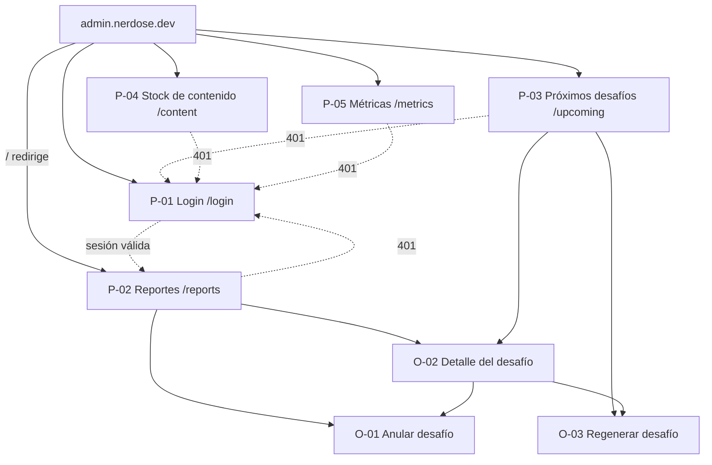

# Product Map — admin

> Inventario estructural de la superficie. Define qué pantallas existen,
> cómo se agrupan y cómo se navega entre ellas. **No define flujos** —
> eso vive en `user-flows.md`. Si el equipo lee esto y no hay objeciones,
> el documento falló: debería generar fricción para provocar decisiones.

## Audiencias en esta Superficie

- **responsable** ([research-context](../../audiences/responsable/research-context.md)) — Única persona que opera la plataforma (U-02): revisa reportes, anula desafíos, mira próximos desafíos y stock, consulta métricas. Audiencia única y primaria.

Viewport: `desktop` (único). No hay caso mobile relevado (ver pregunta abierta 4). UI solo en español; el contenido de los desafíos se muestra en ES y EN lado a lado. Identidad visual: extiende el lenguaje oscuro/terminal de `docs/nerdose.html` (acento `#3DDC84`); el prototipo no tiene pantallas de admin, así que el layout es nuevo.

## Inventario de Pantallas

| # | Pantalla | Slug / ruta | Propósito | Audiencia primaria | Viewports | Referencia PRD |
|---|----------|-------------|-----------|---------------------|-----------|----------------|
| P-01 | Login | `login` · `/login` | Ingresar con la contraseña única; muestra el motivo si volvió por sesión vencida o por límite de intentos (con los minutos de espera) | responsable | solo desktop | C-38, NFR-S07, REQ-007 |
| P-02 | Reportes | `reportes` · `/reports` | Cola de reportes agrupados por desafío (alertados primero, luego más reportados, luego más recientes; sin paginación en v1), filtro por estado (abiertos / resueltos / descartados; default `open`), acceso al detalle y a anular; aviso de anulación confirmada | responsable | solo desktop | C-37, C-39, C-40, C-41, REQ-007 |
| P-03 | Próximos desafíos | `proximos-desafios` · `/upcoming` | Grilla de mañana a +14 días × juegos registrados (4 con Big O, REQ-009; Bug Hunt se suma solo) con estado por celda: aprobado, sin desafío con su falla de generación (intentos y motivo), regeneración pendiente, regeneración fallida con su motivo, usa un ítem rechazado. Acceso al detalle y a regenerar; aviso de fallas activas | responsable | solo desktop | C-43, C-44, C-49, REQ-008 |
| P-04 | Stock de contenido | `stock-contenido` · `/content` | Salud de los bancos (términos desglosado por Devdle y Grep Grid, y hechos): disponibles, totales, rechazados con motivo, días de stock y si alcanza para ciclar; última carga del dataset (fecha, versión, insertados, actualizados) y top 50 de palabras rechazadas en Devdle por jugadores distintos; estados vacíos; solo lectura | responsable | solo desktop | C-45, REQ-008 |
| P-05 | Métricas | `metricas` · `/metrics` | Rango de fechas, cifras resumen y tablas: jugadores únicos, retención D1/D7, distribución de rachas, calidad por desafío | responsable | solo desktop | C-46 |

> `/` redirige a `/reports` (P-02). Cualquier ruta sin sesión redirige a `/login`.
>
> Viewport restringido: todas las pantallas son solo desktop por decisión de `product-overview.md` (herramienta interna con tablas y previews en paralelo). Es una decisión de producto, no un detalle de layout; ver pregunta abierta 4.
>
> Fuera de alcance deliberado (el PRD no lo pide): dashboard de inicio, ajustes, perfil, gestión de usuarios, edición manual de contenido. Cerrar sesión es una acción del encabezado, no una pantalla.

## Inventario de Overlays

| # | Overlay | Slug | Tipo | Trigger | Propósito |
|---|---------|------|------|---------|-----------|
| O-01 | Anular desafío | `anular-desafio` | modal | P-02 · acción "Anular" del grupo de reportes y de O-02 | Formulario `void_reason` (req, máx. 500) + culpable elegido de una lista con los ítems del propio desafío (`culprits`: términos o hechos por nombre), "La plantilla del juego" o "Ninguno"; sin tipear ids (REQ-007). Resumen de consecuencias irreversibles que nombra el ítem a rechazar. Avisos propios para `not_voidable` e `invalid_culprit`. Solo si el desafío está `published` (C-41) |
| O-02 | Detalle del desafío | `detalle-desafio` | drawer ancho (panel lateral) | P-02 · fila del grupo de reportes; P-03 · celda de juego/día | Solución completa ES y EN lado a lado y log de verificación. Desde P-02 la solución se muestra con una vista genérica del `payload` (`PayloadView`, REQ-007) y suma cada reporte (motivo, mensaje en texto plano, idioma, contexto, `player_ref`, fecha) con resolver/descartar **por reporte**, y "Anular desafío". Desde P-03 (REQ-008) muestra la preview del `client` en modo solución (como la ve el jugador, con la solución superpuesta; `PayloadView` si el juego no tiene preview), intento y versión del generador (nunca el seed), el estado de la regeneración y el aviso de ítem rechazado, y suma la acción regenerar |
| O-03 | Regenerar desafío | `regenerar-desafio` | modal | P-03 · acción "Regenerar" de la celda y de O-02 | Confirma el pedido de regeneración (solo `approved` con fecha > hoy; `not_regenerable` si no). El pedido es asíncrono e idempotente; al confirmar, la celda pasa a "regeneración pendiente" y P-03 hace polling cada 5 s hasta que el reemplazo pasa la verificación, falla (queda el actual, con el motivo) o se cancela porque llegó la fecha (se publica el actual) |

> **Sesión vencida: no es un overlay.** NFR-S07 y C-38 definen que un token vencido devuelve al login. Se resuelve como estado global (ver abajo) con aviso en P-01, no como modal sobre la pantalla vigente.
>
> **Regeneración pendiente** también existe como estado inline de la celda en P-03 (sin overlay); O-03 solo cubre la confirmación del pedido.

## Estructura de Navegación

### Navegación principal

Barra superior fija (encabezado único, sin sidebar), visible en P-02 a P-05. **REQ-007 entregó Reportes y Cerrar sesión; REQ-008 suma Próximos y Stock**; Métricas se suma con FG-10:

- **Reportes** → P-02 (destino de `/`)
- **Próximos** → P-03, con el contador de fallas de generación activas («Próximos (n)», REQ-008)
- **Stock** → P-04
- **Métricas** → P-05
- **Cerrar sesión** (acción) → borra el token y va a P-01

Las etiquetas del encabezado y de los títulos de pantalla son idénticas (uso esporádico, consistencia entre secciones). Reportes lleva un contador de grupos con reportes abiertos (REQ-007) y Próximos uno de fallas de generación activas (REQ-008): como no hay alertas por mail (ADR-017), los contadores son el aviso.

### Navegación secundaria

Dentro de **Reportes**: filtro de estado (abiertos / resueltos / descartados).
Dentro de **Métricas**: selector de rango de fechas (`from`, `to`) que aplica a todas las tablas.
Dentro de **Próximos** y **Stock**: sin navegación secundaria.

## Information Architecture

### Agrupación: Intervención (reaccionar a un problema)

Pantallas: Reportes (P-02); overlays Anular (O-01) y Detalle (O-02).

**Por qué se agrupan:** es el JTBD 1 y el flujo de entrada esperado (revisión de rutina; los alertados por umbral van primero). Es la pantalla de aterrizaje de `/`.

### Agrupación: Anticipación (mirar lo que viene)

Pantallas: Próximos desafíos (P-03), Stock de contenido (P-04); overlays Detalle (O-02) y Regenerar (O-03).

**Por qué se agrupan:** JTBD 2. Un hueco en la grilla y un banco por agotarse son el mismo problema (días sin desafío) visto desde dos ángulos; se mantienen como pantallas separadas porque P-03 es por desafío y P-04 es por banco.

### Agrupación: Medición

Pantallas: Métricas (P-05).

**Por qué se agrupan:** JTBD 3, solo lectura, tablas simples sin gráficos (decisión de arquitectura de `admin`).

### Reutilización

O-02 es un solo componente con dos orígenes (P-02 y P-03): misma vista del desafío, acciones distintas según el contexto y el estado del desafío (`published` permite anular; `approved` con fecha futura permite regenerar).

## Estados Globales

- **Autenticado vs no autenticado** — Todo salvo P-01 requiere sesión. Sin token, o ante un `401`, se borra el token de `sessionStorage` y se redirige a P-01.
- **Sesión vencida** — Token de 8 h expirado, ausente o malformado (`401 unauthorized`): borra el token, limpia los datos en memoria y vuelve a P-01 con aviso "La sesión venció, ingresá de nuevo". Se pierde el contexto de la pantalla y cualquier formulario abierto; el login lleva siempre a P-02 (pregunta abierta 3, resuelta por REQ-007).
- **Login bloqueado** — 5 intentos por IP cada 15 min: P-01 informa los minutos de espera (`Retry-After`) y deshabilita el envío hasta entonces.
- **Regeneración pendiente** — Mientras alguna celda de P-03 tenga una regeneración pendiente, la pantalla (y O-02 si está abierto) hace polling cada 5 s (REQ-008) y marca la celda; el resultado reemplaza el desafío, deja el actual con «regeneración fallida» y su motivo, o se cancela si llega la fecha (se publica el actual).
- **Falla de generación activa** — Un juego sin desafío aprobado para una fecha de la ventana, con su falla registrada (intentos y motivo): se ve en la celda, en el aviso de P-03 y en el contador «Próximos (n)» del encabezado; deja de mostrarse sola cuando una corrida posterior logra el desafío (REQ-008, ADR-017).
- **Sin datos / vacío** — Reportes sin abiertos, rango de métricas sin Play, celdas sin desafío en P-03, "sin datos de carga" y "sin rechazos" en P-04: cada pantalla distingue "no hay nada" de "error de carga".

## Mapa Visual

## Preguntas Abiertas

1. ~~**¿El responsable necesita saber que hay reportes o fallas sin abrir Reportes (contador en el encabezado, aviso de generación fallida, días sin desafío)?**~~ **Resuelta por REQ-007 y REQ-008:** el encabezado lleva el contador de grupos con reportes abiertos (los alertados van primero en P-02) y el de fallas de generación activas en «Próximos (n)», con aviso destacado en P-03. Sin badges ni notificaciones más allá de esos contadores.
   - Si sí: agregar indicadores globales en el encabezado (reportes alertados, fallas de generación en los próximos 14 días) y estado global "alerta activa". Con el ADR-017 las alertas solo existen en el admin, así que este es el único aviso.
   - Si no: el encabezado es solo navegación; las alertas se ven solo dentro de Reportes y Próximos desafíos.

2. ~~**¿Hace falta ver el log de verificación y el detalle de culpables desde Reportes, o alcanza con solución y textos ES/EN?**~~ **Resuelta por REQ-007:** O-02 muestra el log en ambos orígenes y O-01 ofrece los culpables del propio desafío (`culprits`) por nombre.
   - Si hace falta el log en P-02: O-02 muestra el mismo bloque de log en ambos orígenes y el selector de culpable de O-01 se alimenta desde el desafío (term o hecho ya identificado).
   - Si no: O-02 desde Reportes se reduce a solución, ES/EN y reportes; el log solo vive en el origen P-03.

3. ~~**¿Qué pasa con una anulación o regeneración en curso cuando la sesión vence (401)?**~~ **Resuelta por REQ-007:** se descarta. El login siempre lleva a P-02 y el responsable verifica el estado del desafío antes de repetir (la anulación es atómica: o se aplicó completa o no se aplicó).
   - Si se conserva el borrador (motivo y culpable): agregar estado "sesión vencida con retorno" y volver a la misma ruta tras el login.
   - Si se descarta: el login siempre lleva a P-02; más simple, pero el motivo escrito se pierde (la anulación es irreversible, el riesgo es el reintento, no el dato).

4. **¿Hay uso del admin desde el teléfono (revisión rápida de alertas)?**
   - Si sí: aparece un viewport mobile; como mínimo P-02, O-01 y O-02 necesitarían variante (O-02 pasaría de drawer ancho a pantalla completa y ES/EN a pestañas en lugar de lado a lado). P-03 a P-05 podrían quedar solo desktop.
   - Si no: se mantiene desktop único, sin variantes.

5. ~~**¿P-03 es una grilla 14 × 5 con las 70 previews cargables, o una lista por día que expande la preview bajo demanda?**~~ **Resuelta por REQ-008:** grilla de celdas con estado; la preview se carga solo al abrir O-02.
   - Si grilla de celdas con estado y preview en O-02: se ven los huecos de un vistazo, pero se renderizan los `client` solo al abrir el detalle (menos costo, coherente con el contrato de props aún sin cerrar).
   - Si lista por día con preview inline: sin O-02 en P-03; la página es larga y ES/EN lado a lado se repite 70 veces.

6. **¿Las métricas de calidad por desafío necesitan llevar a Reportes o al desafío (enlace desde la fila)?**
   - Si sí: la fila de calidad abre O-02 o filtra P-02 por ese desafío; agrega una relación P-05 → P-02.
   - Si no: P-05 queda aislada, sin overlays ni enlaces salientes.

7. **¿La preview en modo solución debería reemplazar también a `PayloadView` en O-02 desde Reportes?** (surge de REQ-008, que la limita a Próximos)
   - Si sí: O-02 se ve igual desde ambos orígenes y el responsable juzga un reporte viendo el desafío como lo vio el jugador; el `Preview` pasa a un módulo compartido del admin.
   - Si no: desde Reportes sigue la vista genérica del `payload`, suficiente para comparar textos ES/EN, y la preview queda en Próximos.

---

**Próximo artefacto:** `user-flows.md` de esta misma superficie define los 3-5 flujos críticos sobre las pantallas inventariadas acá.
