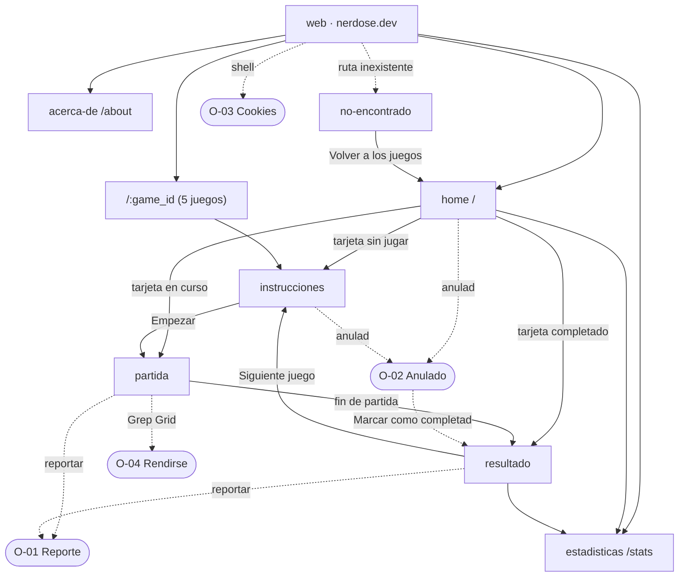

# Product Map — web

> Inventario estructural de la superficie. Define qué pantallas existen,
> cómo se agrupan y cómo se navega entre ellas. **No define flujos** —
> eso vive en `user-flows.md`. Si el equipo lee esto y no hay objeciones,
> el documento falló: debería generar fricción para provocar decisiones.

**Base de diseño:** `docs/nerdose.html` (NFR-U07, decisión #31) y el Design System `docs/design-system/web/` (v1.4.1), que lo traduce a tokens y componentes. Donde el prototipo difiere del PRD en datos o reglas, manda el PRD; en estética, manda el prototipo (REQ-003). Viewports: `mobile` (primario, desde 320 px) y `desktop`. Fuentes de trazabilidad: `[fuente: PRD §requirements]` salvo que se indique otra.

## Audiencias en esta Superficie

- **jugador** ([research-context](../../audiences/jugador/research-context.md)) — Juega los desafíos del día, ve rachas y estadísticas, comparte y reporta problemas. Audiencia única y primaria (U-01). El responsable (U-02) no usa esta superficie.

## Criterio de inventario de los juegos

Cada juego es un único path `/:game_id` (ADR-006) con tres fases que decide el servidor según el estado de la Play (C-08, C-09, C-10):

- **Instrucciones** — no hay Play de hoy. Al salir de las instrucciones se crea la Play (C-09).
- **Partida** — Play `in_progress`. Al volver el mismo día se retoma en el estado exacto (C-10).
- **Resultado** — Play terminada (`won`, `lost` o `voided`). Reabrir el juego el mismo día muestra el resultado (F-03, criterio de Timeline #8).

Se inventaría **una pantalla por fase por juego** (15 pantallas), porque cada fase tiene bloques propios y la de partida difiere por completo entre juegos. Las fases comparten el shell y el header. "Sin desafío hoy" (C-14) y "desafío anulado" (C-08) no son pantallas aparte: son **estados** de la fase de instrucciones (ver Estados de pantalla).

## Inventario de Pantallas

| # | Slug | Pantalla | Propósito | Audiencia primaria | Viewports | Referencia PRD |
|---|------|----------|-----------|---------------------|-----------|----------------|
| 1 | `home` | Home (catálogo) | Ver qué juegos faltan hoy, la racha global y cuánto falta para el próximo desafío | jugador | ambos | F-02, C-05, C-06, C-14, C-42 |
| 2 | `estadisticas` | Estadísticas | Ver rachas, récords, completados, % de victorias, stats por juego, heatmap e historial | jugador | ambos | F-09, C-34 |
| 3 | `acerca-de` | Acerca de | Explicar qué es nerdose y atribuir Wikipedia y Wikidata; aviso de privacidad | jugador | ambos | C-07 |
| 4 | `devdle-instrucciones` | Devdle · Instrucciones | Explicar reglas y cómo leer las pistas antes de empezar | jugador | ambos | F-04, C-08, C-09 |
| 5 | `devdle-partida` | Devdle · Partida | Adivinar el término en hasta 6 intentos con teclado en pantalla y físico | jugador | ambos | C-15, C-10, C-11, C-36 |
| 6 | `devdle-resultado` | Devdle · Resultado | Ver palabra, categoría, definición y resumen, la distribución de intentos y compartir | jugador | ambos | C-18, C-12, C-13, C-36 |
| 7 | `bug-hunt-instrucciones` | Bug Hunt · Instrucciones | Explicar el juego (un intento, líneas elegibles, lenguaje) | jugador | ambos | F-08, C-08, C-09 |
| 8 | `bug-hunt-partida` | Bug Hunt · Partida | Leer la especificación y el código, elegir una línea y confirmar | jugador | ambos | C-30, C-26, C-36 |
| 9 | `bug-hunt-resultado` | Bug Hunt · Resultado | Ver la línea, el test que falla, el fix y la explicación; compartir | jugador | ambos | C-32, C-12, C-13, C-36 |
| 10 | `big-o-instrucciones` | Big O · Instrucciones | Explicar el juego (peor caso, 8 opciones, un intento) | jugador | ambos | F-07, C-08, C-09 |
| 11 | `big-o-partida` | Big O · Partida | Leer el código, elegir una de 8 complejidades y confirmar | jugador | ambos | C-27, C-26, C-36 |
| 12 | `big-o-resultado` | Big O · Resultado | Ver la respuesta correcta y la explicación paso a paso; compartir | jugador | ambos | C-29, C-12, C-13, C-36 |
| 13 | `timeline-instrucciones` | Tech Timeline · Instrucciones | Explicar el juego (5 hitos de distintas categorías, del más antiguo al más reciente, un intento, mover con asa, ↑ ↓ o teclado; el orden armado no se guarda si se sale antes de confirmar) | jugador | ambos | F-06, C-08, C-09, REQ-006 |
| 14 | `timeline-partida` | Tech Timeline · Partida | Ordenar 5 hitos (arrastre desde el asa, botones ↑ ↓ o teclado) y confirmar en un solo intento | jugador | ambos | C-23, C-36, NFR-U03, REQ-006 |
| 15 | `timeline-resultado` | Tech Timeline · Resultado | Ver `N/5`, tu orden contra el correcto con fechas (según precisión) y notas, y las rachas; compartir | jugador | ambos | C-25, C-12, C-13, C-36, REQ-006 |
| 16 | `grep-grid-instrucciones` | Grep Grid · Instrucciones | Explicar el juego (8 palabras, 4 direcciones solo hacia adelante, dos toques, sin tiempo, se puede rendir) | jugador | ambos | F-05, C-08, C-09, REQ-005 |
| 17 | `grep-grid-partida` | Grep Grid · Partida | Tocar (o marcar con teclado) primera y última letra de cada palabra; contador `N/8`; definición de cada palabra encontrada; "Rendirse" | jugador | ambos | C-19, C-20, C-10, C-36, REQ-005 |
| 18 | `grep-grid-resultado` | Grep Grid · Resultado | Ver `N/8`, la grilla con las 8 palabras marcadas (encontradas y reveladas), las 8 definiciones y las rachas; compartir | jugador | ambos | C-22, C-12, C-13, C-36, REQ-005 |
| 19 | `no-encontrado` | No encontrado (404) | Avisar que la dirección no existe y volver a los juegos en un toque | jugador | ambos | REQ-002 (supuesto «Navegación») |

Todas las pantallas existen en ambos viewports. La excepción de contenido a anotar es la grilla de Grep Grid (12×12) y el código de Bug Hunt / Big O a 320 px: se resuelven en layout (scroll horizontal del código, celdas de la grilla escaladas al ancho: la grilla de Grep Grid entra completa a 320 px sin scroll horizontal, REQ-005 CA 36; las 5 filas de Tech Timeline ocupan el ancho y el nombre envuelve antes que achicar el asa o los botones ↑ ↓, REQ-006 CA 11), no con una pantalla distinta `[fuente: PRD §NFR-U01]`.

### Bloques por pantalla

Header común a todas las pantallas de plataforma (shell, `app-header` del DS): marca `> nerdose_`, navegación (`./juegos`, `./stats`, `./about`) **siempre dentro del header** y acomodada con `flex-wrap` en mobile (sin tira de navegación aparte, REQ-003), **`#número` del desafío del día** (reemplaza "desafío del 30/10" del prototipo; decisión #12, F-02), selector de idioma ES/EN segmentado y, en la home, la **píldora de racha global** que enlaza a `estadisticas` (REQ-003). El `#número` se oculta cuando el servidor no lo informa (antes del lanzamiento, REQ-002). En las pantallas de juego el header es el `game-header` del DS, con el nombre del juego; en las de resultado se suma el botón "Compartir". El footer (`site-footer`) es una sola línea, como el prototipo: el lema `> nerdose — una plataforma, múltiples desafíos.` y `exit 0`, en todas las pantallas. El aviso de privacidad (una única cookie funcional, sin datos personales ni cookies de terceros) vive en `acerca-de` (C-07, REQ-003).

> **Pendiente de alineación (FG-8+):** las 6 pantallas de juego de Bug Hunt y Big O todavía declaran la tira `nav-movil` y el header de plataforma; se pasan al `game-header` del DS cuando se diseñe cada juego. REQ-003 alineó el shell de plataforma (`home`, `estadisticas`, `acerca-de`, `no-encontrado`) y el footer de todas; **REQ-004 pasó las 3 de Devdle al `game-header`** (`playing` en instrucciones y partida, `finished` en resultado), sin `nav-movil`; **REQ-005 hizo lo mismo con las 3 de Grep Grid** y **REQ-006 con las 3 de Tech Timeline**.

| Slug | Bloques principales (de `docs/nerdose.html` ajustados al PRD) |
|------|-----------------------------------------------------------------|
| `home` | Hero (prompt `$ nerdose --today // fecha`, titular, presentación breve, CTA "Seguir jugando" → tarjetas y "¿Cómo funciona?" → sección "Cómo funciona" de la misma home) con la **ventana de terminal** del día al lado (estado por juego, racha global y récord, cuenta regresiva `HH:MM:SS`); "Los desafíos de hoy" con barra segmentada de progreso y 5 tarjetas de juego (miniatura, nombre, badge de estado, descripción, duración, racha del juego y CTA; la tarjeta del próximo juego a jugar se destaca) + tarjeta decorativa "próximo juego" (`$ git checkout -b próximo-juego`, REQ-003); panel "Tu progreso" (racha global de 88 px, récord, enlace a `estadisticas`; el heatmap y los demás mini-stats esperan a FG-3 / FG-10); "Cómo funciona" en 4 pasos (REQ-003) |
| `estadisticas` | Racha global actual, récord, desafíos completados; heatmap de 365 días; bloque por juego (racha, récord, jugadas, % de victorias, stat propia); historial paginado con etiqueta corta ("✓ 4/6", "✗ L7", "6/8"). El prototipo muestra "días con actividad" y "juegos por día activo": no están en C-34, **manda el PRD** |
| `no-encontrado` | Código `404 · página no encontrada`; mensaje corto; CTA "Volver a los juegos". Mismo header y footer del shell (REQ-002) |
| `acerca-de` | Qué es nerdose y cómo funciona; los 5 juegos; reglas de racha (completar cuenta, días neutros, anulados); atribución Wikipedia/Wikidata (CC BY-SA); aviso de privacidad (cookie funcional, sin cuenta) |
| `*-instrucciones` | Nombre y acento del juego; reglas en 3 pasos (patrón "cómo se juega" del prototipo); duración estimada; estado del día de ese juego; CTA "Empezar" (crea la Play); aviso de que la partida no cuenta hasta completarla |
| `devdle-partida` | Consigna (`// término técnico · N letras · intento K de 6`); tablero de 6 intentos × 4 a 12 letras con feedback por letra (color + símbolo, NFR-U04), escalado al ancho; teclado en pantalla y físico; pista: las 8 categorías del banco, fijas todos los días (REQ-004); hint de jugada que no consume intento ("no está en la lista", faltan letras, caracteres no A–Z, demasiadas jugadas); leyenda de pistas; acceso a "Reportar un problema" (FG-6, REQ-007: con estado "Ya reportaste este desafío") |
| `devdle-resultado` | Veredicto (ganó/perdió, `N/6` o `X/6`); la grilla de intentos; palabra, categoría, definición y resumen en el idioma activo; distribución de intentos 1–6 y X (stat propia, C-18); rachas actualizadas; "Compartir" en el header y en el cuerpo (confirmación "✓ Copiado" en el botón); "Reportar un problema" (FG-6, REQ-007: con estado "Ya reportaste este desafío"); próximo desafío en `HH:MM:SS`; "Siguiente juego" solo si queda un juego pendiente (REQ-004) |
| `bug-hunt-partida` | Especificación ("qué debería hacer"); código con numeración de líneas y pestañas JS/Go/Java; líneas no elegibles marcadas (firma, solo llaves); tests visibles; aviso "1 test oculto falla"; selección de línea y botón "Confirmar" (dos pasos, decisión #26); "Reportar un problema" |
| `bug-hunt-resultado` | Veredicto y línea del bug; test que falla (input, esperado vs obtenido); fix como diff; explicación paso a paso; tipo de bug y mutación (del prototipo; **no figuran en C-32**, a validar); rachas; "Compartir"; "Reportar un problema" |
| `big-o-partida` | Código con pestañas JS/Go/Java; pregunta "¿Cuál es la complejidad temporal (peor caso) de `f(n)`?"; 8 opciones fijas; "Confirmar" tras seleccionar; "Reportar un problema" |
| `big-o-resultado` | Veredicto y respuesta correcta; explicación paso a paso (costo por bloque, reglas, simplificación); lenguaje con el que confirmó; rachas; "Compartir"; "Reportar un problema". El bloque "en números, con n = 1024" del prototipo no está en C-29: a validar |
| `timeline-partida` | Comentario `// consigna` y la consigna fija como `h1`; panel "// tu orden" con 5 filas `timeline.row` mezcladas y sin fecha (asa ⠿ · posición · nombre + categoría del hito · ↑ ↓); reordenar arrastrando desde el asa (el resto de la fila deja hacer scroll), con ↑ ↓ o con teclado (Espacio, flechas, Escape) con anuncio "posición N de 5"; hint que anuncia movimientos y rechazos sin penalizar; ayuda de cómo mover; "Confirmar orden" siempre habilitado, sin diálogo; el orden armado no se guarda al salir; estados "anulado" y "sin sesión"; "Reportar un problema" (FG-6, REQ-007: con estado "Ya reportaste este desafío"). Sin scroll horizontal desde 320 px (REQ-006) |
| `timeline-resultado` | Veredicto (victoria solo con 5/5) y puntaje grande `N/5` "posiciones correctas"; "// tu orden" con "✓ bien" / "✗ va en N°" (ámbar + punteado, nunca rojo) junto a "// orden correcto" como riel con fecha según precisión (año, mes y año, o fecha completa) y nota en el idioma activo; rachas; "Compartir" solo en el header (`⏳ Tech Timeline #N` / 5 cuadrados 🟩/🟥 + `N/5` / `nerdose.dev`, confirmación "✓ Copiado" en el botón); barra de cierre con racha y próximo desafío; "Reportar un problema" (FG-6, REQ-007: con estado "Ya reportaste este desafío"); "Siguiente juego" solo si queda un juego pendiente (REQ-006) |
| `grep-grid-partida` | Consigna (`$ grep -o '[A-Z]*' hoy.txt`); contador **`N/8 encontradas`** (reemplaza el reloj "02:14 tiempo", decisión #6); grilla 12×12 escalada al ancho, con dos toques o teclado (flechas + Enter/Espacio) y celdas encontradas marcadas con color y glifo (NFR-U04); hint de consola que guía la selección y avisa, sin penalizar, "no es una palabra", selección inválida (en reversa o no alineada) y demasiadas jugadas; lista de las 8 palabras en orden fijo, con tachado y definición breve solo en las encontradas (anti-spoiler); **botón "Rendirse"** separado de la grilla, que abre O-04 (decisión #7, C-20); estados "anulado" y "sin sesión" a mitad de partida; acceso a "Reportar un problema" (FG-6, REQ-007: con estado "Ya reportaste este desafío"). **Sin cronómetro en ningún punto** (REQ-005) |
| `grep-grid-resultado` | `N/8` y veredicto (victoria solo con 8/8; "Te rendiste con N/8" si se rindió); grilla con las 8 palabras marcadas: encontradas (relleno + ✓) y reveladas (borde punteado + ○); lista de las 8 palabras con definición en el idioma activo; rachas actualizadas; "Compartir" solo en el header (`🔎 Grep Grid #N` / `N/8` / `nerdose.dev`, sin palabras ni indicio de rendición; confirmación "✓ Copiado" en el botón); "Reportar un problema" (FG-6, REQ-007: con estado "Ya reportaste este desafío"); próximo desafío en `HH:MM:SS`; "Siguiente juego" solo si queda un juego pendiente (REQ-005) |

El prototipo menciona "tu tiempo final es tu puntaje" en Grep Grid: **se elimina** (C-22, el puntaje son las palabras encontradas).

### Estados de pantalla

**`home`** — estado por tarjeta de juego (C-05) y estados del día:

| Estado | Condición | Qué muestra la tarjeta | Traza |
|--------|-----------|------------------------|-------|
| Sin jugar | Challenge `published`, sin Play | CTA "Jugar →" a `{juego}-instrucciones` | C-05 |
| En curso | Play `in_progress` | Etiqueta "en curso" y CTA "Seguir jugando" a `{juego}-partida` | C-05, C-10 |
| Completado | Play `won`/`lost` | Etiqueta con `history_label` ("✓ 4/6", "L4", "5/8"), CTA "Ver resultado" a `{juego}-resultado`. Perder también es "completado" | C-05, C-33 |
| Sin desafío hoy | `challenge_status = none` | Etiqueta "sin desafío hoy", sin CTA de juego; indica que no afecta la racha | C-14, C-33 |
| Anulado | `challenge_status = voided` | Etiqueta "anulado" y CTA que lleva al aviso O-02; si ya hay Play `voided` (jugó antes de la anulación o marcó como completado), se ve como completado y el CTA "Ver resultado" lleva a `*-resultado` en estado anulado | C-05, C-41, C-42, REQ-007 |
| Cuenta regresiva | Siempre visible | `HH:MM:SS` hasta `next_reset_at`; al llegar a 0 recarga el estado del día (con espera aleatoria de 0–3 s, ADR-008) y todo vuelve a "sin jugar" | C-06 |
| Sin sesión (cookies bloqueadas) | La creación de la sesión respondió bien pero el estado del día sigue sin sesión | Se ven los 5 juegos, pero sin estados de partida y con CTA deshabilitados; aviso O-03 | C-02, C-05, REQ-002 |
| Sesión no disponible | La creación de la sesión fue rechazada por límite (429) | Igual que sin sesión pero **sin** O-03; se reintenta en la próxima carga | C-01, REQ-002 (CA 13) |
| Ningún desafío hoy | Los 5 juegos con `challenge_status = none` (hasta que existan generadores) | Las 5 tarjetas "sin desafío hoy · no afecta tu racha", sin CTA de juego; progreso "Hoy no hay desafíos publicados" | C-05, C-14, REQ-002 (CA 9) |
| Antes del lanzamiento | `number = null` (hoy < día de lanzamiento) | Sin indicador del día en el header («desafío del dd/mm»); tarjetas "próximamente"; nunca se muestra un número ≤ 0 | C-05, REQ-002 (CA 17) |
| Error de carga | Falla el estado del día (500, 429 o red) | Mensaje de error con "Reintentar"; las 5 tarjetas siguen visibles con nombre y descripción (catálogo estático), sin estado ni CTA | REQ-002 (CA 18) |
| Primera visita | Player nuevo, sin Play | Todos "sin jugar", racha global 0, resumen sin datos | C-01, C-05 |

**`*-instrucciones`** — la fase de instrucciones cubre también los casos sin partida:

| Estado | Qué reemplaza | Traza |
|--------|---------------|-------|
| Normal | Instrucciones + CTA "Empezar" | C-08, C-09 |
| Sin desafío hoy | Mensaje "sin desafío hoy" (día neutro, no afecta la racha) y "Volver a los juegos"; sin CTA "Empezar" | C-14 |
| Anulado y sin Play | Overlay O-02 con "Marcar como completado" + "Volver a los juegos"; no se puede empezar | C-08, C-42 |
| Anulado con Play previa | La Play (en curso o terminada) pasó a `voided`: se muestra `*-resultado` en estado anulado (aviso + rachas, sin solución ni Compartir), con "Reportar un problema" | C-41, REQ-007 (decisión 5) |
| Sin sesión | CTA "Empezar" deshabilitado, O-03 explicando la cookie funcional y "Reintentar" (recrea la sesión). También tras un `no_session` al empezar | C-02, C-09, REQ-004 (CA 19) |
| `challenge_expired` / día nuevo | Si el día cambió con la pantalla abierta o una jugada respondió `challenge_expired`: se carga el desafío nuevo (nuevo `#número`), vuelve a instrucciones con el aviso "Empezó el desafío #N. La partida de ayer quedó sin terminar y no cuenta para tu racha." | C-11, REQ-004 (CA 17) |

## Inventario de Overlays

| # | Overlay | Tipo | Trigger | Propósito |
|---|---------|------|---------|-----------|
| O-01 | Reportar un problema | bottom-sheet (mobile) / modal (desktop) | `*-partida` · link-reportar; `*-resultado` · link-reportar (también en estado anulado) | Formulario con motivo (6 valores de `reason`, `select`), mensaje opcional con contador (máx. 1000), aviso "No incluyas la respuesta si todavía estás jugando" (en partida). Confirma dentro del overlay ("Gracias, recibimos tu reporte"). Un reporte por jugador y desafío: con `GameToday.reported` o tras `already_reported`, el trigger pasa a "Ya reportaste este desafío" deshabilitado. Disponible solo con Challenge `published` o `voided`, también el de ayer si el jugador sigue en el resultado. **Implementado por REQ-007** |
| O-02 | Aviso de desafío anulado | modal (ambos viewports) | `home` · tarjeta en estado "anulado"; `*-instrucciones` · estado "anulado y sin Play" | Texto "Este desafío tenía un error y fue anulado. Tu racha no se ve afectada" y acción **"Marcar como completado"** (C-42), que crea la Play `voided`, suma la racha del juego y la global, y lleva a `*-resultado` en estado anulado. Solo se ofrece a quien no tiene Play. Acción secundaria: cerrar. Si el día cambió (`challenge_expired`), recarga el desafío de hoy. **Implementado por REQ-007** |
| O-03 | Aviso de cookies bloqueadas | banner (ambos viewports; fijo bajo el header) | Shell · detección: `POST /api/session` respondió 200 y el `GET /api/today` siguiente sigue con `has_session = false` (no se muestra tras un 429, REQ-002) | Texto "Activá las cookies para poder jugar". Persiste hasta que la sesión se crea. El selector ES/EN sigue funcionando, solo en el navegador. El catálogo, `estadisticas` (vacía) y `acerca-de` siguen visibles; los CTA de juego quedan deshabilitados |
| O-04 | Confirmar "Rendirse" | modal (ambos viewports) | `grep-grid-partida` · btn-rendirse | Confirmar que se cierra la partida como perdida con `N/8`, que cuenta para la racha y que revela las faltantes. Acciones: "Seguir jugando" (foco inicial; también Escape, sin request, devuelve el foco a "Rendirse") y "Sí, rendirme". Disponible desde 0/8. **Confirmado por REQ-005** (supuesto «Confirmación de "Rendirse"», CA 10-12; decisión #26 del PRD) |

No hay overlay de selector de idioma: el cambio ES/EN y el cambio de lenguaje de código son **controles inline** (ver Navegación). El share nativo es del sistema operativo; si no está disponible, se copia al portapapeles con un aviso breve ("copiado") `[fuente: PRD §Supuestos, C-13]`.

En desktop, O-01 es un modal centrado y no se vuelve inline: no hay espacio fijo para un formulario en las pantallas de partida. O-03 y O-02 son iguales en ambos viewports.

## Estructura de Navegación

### Navegación principal

Header presente en todas las pantallas:

- **Marca `> nerdose_`** → `home`
- **`./juegos`** → `home` (sección de tarjetas)
- **`./stats`** → `estadisticas` (`/stats`)
- **`./about`** → `acerca-de` (`/about`)
- **Píldora de racha global** (solo en `home`) → `estadisticas` (REQ-003)
- **«desafío del dd/mm»** (header de juego) — indicador del día del desafío, no navega. El `#número` se sigue mostrando en el cuerpo: instrucciones («Desafío #N»), aviso de día nuevo y texto de share (revisión visual 2026-11-09, alineado al prototipo)
- **ES | EN** — control inline; cambia el idioma de UI y de contenido sin recargar y sin perder la partida; con sesión se guarda en el Player, sin sesión solo en el navegador (C-03, REQ-002)

Rutas: `/` → `home`; `/:game_id` → fase de juego correspondiente; `/stats`; `/about`; cualquier otra ruta o `game_id` desconocido → `no-encontrado` (ADR de `web`, overview; REQ-002).

En mobile el header debe caber en 320 px. **Resuelto por REQ-003:** el header es el mismo en todos los anchos y se acomoda con `flex-wrap` (marca y acciones en un renglón, nav en el siguiente), sin media queries ni tira de navegación aparte. No hay overlay de menú: el PRD no lo exige.

### Navegación secundaria

Dentro de las **pantallas de juego**:
- Selector de lenguaje de código JS / Go / Java (solo `bug-hunt-partida`, `bug-hunt-resultado`, `big-o-partida`, `big-o-resultado`; C-26). Es solo una vista y arranca en `preferred_code_language`.
- "Siguiente juego" y "Volver a los juegos" (resultado) → siguiente `*-instrucciones`/`*-partida` pendiente o `home`.
- Enlace "Ver mis estadísticas" (resultado) → `estadisticas`.

Dentro de **`home`**: tarjeta de juego → fase correspondiente; "ver estadísticas →" → `estadisticas`; "¿Cómo funciona?" → sección "Cómo funciona" de la misma pantalla (ancla `#como`, REQ-003). `acerca-de` se alcanza desde `./about` del header.

Dentro de **`estadisticas`**: bloque por juego y "ver historial completo" (paginado en la misma pantalla, ver pregunta 3).

## Information Architecture

### Agrupación: Catálogo y progreso

Pantallas: `home`, `estadisticas`

**Por qué se agrupan:** Responden "qué me falta hoy y cómo voy". Ambas leen los mismos agregados (C-05, C-34) y se enlazan entre sí. `[fuente: PRD F-02, F-09]`

### Agrupación: Juego (por `game_id`)

Pantallas: `{juego}-instrucciones`, `{juego}-partida`, `{juego}-resultado` × 5

**Por qué se agrupan:** Comparten un único path y el ciclo común de F-03; el servidor decide la fase. Cada juego aporta su propia fase de partida y su propio bloque de resultado con stat propia (C-18, C-22, C-25, C-29, C-32).

### Agrupación: Información

Pantallas: `acerca-de`, `no-encontrado`

**Por qué se agrupan:** Contenido estático, sin dependencia de sesión. `acerca-de` lleva la atribución obligatoria (CC BY-SA) `[fuente: PRD C-07]`; `no-encontrado` es la salida de cualquier ruta inexistente `[fuente: REQ-002]`.

### Agrupación: Configuración personal

Pantallas: (ninguna)

**Por qué se agrupan:** El PRD no pide pantalla de preferencias: idioma y lenguaje de código se cambian inline (C-03). Sin onboarding, perfil ni cuenta en v1 (F-01).

## Estados Globales

- **Sesión anónima** — Se crea o renueva en cada carga (C-01). Sin sesión no hay partidas, rachas ni estadísticas propias. `[fuente: PRD C-01]`
- **Cookies bloqueadas** — O-03; catálogo visible, juego bloqueado. `[fuente: PRD C-02]`
- **Idioma ES / EN** — Aplica a toda la superficie, también a mitad de partida; el contenido del desafío se resuelve en el servidor (C-03, C-04). `[fuente: PRD NFR-U05]`
- **Cambio de día (00:00 UTC)** — Cualquier pantalla abierta puede recibir `challenge_expired` al jugar: se carga el desafío nuevo, la Play vieja queda `in_progress` y no cuenta. En `home` la cuenta regresiva recarga sola. `[fuente: PRD C-06, C-11]`
- **Desafío anulado** — Afecta a la tarjeta, a las instrucciones y al resultado (O-02). La racha no se ve afectada. `[fuente: PRD C-41, C-42]`
- **Error de red / sin conexión** — El PRD supone conexión permanente y no hay modo offline. El manejo de errores globales vive en el shell. En `home`, REQ-002 define el estado "error de carga" (mensaje con "Reintentar", catálogo estático visible); en el resto de las pantallas el copy sigue sin definir. `[fuente: PRD §Supuestos; REQ-002 CA 18]`
- **Antes del lanzamiento** — Mientras hoy sea anterior al día del desafío #1, el servidor no informa el desafío y el header no muestra «desafío del dd/mm». `[fuente: REQ-002 CA 17]`

## Mapa Visual

Juegos: `devdle`, `bug-hunt`, `big-o`, `timeline`, `grep-grid`.

## Preguntas Abiertas

1. **¿Las instrucciones se muestran cada día o solo la primera vez?** C-09 crea la Play "al salir de las instrucciones", y NFR-U06 apunta a 1-3 minutos por juego.
   - Si se muestran siempre: es un toque extra por juego y por día, pero la pantalla `*-instrucciones` es el único punto de entrada y no hay estado "ya vistas".
   - Si se omiten tras la primera vez (preferencia guardada en el navegador): hay que sumar ese estado, una forma de volver a verlas desde la partida (sugerencia: enlace "¿Cómo se juega?" en `*-partida`), y `home` enlaza directo a `*-partida`/`Empezar`. El PRD limita el almacenamiento del navegador a conveniencias, así que es viable.

2. ~~**¿Qué ve el jugador en `*-resultado` cuando su Play es `voided`?**~~ **Resuelta por REQ-007:** una sola variante mínima del estado `anulado` (aviso + rachas, sin solución ni Compartir), haya o no jugado antes de la anulación: `GameToday` devuelve la Play `voided` con `result: null` y `public_view: null`. "Reportar un problema" sigue visible. Si jugó y luego se anuló, la Play conserva su `result` (C-41); si usó "Marcar como completado", no hay `result` ni partida.
   - Si hay resultado y el jugador ve la solución y su propio resultado con el aviso de anulación: `*-resultado` necesita una variante "anulado con resultado" y otra "anulado sin resultado".
   - Si en ambos casos solo se ve el aviso y la racha: una sola variante mínima de `*-resultado`, sin share (C-13 no cubre explícitamente Play `voided`).

3. **¿"Ver historial completo" es una pantalla o está dentro de `estadisticas`?** C-34 pide historial paginado; las rutas del PRD y de `web` solo declaran `/stats`.
   - Si está inline (paginación o "cargar más"): el inventario queda igual (19 pantallas); en mobile `estadisticas` es larga.
   - Si es una pantalla propia (`/stats/historial`): se agrega una ruta y un item #20, y la tabla de 5 juegos por fila del prototipo necesita variante mobile.

4. ~~**¿Qué pasa con un `/:game_id` que no existe y con rutas desconocidas?**~~ **Resuelta por REQ-002:** se muestra la pantalla `no-encontrado` (#19) con enlace a la home; no se redirige.

5. **¿Qué CTA lleva el resultado después del primer juego completado: "Siguiente juego" o "Volver a los juegos"?** El prototipo usa ambos en distintos juegos.
   - Si es "Siguiente juego" (próximo pendiente): `*-resultado` necesita la lista del día y un estado "todos completados" donde el CTA cambia a la cuenta regresiva.
   - Si es solo "Volver a los juegos": se simplifica el resultado, pero el jugador pasa siempre por `home` para encadenar partidas.
   - **Avance de REQ-004:** en Devdle, "Siguiente juego" se oculta cuando no queda ningún juego con desafío sin completar (estado "sin juegos pendientes"); la decisión de fondo sigue abierta.

6. ~~**¿Se confirma el modal O-04 de "Rendirse"?**~~ **Resuelta por REQ-005:** O-04 se implementa (rendirse es irreversible; decisión #26 del PRD), con foco inicial en "Seguir jugando". Los otros juegos no suman un modal: ya separan selección y "Confirmar" en dos pasos.

---

**Próximo artefacto:** `user-flows.md` de esta misma superficie define los 3-5 flujos críticos sobre las pantallas inventariadas acá.
